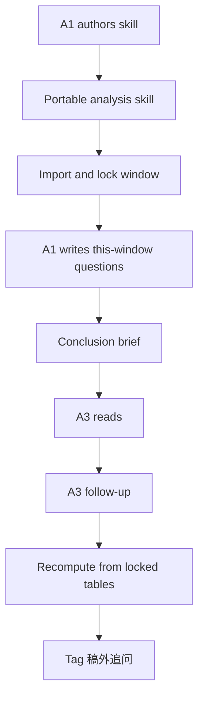
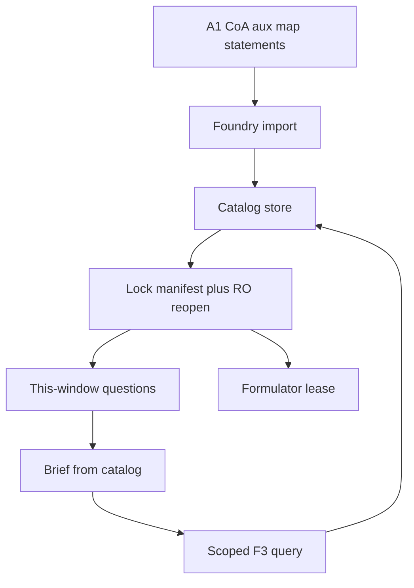
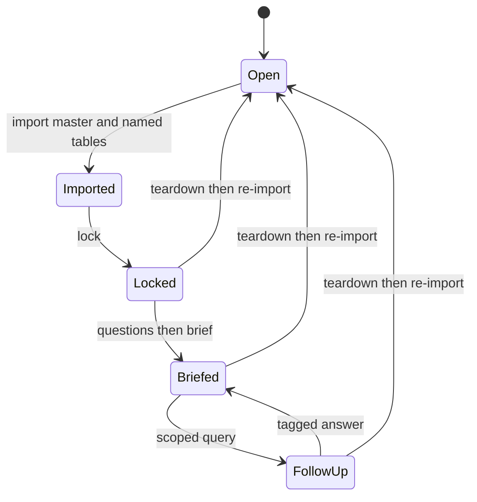
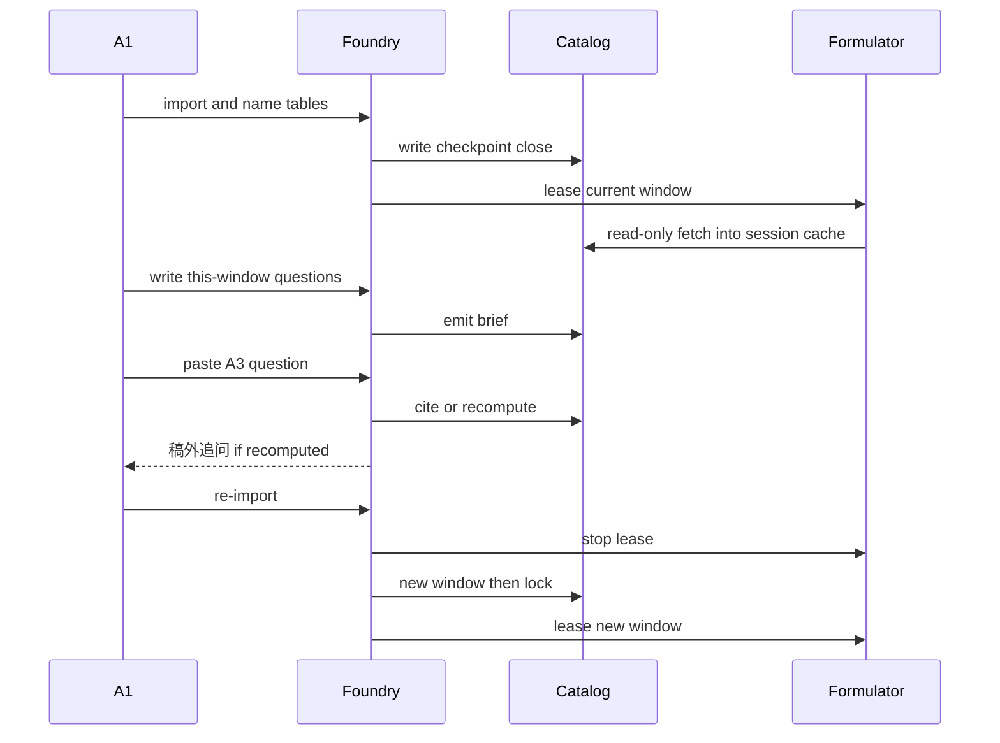

# Finance Manager Skill Foundry - Plan

## Goal Capsule

- **Objective:** A finance manager can author her own analysis skill and, each closing window, produce a conclusion-bearing brief that a leader can follow up on from that window's locked books.
- **Means:** Native DeepSeek harness hosting foundry tools, a foundry-owned DuckDB lock catalog, Data Formulator live-attached read-only to that catalog, and a Skill creator that cannot mark done until a fixture period loop passes (KTD1, KTD2, KTD3, KTD4).
- **Product authority:** Product Contract R/A/F/AE IDs win on behavior. KTDs win on mechanism. `outlet-member-pack/` is method lab only.
- **Product Contract preservation:** changed: R9 (2026-08-25) — brief may ship with not-in-window items marked. changed: R3 (2026-08-26) — window locks CoA plus optional aux and analysis map; units is a shortcut dim of aux. R1–R2 and R4–R8 meaning unchanged.
- **Execution profile:** code. New package ``.
- **Stop conditions:** Do not replace the ERP. Do not drop harness, DuckDB, Data Formulator, or Skill creator. Do not copy lab `questions.md` or the lab DuckDB ban into the product.
- **Tail ownership:** `ce-work` executes U1–U6. Abandoned probe, Formulator, or harness experiments must not remain in the tree.
- **Open blockers:** None. U3 host file shape settled 2026-08-26: a Cordis bundle that execs the foundry CLI. changed: language (2026-08-30) -- the bundle is JavaScript (`dsh-plugin/index.js`), not TypeScript. What that decision resolved (a Cordis bundle over a Python stdio MCP host) is unchanged.

---

## Product Contract

### Summary

A Skill foundry on the native DeepSeek harness: she authors a portable analysis skill, then each period the foundry locks a DuckDB catalog she imported, takes her this-window questions, and emits a conclusion brief. Formulator live-attaches that catalog read-only. Leader follow-up recomputes from the lock and tags 稿外追问.

### Problem Frame

Today she collects GL, AP, AR, FA, and cash-flow extracts from accountants and shapes them in Excel pivot tables into a management pack. The pack has few written conclusions. A leader cannot ask a number against it. The next finance manager would rebuild the pivots from memory of "what we emphasize." The pain is not missing a general BI product. It is that her questions, caliber, auxiliary cuts, and analysis map live only in her head and in disposable workbooks.

### Key Decisions

- Skill foundry over a closing-period workbench or a leader-first ask surface `(session-settled: user-directed — chosen over period studio and leader-askable: the takeaway is the skill she authored)`. Governs R1, R2, F1.
- Method plus runtime plus guided authoring stay one product `(session-settled: user-directed — chosen over splitting those three: she needs a kit she can stand up herself)`. Governs R1, R8.
- Brief first, then leader follow-up `(session-settled: user-directed — chosen over leader-only ask or static pivots: the leader needs a conclusion draft they can interrogate)`. Governs R5, R6, F2, F3.
- Master data imported each period then locked `(session-settled: user-directed — chosen over living in-product ledgers or cite-only: a caliber change must be a new import)`. CoA stays the statutory trunk. Aux is optional. The analysis map is the FA caliber she can change without touching CoA. Governs R3, R4.
- She writes this window's questions before the brief; no durable product question list `(session-settled: user-directed — chosen over a fixed triad or system-drafted questions: emphasis travels with the person, not the product)`. Governs R5.
- Follow-up may recompute from this window's imported tables and must tag 稿外追问 / 我重算 `(session-settled: user-directed — chosen over brief-only answers or unbounded explore: depth without silent invention)`. Governs R6, R7.
- Harness, DuckDB, Data Formulator, and Skill creator all ship in v1 `(session-settled: user-directed — chosen over a Cursor-only skill template: she named these four as the smallest real kit)`. Governs R8.
- A new manager can use the same method with different emphasis `(session-settled: user-directed — chosen over binding the product to one person's business memory)`. Governs R2, R5.
- Brief may ship when some this-window questions are not-in-window `(session-settled: user-directed — chosen over refusing the whole brief: she can still send a conclusion draft)`. Governs R9.

### Actors

- A1. Finance manager — authors the skill, maintains source files for chart of accounts, optional auxiliary dimensions, and the analysis map, names this window's tables and questions, accepts the brief.
- A2. Accountant — supplies raw statements. Not a product user. Their files are inputs.
- A3. Leader — reads the brief and asks follow-ups. Does not author the skill or unlock the window.
- A4. Successor finance manager — authors or revises a skill with different 整理重点 on the same method.

<!-- ce-section: work-relationships -->
### How This Work Fits Together

This plan owns the finance Skill foundry and the period loop an authored skill must run.

- `outlet-member-pack/` — method laboratory. Shares catalog discipline, 转正, tagged claims, and refuse-unregistered. Not this product's business content. Can proceed independently.
- Native DeepSeek harness — period host for foundry tools (KTD1).
- LongHorizon — operational auditor for the F1 done probe only. Not the period host. No unit ships LongHorizon files.



### Requirements

**Authoring**

- R1. A1 can create and revise a finance analysis skill through guided authoring on the packaged harness. The skill is the portable artifact a successor can take over.
- R2. The authored skill is not done until it can run a full period loop in F2. A chat wrapper that cannot lock a window, take this-window questions, emit a brief, and tag follow-up recomputes does not count as authored.

**Window and master data**

- R3. Each period A1 imports her chart-of-accounts, optional auxiliary dimensions, and analysis map, then the window locks. Changing caliber — the map, or the aux members used as cuts — requires an explicit re-import. A units file may still be imported as a shortcut dim of aux. The product does not own ERP posting maps or multi-book maps.
- R4. A1 names which source statements enter this window. The product does not require a fixed set of GL, AP, AR, FA, and cash-flow.

**Brief and follow-up**

- R5. Before the brief, A1 writes the questions this window must answer. Those questions apply only to this window.
- R6. The first deliverable is a conclusion-bearing brief answering R5. A pivot-only or chart-only pack without written conclusions is not a brief.
- R7. A3 may ask beyond the brief. Answers that recompute from this window's imported tables must be tagged 稿外追问 / 我重算. Answers must not use unlocked or unimported files.
- R9. When a this-window question cannot be answered from named tables, the brief still ships. That item is marked not-in-this-window and is not invented.

**Runtime kit**

- R8. v1 includes a packaged harness, DuckDB, Data Formulator, and Skill creator. Planning chooses brands and wiring; it may not drop any of the four.

### Key Flows

- F1. Author a skill
  - **Trigger:** A1 starts the foundry with no usable skill, or a successor wants different emphasis.
  - **Actors:** A1 or A4
  - **Steps:** Guided authoring produces a skill. The foundry refuses "done" until the skill can execute F2.
  - **Covered by:** R1, R2, R8

- F2. Run a locked period
  - **Trigger:** A1 has source files for this window.
  - **Actors:** A1, A2 as file source
  - **Steps:** Import master data and named statements. Lock. Capture this-window questions. Emit the brief. A1 sends the brief to A3.
  - **Covered by:** R3, R4, R5, R6, R9

- F3. Leader follow-up
  - **Trigger:** A3 asks a question against the brief.
  - **Actors:** A3, A1 as operator if the harness requires it
  - **Steps:** Cite the brief when the number is already there. Otherwise recompute and tag per R7. Refuse tables not in this window.
  - **Covered by:** R6, R7

### Acceptance Examples

- AE1. New manager, new emphasis
  - **Covers R2, R5.**
  - **Given:** A4 inherits the method and last period's source-file types, not A1's question list.
  - **When:** A4 authors or revises the skill and writes different this-window questions.
  - **Then:** F2 still runs. The brief answers A4's questions, not A1's last list.

- AE2. Lock holds
  - **Covers R3.**
  - **Given:** A window is locked after import.
  - **When:** A1 edits the chart of accounts or the analysis map in the source spreadsheet without re-importing.
  - **Then:** The brief and follow-ups keep using the locked import. The product tells her a re-import is required to take the edit.

- AE3. She picks two statements
  - **Covers R4, R6, R9.**
  - **Given:** Accountants delivered GL, AP, AR, FA, and cash-flow.
  - **When:** A1 imports only GL and AR for this window and writes questions those two can answer, plus one cash-flow question and one map-cut question, with no map imported.
  - **Then:** A brief is allowed. The cash-flow item and the map-cut item are marked not-in-this-window. Follow-up that needs FA is refused as not in this window.

- AE4. Follow-up deeper than the brief
  - **Covers R7.**
  - **Given:** The brief states a contribution or variance without the aux or map split.
  - **When:** A3 asks for that split and the aux or map plus the named statements are in the locked window.
  - **Then:** The answer is computed and labeled 稿外追问 / 我重算, not presented as if it were on the brief. A number aggregated through the map is 我重算; the map itself is not 报表声称.

- AE5. Incomplete authoring
  - **Covers R2.**
  - **Given:** A1 has a conversational skill that can talk about finance but cannot lock a window or emit a tagged brief.
  - **When:** She marks authoring done.
  - **Then:** The foundry refuses. F1 is not complete.

### Success Criteria

- S1. One real closing window: A1 imports and locks, writes this-window questions, and produces a brief a colleague can read without opening her pivots.
- S2. One A3 follow-up that recomputes from the locked window and shows the 稿外追问 / 我重算 tag.
- S3. A4 can run F1–F2 with different questions and no access to A1's undocumented Excel steps.
- S4. The kit that meets S1–S3 still includes every component named in R8.

### Scope Boundaries

**Deferred for later**

- In-product daily editing of the chart of accounts, auxiliary bindings, or analysis map.
- A durable, product-owned question catalog reused every period.
- Leader using the harness with no A1 operator present, if the first harness cannot host that.
- A second company pack (non-finance) built on the same foundry.

**Outside this product's identity**

- Replacing the general ledger or ERP. No posting, no voucher edits.
- Period close, tax filing, or audit workpapers.
- A general BI or dashboard product whose success is a better pivot.
- Shipping `outlet-member-pack/` member-ops content as this product's domain.

**Deferred to Follow-Up Work**

- Claude Code or Codex as a second period host.
- LongHorizon as the period MCP host.
- A3-unattended follow-up session.
- Detached Formulator parquet snapshot as an alternate bind.

### Dependencies / Assumptions

- A1 already keeps chart-of-accounts, optional aux, and analysis-map files she can export each period. A units file is accepted as a shortcut dim of aux.
- Accountants can give her statement extracts as files. The product does not connect live to the ERP in v1.
- `outlet-member-pack/` is the method lab for refuse-unregistered, same-name-different-meaning, and tagged claims. This product does not inherit that pack's DuckDB ban; R8 overrides it for the foundry.
- DeepSeek Harness is a developer preview. The foundry pins a version and owns lock tools natively so a harness upgrade cannot silently drop the fence.

### Sources / Research

- Lab method: `outlet-member-pack/SKILL.md`. Dirty-Excel exam is huashu-excel, not this product.
- Lab is not a lock: `outlet-member-pack/scripts/` rereads the live data dir. `我重算` already appears on the lab brief. `company/questions.md` is a durable 三问. Do not copy those three into the product.
- DuckDB attach and read-only connect: https://duckdb.org/docs/current/sql/statements/attach.html and https://duckdb.org/docs/current/clients/python/dbapi.html
- Data Formulator flags and plugins: https://github.com/microsoft/data-formulator/blob/main/DEVELOPMENT.md and https://github.com/microsoft/data-formulator/blob/main/examples/plugins/README.md
- DeepSeek Harness skills and MCP: https://github.com/deepseek-ai/deepseek-harness
- Official skill-creator does not refuse done: https://github.com/anthropics/skills/blob/main/skills/skill-creator/SKILL.md
- Yonyou CoA / aux / mapping research (2026-08-26): statutory CoA is a stable trunk; personalized FA lives on custom auxiliaries and an analysis map outside the CoA. Foundry standardizes the import contract, not a foundry-owned chart of accounts. Do not import ERP posting maps or multi-book maps.

---

## Planning Contract

### Key Technical Decisions

- KTD1. Period host is native DeepSeek harness wrapping foundry tools `(session-settled: user-directed — chosen over Claude Code as the period host: she named DeepSeek as the packaged harness)`. LongHorizon audits the F1 probe only. The period profile mutates a window only through those tools. Instantiates R8.
- KTD2. The `foundry/` library is the sole mutator. The DuckDB file is the store. The current window id is the only current lock for import, lock, and the Formulator lease. Brief facts and 我重算 read a locked catalog. F3 `query-locked` takes the window id of the brief under discussion, so a historical brief still recomputes from that window after a later re-import. Instantiates R3, R7.
- KTD3. Formulator binds the current window's catalog at launch `(session-settled: user-directed — chosen over a detached parquet snapshot: she wants live attach)`. Conflict: official Formulator copies rows into its own workspace after a read-only fetch, so it is a leased reader keyed by window id, not a peer engine on the lock file. Re-import stops that lease before a new lock. Formulator figures used as numbers are 稿外追问. Instantiates R8, R7.
- KTD4. Skill creator drafts. Foundry owns done via a model-free fixture F2 probe `(session-settled: user-directed — chosen over using her first real extracts as the first done-check: first hour must not depend on a live close)`. Instantiates R2, AE5.
- KTD5. Three roots: skill (method and 整理重点), window (imports, lock, questions, brief, calculation workpaper, follow-up log), Formulator session (cache). v1 store: `var/windows/<window_id>/{catalog.duckdb,lock.json,questions.json,brief.md,schedules.json,workpaper.md,followup.jsonl}`, `var/current` holding the current window id, `var/formulator/<window_id>/` as Formulator home, authored skills at `var/skills/<skill_id>/SKILL.md`. Four kit close methods ship in `method/` and are not copied into `var/skills`. Instantiates R5, AE1.
- KTD6. After lock, brief facts use 报表声称 / 我重算 / 两者一致. Every F3 answer that is not a brief cite prefixes 稿外追问. Instantiates R7.
- KTD7. v1 F3 is A1-operated on a scoped agent `(session-settled: user-directed — chosen over an A3-solo harness: v1 has no leader surface)`. That scope can query-locked only. Instantiates F3, S2.
- KTD8. Extra drop files are listed and not imported. Refuse lock when the CoA or named-table list is empty, or when a named table has zero rows. Missing aux or map still locks. A provided empty or unreadable aux/map refuses. Map rows whose account is not in this window's CoA are listed as extras and stay out of the catalog. Duplicate map keys with different analysis nodes refuse. Empty questions refuse brief, not lock. Named-but-not-on-brief tables stay in-window for F3. Instantiates R4, R9.
- KTD9. Three-layer master data: `coa` required, `aux` optional, `map` optional for lock and required for FA cuts. `units` is a shortcut dim of aux (`dim_id=unit`). Do not predefine Yonyou 7/9/50 auxiliary names. Instantiates R3.

### High-Level Technical Design

The foundry library is the only mutator. Harness and Formulator are callers. Formulator is a leased reader on the current window id.







### Assumptions

- DeepSeek Harness remains installable as a local CLI with a native tool plugin for the duration of v1. If the preview removes native tools, the foundry CLI still enforces the lock and the harness becomes a thin caller.
- Formulator still loads a custom `ExternalDataLoader` when the workspace backend is local. The loader is the live-attach path. Official Formulator has no first-class read-only catalog bind.
- A1 can run `dsh` on her machine. v1 does not require a shared server.

### Implementation Constraints

- Do not set Formulator `--disable-database`. That wipes durable workspace and skips the plugin scanner.
- Do not pass Formulator `--disable-data-connectors`. That hides the locked-catalog loader. Auto-connect only that loader via per-window `connectors.yaml`.
- Do not point Formulator `--data-dir` or `DATA_FORMULATOR_HOME` at the foundry lock file. Use a per-window Formulator home. Set `DF_PLUGIN_DIR` to `formulator-plugin`.
- DeepSeek and Formulator provider keys stay in the process environment or the user-level secret store. Do not write them into the window catalog, authored skill, or Formulator home.
- Do not emit a durable `questions.md` inside the authored skill.
- Do not invent a foundry-owned chart of accounts or preset Yonyou auxiliary names. Do not import ERP posting maps or multi-book maps.
- Do not reuse `outlet-member-pack/scripts/brief.py` as the brief engine. Brief reads the locked catalog only.
- Pin DuckDB to current stable 1.5.x docs (`READ_ONLY` attach option, not LTS-only `ACCESS_MODE`).
- Pin DeepSeek Harness by exact version. Treat upgrades as a breaking change.
- Formulator is a sibling process. It is not a DeepSeek subagent and does not inherit foundry tools.

### Sequencing

U1 then U2. U4 after U1. U3 after U1, U2, and U4. U5 after U2. U6 after U2 and U5. Re-import teardown in U1 must exist before U4 launches Formulator. U3 `launch-formulator` after U4. U3 host smoke after U5.

---

## Output Structure

```text
finance-skill-foundry/
  pyproject.toml
  README.md
  foundry/
    window.py
    catalog.py
    caliber.py
    questions.py
    brief.py
    query.py
    tags.py
    probe.py
    launch_formulator.py
  dsh-plugin/
    package.json
    cordis.patch.yml
    index.js
  formulator-plugin/
    locked_catalog_data_loader.py
  authoring/
  method/
    SKILL.md
  fixtures/period-smoke/
  tests/
    test_lock.py
    test_brief.py
    test_query.py
    test_plugin.py
    test_formulator_fence.py
    test_probe.py
    test_successor.py
```

The tree is a scope declaration. Per-unit `Files` stay authoritative.

---

## Implementation Units

### U1. Window lock and DuckDB catalog

- **Goal:** Import master data and named statements into a window, then lock a foundry-owned DuckDB catalog that ignores later disk edits.
- **Requirements:** R3, R4, AE2, KTD2, KTD8, KTD9
- **Dependencies:** none
- **Files:** `foundry/window.py`, `foundry/catalog.py`, `foundry/caliber.py`, `tests/test_lock.py`, `tests/test_caliber.py`, `pyproject.toml`
- **Approach:**
  1. Build `var/windows/<window_id>/` with `catalog.duckdb` and `lock.json` (window id, CoA hash, aux hash if present, map hash if present, named table ids, file hashes, time). `var/current` holds the current window id. Import accepts xlsx and csv. The import call takes CoA path, optional aux path, optional map path, optional units path (shortcut dim of aux), and `named: [{id, path}]`. Unreadable or empty named files refuse lock and leave no catalog. CoA minimum columns are account code and name. Aux minimum columns are dim id, dim name, member id, and member name. Map minimum columns are source account code, analysis node id, and analysis node name. Units minimum columns remain unit id and name.
  2. Load named files into the catalog writeable. Checkpoint until no WAL remains. Close the write handle. Reopen read-only. Refuse lock when any named table has zero rows. Refuse lock when a loaded table hash does not match the source file hash on the manifest.
  3. Refuse lock when CoA or the named-table list is empty. Missing aux or map still locks. A provided empty aux/map refuses. Map rows whose account is not in CoA are extras, not catalog rows. Duplicate map keys with different nodes refuse. List extra drop files. Do not import them. A killed mid-import leaves no lockable catalog.
  4. Re-import tears down foundry read handles and refuses to flip the current-window pointer while a handle remains, then writes a new window id. Prior brief and follow-up stay historical. U4 registers the Formulator lease as one of those handles and purges the per-window Formulator home. U1 does not invent a Formulator lease API.
- **Execution note:** Prove lock with a failing test on disk-edit-without-reimport before writing the catalog helper.
- **Patterns to follow:** Lab inventory of extras (`outlet-member-pack/scripts/inventory.py`) for listing, not for required-table gates.
- **Test scenarios:**
  - Happy: import CoA, optional aux or units shortcut, optional map, and two named statements; lock; read-only query returns loaded rows.
  - Covers AE2. After lock, edit the source CoA or map spreadsheet; brief and query still see the locked hashes; the product requires re-import.
  - Edge: empty named-table list refuses lock. Missing aux or map still locks. Provided empty aux/map refuses. Map conflict refuses. Map orphan accounts are extras.
  - Edge: a named table with zero rows refuses lock.
  - Error: loaded table hash that does not match the source file hash refuses lock.
  - Edge: extra un-named file is listed and absent from the catalog.
  - Error: reopen write after lock fails.
  - Error: kill import after the first table; lock refuses; no lockable half-catalog remains.
  - Integration: a second process can open the catalog read-only after the writer closes. A new writer fails while that reader is open.
- **Verification:** AE2 holds on fixture files. The lock file and catalog exist. A live-folder edit does not change query results.

### U2. Questions, brief, and tagged query

- **Goal:** Persist this-window questions, emit a conclusion brief, and answer follow-ups from the locked catalog with tags.
- **Requirements:** R5, R6, R7, R9, F2, F3, AE3, AE4, KTD5, KTD6, KTD8
- **Dependencies:** U1
- **Files:** `foundry/questions.py`, `foundry/brief.py`, `foundry/query.py`, `foundry/caliber.py`, `foundry/workpaper.py`, `foundry/tags.py`, `tests/test_brief.py`, `tests/test_query.py`, `tests/test_map_cut.py`, `tests/test_workpaper.py`
- **Approach:**
  1. Store questions on the window as `{id, text, required_table_ids}`, not in the skill. `questions.py` has no default list. The harness may draft question text and table ids; it does not write the brief.
  2. Refuse brief when the question list is empty. `brief.py` is a model-free fact-and-tag emitter: each question gets catalog-derived facts tagged 报表声称 / 我重算 / 两者一致 / not-in-this-window. A question that lists `map` joins the named fact table to the locked analysis map (full aux, then partial aux, then account-only). Same-priority node conflict and unmapped residue are listed on the calculation workpaper; they are not silently assigned. It does not draft free-prose analysis. Missing required tables — including a map-cut with no map — mark not-in-this-window and still ship per R9. `brief.py` and `query.py` refuse unless the addressed window is Locked, Briefed, or FollowUp. Open and Imported return an error and write nothing.
  3. Brief must contain written conclusions. Charts alone fail. Brief reads the locked catalog only. It does not take a live data dir. The same lock write writes `schedules.json` and `workpaper.md`: one schedule per question, expandable to account + aux + amount. The model does not draft that file. An archived Excel copy is not the workpaper and is not a number source. The harness model may wrap brief facts into readable sentences and must not add numbers. Tool results return lock aggregates, brief-cited figures, and tagged 我重算 answers only — not raw account-line rows. DeepSeek is an egress trust boundary for those results. Tests assert tags, not-in-window marks, and that workpaper lines tick back to the lock.
  4. `query.py` and F3 `query-locked` take the window id of the brief under discussion. They allowlist that window's catalog tables. `split_by` of `analysis_node` / `analysis_node_id` / `map` recomputes from the locked map; a window without map refuses. Cite when that map cut is already on the brief (tag 我重算 only). Otherwise tag per KTD6 and append a new workpaper schedule. The current-window pointer stays for import, lock, and the Formulator lease.
- **Patterns to follow:** Lab claim tags as vocabulary only. Do not copy `outlet-member-pack/scripts/brief.py`.
- **Test scenarios:**
  - Happy: two questions the named tables can answer; brief has conclusions and no 稿外追问 on those facts.
  - Happy: a map-cut question with map imported; brief shows analysis-node parts tagged 我重算; claimed total matches 两者一致 when every fact row maps.
  - Covers AE3. GL+AR named plus a cash-flow question and a map-cut question with no map imported; brief ships; cash-flow and map-cut items marked not-in-this-window; FA follow-up refused.
  - Covers AE4. Follow-up asks an in-window split not on the brief; answer prefixes 稿外追问.
  - Edge: zero questions refuses brief. A window that already locked still stays locked.
  - Error: brief or query on an Open or Imported window refuses and writes nothing.
  - Error: query a table not in the lock refuses.
  - Integration: named-but-not-on-brief table may recompute; must tag 稿外追问.
  - Integration: `split_by=analysis_node` without map refuses; with map but not on the brief tags 稿外追问 / 我重算 and appends a workpaper schedule; with map already on the brief cites 我重算 only and does not duplicate the schedule.
  - Happy: workpaper lists account + aux + amount for each brief number; unmapped and conflict rows are explicit; line amounts tick back to the claimed total.
  - Integration: after lock, edit a source spreadsheet; the brief is unchanged without re-import.
  - Integration: after re-import, query against the prior brief's window id still reads that historical catalog.
- **Verification:** Fixture window produces a brief a colleague can read and a tagged refuse/recompute pair.

### U3. DeepSeek harness plugin

- **Goal:** Expose foundry tools on native DeepSeek harness so A1 can run F1, F2, and F3 in one profile family. That family loads authoring and period tools.
- **Requirements:** R8, F1, F2, F3, KTD1, KTD7
- **Dependencies:** U1, U2, U4
- **Files:** `dsh-plugin/package.json`, `dsh-plugin/cordis.patch.yml`, `dsh-plugin/index.js`, `tests/test_plugin.py`
- **Approach:**
  1. Register native tools that call `foundry/` through a Cordis bundle that execs the foundry CLI. Do not reimplement the period loop in the plugin. Do not add a Python stdio MCP host. The bundle is one hand-maintained JavaScript module, `dsh-plugin/index.js`, which `package.json` already points `main` and `exports` at. A parallel TypeScript source was dropped 2026-08-30: nothing built it, so the two copies drifted by hand instead, and a build step would add a node toolchain the period loop does not otherwise need. Argument validation the types would have covered is enforced at runtime, because tool arguments arrive from a model, not from typed code.
  2. Pin the harness version. Fail plugin startup if tools do not register. The period profile mounts only foundry tools. It omits bash, `dsh-tool-fs`, and str-replace-editor. It runs sandbox read-only. The catalog directory is not the session cwd writable root.
  3. Tool by state: Open/Imported get import and lock. Locked gets record-questions, emit-brief, launch-formulator. `launch-formulator` calls `foundry/launch_formulator.py` from U4. Briefed/FollowUp get query-locked only, bound to the brief's window id. re-import is an A1-approved reset, never an F3 tool.
  4. F3 is a scoped agent on the A1 host. Its allowlist is query-locked. It cannot import, lock, re-import, record-questions, or emit-brief. F3 also denies read of the window catalog directory and that window's Formulator home through filesystem or shell tools. Query and brief tool results return lock aggregates, brief-cited figures, and tagged 我重算 answers only — not raw account-line rows. DeepSeek and Formulator provider keys come from the process environment or the user-level harness secret store. Do not write keys into the window catalog, authored skill, or per-window Formulator home.
- **Execution note:** Unit done is tool registration, fail-closed startup, and F3 denial of re-import and catalog-path filesystem access. Headless probe smoke stays the post-U5 Verification Contract gate for KTD1.
- **Patterns to follow:** Thin host. U5 owns the only F2 runner. U4 owns Formulator launch.
- **Test scenarios:**
  - Happy: tools register and call `foundry/` on a fixture window.
  - Error: plugin startup fails closed when a required tool is missing.
  - Integration: F3 scope execute of re-import is denied.
  - Integration: F3 filesystem or shell access to the lock file is denied.
- **Verification:** Tools register. Missing tools fail startup. F3 cannot re-import or read the lock path through host filesystem tools.

### U4. Formulator live read-only attach

- **Goal:** Launch Data Formulator against the locked catalog without a second writable number store.
- **Requirements:** R7, R8, KTD3
- **Dependencies:** U1
- **Files:** `formulator-plugin/locked_catalog_data_loader.py`, `foundry/launch_formulator.py`, `tests/test_formulator_fence.py`
- **Approach:**
  1. `foundry/launch_formulator.py` launches Formulator as a sibling process with a per-window home and registers that lease as a foundry read handle. It is not a DeepSeek subagent and inherits no foundry tools. The launcher sets `DF_PLUGIN_DIR` to `formulator-plugin` and a per-window `DATA_FORMULATOR_HOME` that is not the lock path. U3 `launch-formulator` only calls this helper.
  2. The loader file is `locked_catalog_data_loader.py`. It opens the current window catalog read-only only to fetch. Fail closed when catalog rows exceed Formulator `MAX_IMPORT_ROWS` (2,000,000) or required columns are dropped. Do not use `--disable-database`. Do not pass `--disable-data-connectors`.
  3. Auto-connect only the locked-catalog loader via that window's `connectors.yaml`. Refuse refresh, extra-source loads, and the starter-question route in the loader. `record-questions` never accepts Formulator output. Formulator's LiteLLM provider is an egress trust boundary: the loader may hold only the import-cap projection, not extra account-line dumps into prompts.
  4. Re-import, window teardown, and U6 successor checkout stop the lease and purge that window's Formulator home. Formulator parquet and `session_state.json` are financial extracts with the same retention as the lock. Charts used as numbers are 稿外追问 per KTD3. Provider keys come from the process environment or the user-level Formulator secret store, never from the window, skill, or Formulator home.
- **Patterns to follow:** Formulator plugin scanner and `ExternalDataLoader` contract in the official examples plugin README.
- **Test scenarios:**
  - Happy: after lock, loader lists only locked table names and row counts match the catalog.
  - Error: loader cannot open the catalog while a write handle is still open.
  - Error: refresh, connector load, or starter-question route is refused.
  - Error: a fixture over the import cap fails closed instead of truncating.
  - Integration: Formulator home is per-window and not the lock path. Catalog hashes stay unchanged. Window questions stay unchanged. After re-import teardown, Formulator lists only the new window.
- **Verification:** Launcher brings Formulator up on a locked fixture. Catalog hashes stay unchanged after a Formulator session.

### U5. Authoring wrap and fixture done-gate

- **Goal:** Guided authoring produces a skill that is not done until a fixture F2 loop passes.
- **Requirements:** R1, R2, AE5, KTD4, KTD5
- **Dependencies:** U2
- **Files:** `authoring/SKILL.md`, `foundry/probe.py`, `fixtures/period-smoke/`, `tests/test_probe.py`
- **Approach:**
  1. F1 guided authoring runs on the pinned DeepSeek harness via `authoring/SKILL.md`. Authoring writes method and 整理重点 only. It must not write this-window questions into the skill. Authoring tools cannot write the window.
  2. `probe.py` is model-free: import, lock, read fixture-window questions, brief, one tagged recompute, one unnamed refuse. That exit code is the only done signal.
  3. Foundry-owned mark-done succeeds only on probe exit 0. Skill-creator satisfaction is ignored. U3 headless smoke is not mark-done. LongHorizon may audit that probe as an operational check; no unit ships LongHorizon files.
- **Execution note:** Implement the probe as an executable check first. Wrap authoring around it.
- **Patterns to follow:** Cursor create-skill "validate then proceed" is the done-gate pattern only. Official skill-creator eval loop is not the done-gate. F1 itself does not run in Cursor.
- **Test scenarios:**
  - Covers AE5. A chat-only skill marks done; probe fails; foundry refuses.
  - Happy: skill plus fixture loop; probe passes; done is allowed.
  - Error: a skill tree that contains a questions file fails the probe.
  - Error: probe still passes without a three-table required gate. Fixture questions carry `required_table_ids` on an AE3-shaped named subset.
- **Verification:** AE5 holds. A passing probe is the only done signal.

### U6. Successor handoff

- **Goal:** A4 can change 整理重点 and this-window questions without inheriting A1's last list.
- **Requirements:** R2, R5, AE1, S3, KTD5
- **Dependencies:** U2, U5
- **Files:** `tests/test_successor.py`, `authoring/SKILL.md`
- **Approach:**
  1. Successor authoring copies method and may edit 整理重点.
  2. Last window's questions stay on that window. They are not copied into the skill.
  3. File types may be hinted. Last period's numbers must not be. Successor checkout purges A1's last-window Formulator home before A4 launches Formulator.
- **Test scenarios:**
  - Covers AE1. A4 writes different questions on a new window; brief answers A4; A1's last list is absent.
  - Edge: skill checkout with no prior window still runs F1 then F2 on fixtures.
  - Integration: after successor checkout, A4's Formulator listing does not contain A1's last-window tables.
- **Verification:** Successor fixture produces a brief that does not contain A1's last questions.

---

## Verification Contract

Greenfield package. No existing repo test command. The foundry owns pytest.

| Gate | Command | Proves | Units |
|---|---|---|---|
| Lock | `python -m pytest tests/test_lock.py tests/test_caliber.py` | R3, AE2, KTD9 | U1 |
| Brief and query | `python -m pytest tests/test_brief.py tests/test_query.py` | R5–R7, R9, AE3, AE4 | U2 |
| Formulator fence | `python -m pytest tests/test_formulator_fence.py` | KTD3 | U4 |
| Probe and successor | `python -m pytest tests/test_probe.py tests/test_successor.py` | R2, AE1, AE5 | U5, U6 |
| Full foundry | `python -m pytest finance-skill-foundry/tests` | U1–U6 fixture tests for R/F/AE. S1–S4 remain the DoD demonstration, not proved by this command. | U1–U6 |
| Host smoke | Headless DeepSeek profile invokes the U5 probe | KTD1 | U3 |

`release:validate` does not apply. Behavioral skill evaluation is the U5 probe, not a vibe pass.

---

## Definition of Done

**Global**

- R1–R9, F1–F3, and AE1–AE5 hold on fixtures.
- S1–S4 can be demonstrated without opening A1's pivots.
- All four R8 components are present in the shipped kit.
- Abandoned probe, Formulator, or harness experiments are not left in the tree.
- `outlet-member-pack/` is unchanged.

**Per unit**

- U1. Lock ignores a post-lock disk edit of CoA or map. Empty CoA or a zero-row named table refuse lock. Missing aux/map still locks.
- U2. Partial brief and tagged follow-up match AE3 and AE4.
- U3. Tools register. Missing tools fail startup. F3 cannot re-import or read the lock path through host filesystem tools.
- U4. Formulator cannot change catalog hashes or load extra sources.
- U5. Chat wrapper cannot mark done. Fixture probe can.
- U6. A4 brief does not answer A1's last questions.

---

## System-Wide Impact

- Three roots per KTD5. Runtime store is `var/windows`, `var/current`, `var/formulator`, and `var/skills`. Formulator session is a per-window copy, not a second lock.
- F3 scoped agent cannot reach import, lock, or re-import on the A1 host. `query-locked` reads the brief's window id.
- Re-import tears down foundry read handles (including the U4-registered Formulator lease) before a new catalog write. Old briefs stay historical and remain queryable by window id.
- Formulator and harness prompts should use lock aggregates when they suffice. Do not paste raw account lines into those prompts.

---

## Risks & Dependencies

- DeepSeek Harness is a developer preview with advertised breaking changes. Mitigation: pin version; keep lock logic in `foundry/`. The period profile mounts only foundry tools, omits bash / filesystem / editor writers, and runs sandbox read-only so the catalog directory is not a writable cwd.
- Formulator has no official "do not invent questions" flag. Mitigation: sibling launch, starter-question route blocked, `record-questions` ignores Formulator output.
- Official Formulator copies fetched rows into its workspace. Mitigation: treat that copy as a lease per KTD3. Foundry catalog remains the number source.
- Same-process write-then-read-only may keep a file lock. Mitigation: isolate import in a child process if reopen fails. Re-import refuses if any read handle remains.

---

## Alternative Approaches Considered

- Claude Code as v1 period host. Rejected at plan-scope: user chose native DeepSeek harness.
- Detached parquet snapshot for Formulator. Rejected at plan-scope: user chose live attach.
- LongHorizon as the period host. Rejected in research: it audits; it does not host MCP skill tools for DeepSeek phase-1.
- Copy `outlet-member-pack/` scripts as the runtime. Rejected: no lock, durable 三问, lab brief engine rereads the live data dir and stamps 我重算 without the KTD6 triad or 稿外追问 split, required-table triad.

---

## Documentation Plan

- `README.md` states the period loop, the four kit pieces, the pin versions, and the `var/` store roots.
- Authoring skill states: questions live on the window; done is the probe.

---

## Deferred / Open Questions

### From 2026-08-25 review

- **Period host file will not register tools** — U3 — DeepSeek harness plugin (P0, feasibility, adversarial, confidence 100) — **resolved 2026-08-26:** a Cordis bundle that execs the foundry CLI. Python stdio MCP was not chosen. **Language amended 2026-08-30:** the bundle is JavaScript, not TypeScript (see U3).
