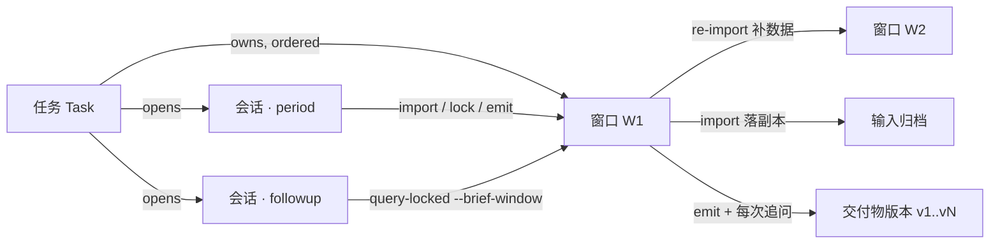

# Foundry Task Chain - Plan

Addendum to `2026-08-25-2109-feat-finance-skill-foundry-plan.md`. That plan owns U1–U6 and
the Product Contract R1–R9 / KTD1–KTD9. This one adds U7–U10 and does not restate them.
Where the two disagree, the earlier plan wins on R and KTD; this one wins on U7–U10 mechanism.

## Goal Capsule

- **Objective:** A finance manager can see every closing period as one task that owns its
  windows, its sessions, its archived inputs, and every version of every document it produced.
  A leader follow-up arriving days later lands on that task, against the exact brief version
  the leader read.
- **Means:** A task root above the existing window root; content-addressed input archive and
  deliverable versions; the Cordis bundle rebuilt to upstream's real registration contract so
  it can read the session id at call time; an Electron app in DesignBot's shape.
- **Product authority:** R1–R9 and KTD1–KTD9 from the base plan are unchanged. KTD7 (v1 F3 is
  A1-operated, no leader surface) still holds — this work builds the road, not the leader seat.
- **Execution profile:** code. New `foundry/task.py`, new `app/`, rewritten `dsh-plugin/index.js`.
- **Stop conditions:** Do not make the Electron app a second mutator. Do not unpin dsh. Do not
  ship a leader-operated session. Do not delete `host-smoke`.
- **Open blockers:** None for U7. U8 carries one unknown that only a real dsh load resolves
  (see U8 Execution note).

---

## Ground Truth

Five facts established 2026-08-30 by reading this repo and the dsh runtime vendored in
`~/projects/design-toolkit-app/extra/dsh/`. Every unit below rests on these.

### G1. Input documents are not stored — gap

`lock.json` records each source file's absolute path and sha256. `_lock_locked()` compares that
hash against the file on disk exactly once, and nothing reads the source again afterwards. The
original workbook stays wherever the operator's disk had it; delete it and the window cannot
show what it was built from.

Source: `foundry/window.py:460`.

### G2. Follow-up binds to a window, not to a session — gap

`query-locked --brief-window W --question-id q3` appends to `followup.jsonl` and to
`schedules.json`. The anchor is "which brief, which question", which is right as far as it goes.
No session identity is recorded, so two follow-ups a leader asked in two different conversations
are indistinguishable from two asked in one.

Source: `foundry/query.py:62` `_record_followup`.

### G3. The Cordis bundle does not match the runtime's registration contract — gap

Upstream tool plugins export `inject = ['tools']` and an `apply(ctx, config)` that calls
`ctx.tools.register(defineTool({... execute(args, exec) ...}))`. `dsh-plugin/index.js` exports
neither `inject` nor a registering `apply`; its `apply(context)` *returns* an array of tool
descriptors, and Cordis discards return values.

`host-smoke` cannot see the difference because it calls `apply({profile: "period"})` itself and
inspects the returned array — it tests foundry's own convention, not dsh's. How many tools the
bundle registers under a real `dsh` run is therefore unknown, not verified.

Sources: `@deepseek-ai/dsh-tool-todo@0.1.1-rc.2` `lib/index.js:12,78,97,172` ·
`dsh-plugin/index.js:248` · `foundry/host_profile.py:159`.

### G4. A registered tool can read the session id — verified

`execute(args, exec)` receives `exec.agent`; `exec.agent.id` is the session id and
`exec.agent.session.append(...)` writes events into it. Verified at both `0.1.0-rc.7` (source)
and `0.1.1-rc.2` (published build).

Sources: `dsh-tool-cordis/src/index.ts:222` (rc.7) · `dsh-tool-todo/lib/index.js:174-175` (rc.2).

### G5. dsh has a produced-files lane that foundry's tools do not currently join — verified

`dsh-client-ui-deliverables` folds a turn's produced files into a clickable tail row. It reads
`view.locations[].path` from calls whose presentation is either `card: "diff"` or
`card: "generic"` with `kind: "edit"`. foundry's tools return JSON strings with no such view, so
`brief.md` and `workpaper.md` do not appear there.

Source: `@deepseek-ai/dsh-client-ui-deliverables@0.1.1-rc.2` `lib/client.js:21-22`.

### G6. One brief per window; the workpaper is what mutates — verified

`emit_brief` is idempotent: once the window reaches `Briefed` it returns the existing `brief.md`
unchanged. Follow-ups do not rewrite the brief. They append a schedule and re-render
`workpaper.md`. So "an already-delivered document gets rewritten later" is a workpaper problem,
not a brief problem, and versioning is the proportionate answer.

Source: `foundry/brief.py:50-62`.

### G7. The period fence does not exist — gap, found by U8's real-load test

`dsh.foundry.profiles.period.omit` names `bash`, `dsh-tool-fs` and `str-replace-editor`, and
`registerTools` refuses to start when any of them appear. That check only ever inspects the
roster the bundle is handed. An agent's tool set is decided by its **preset**, a composition a
profile row cannot reach into. Measured on a real boot of the pinned runtime with the stock
`headless` preset: the model is offered foundry's ten tools **and** `bash`, `write`, `edit`,
`read`, `str_replace_editor`, `glob`, `grep`, `skill`, `web_search`, `subagent` — 35 in total.

Locked books a model can read around are not locked, so this is R7 and KTD7, not a nicety.
**Closed by U11, 2026-08-30**, and the fix turned out to be two fixes: a profile without agent
presets needs its tool rows disabled by patch, and a profile with them needs a foundry-owned
preset, because there a profile row cannot take away what a preset mounts. The original entry
below was measured on `headless` and named the preset mechanism, which was right for `web` and
wrong for the profile it was measured on.

Source: `tests/test_real_load.py`, run against `@deepseek-ai/dsh@0.1.1-rc.2`, 2026-08-30.

### G8. Installing the bundle is one command, and two is the trap — verified

`dsh plugin --profile P add <dir>` writes the package into the profile's dependencies and
appends it to `dsh.profile.bundles`; a package carrying `dsh.bundle.patch` contributes its own
insert row from there. Passing that same patch file to `--patch` composes the row twice. A
local directory is linked rather than copied, so a checkout edit is live in the profile.

Two related facts the same boot established: a package with no `dsh.bundle` block installs as a
plain dependency and never becomes a profile layer (the runtime warns and loads nothing), and
`ctx.tools.schemas()` is empty during any plugin's own `apply` — tools arrive later, as the
preset mounts them.

---

## Key Decisions

- **A task is the unit of work; a window stays the unit of caliber**
  `(session-settled: user-directed)`. Re-import already opens a successor window, so one closing
  period spans several windows and the old brief's follow-ups stay on the old window. The task
  is what makes that one thing instead of several directories. Governs U7.

- **The window archives the bytes it parsed** `(derived from G1)`. Import copies each source file
  into the window before parsing, and everything downstream — parse, hash, `lock()` verification —
  reads the copy. The window becomes self-contained and hand-offable. Governs U7.

- **Deliverables are content-addressed and append-only** `(derived from G6)`. Every write of a
  produced document also stores its bytes under its sha256 and appends a row naming what caused
  that version. The live file stays in the window directory for a human to open; the archive is
  the immutable history. Governs U7.

- **The leader's own words are recorded separately from the executed question**
  `(session-settled: user-directed 2026-08-30 — chosen over recording only `query-locked`'s
  `text`)`. A model may paraphrase; what the leader asked and what the machine computed are two
  columns that must be readable side by side. The operator pastes the original once when the
  follow-up session opens, and every follow-up in that session points back to it. Governs U8.

- **Binding is decided by code, never by the model** `(derived from G4, and 编码纪律 5)`. The task
  comes from a resolution chain the CLI evaluates; the session comes from `exec.agent.id`. No tool
  parameter asks a model which task it is working on.

- **The session id must be read per call, not per process** `(derived from G4)`. One dsh process
  hosts many sessions, so an environment variable would collapse them all into one id. This is why
  U8 depends on fixing G3 rather than merely adding a flag.

- **The Electron app is a caller, never a mutator** `(instantiates KTD2)`. It shells out to the
  `foundry` CLI for everything, including list views, which get their own read-only JSON commands.
  One place knows the store layout.

## Version Decisions

- **DuckDB stays on the 1.5 line, floor raised to 1.5.5.** 1.5.5 (2026-07-22) is the latest
  stable; 1.6.0 exists only as `.dev` prereleases on PyPI. The installed interpreter already runs
  1.5.5. The pin moves from `>=1.5,<1.6` to `>=1.5.5,<1.6` so a fresh install cannot land on an
  older 1.5.x. `READ_ONLY` attach stays the documented option (not LTS-only `ACCESS_MODE`), as the
  base plan requires.

- **DeepSeek Harness pin moves `0.1.0-rc.7` → `0.1.1-rc.2`.** rc.7 was published 2026-08-17,
  rc.2 on 2026-08-21. "Keep it latest" means re-pinning at the newest release, not unpinning:
  the base plan's reason for pinning (a preview runtime must not silently change what the fence
  does) is unchanged. The registration contract G3/G4 rests on and the deliverables lane of G5
  were both re-verified against the 0.1.1-rc.2 published builds before this pin moved.

- **Re-pinning is a unit-gated step, not a sweep.** The version strings change in U7 (`pyproject`,
  `README`), but nothing exercises the new harness until U8's real-load test. If that test fails
  against rc.2, the pin is a finding to report, not a number to quietly revert.

---

## Data Model



### Invariants

- A window belongs to exactly one task. The back-pointer lives in the window directory.
- A session belongs to exactly one task and carries exactly one role
  (`author` / `period` / `followup`).
- A follow-up belongs to one session, one window (its brief's), optionally one question, and
  optionally the sha of the export the leader actually read.
- A deliverable version belongs to one task and one window and names its cause.
- Every one of these edges is written by `foundry/`, never supplied by a model.

### Store

```text
var/tasks/<task_id>/
  task.json            # id, title, period, created_at, skill_id
  windows.jsonl        # ordered: {window_id, reason: initial|reimport, at}
  sessions.jsonl       # {session_id, role, opened_at, leader_verbatim?}
  deliverables.jsonl   # {seq, kind, window_id, sha256, bytes, cause, session_id, at}
  artifacts/<sha256>.<ext>
var/current-task       # current task id

var/windows/<window_id>/
  task                 # one line: task_id (back-pointer)
  inputs/<role>.<ext>  # archived source bytes
  # everything already there is unchanged:
  catalog.duckdb  lock.json  state.json  questions.json
  brief.md  schedules.json  workpaper.md  followup.jsonl
```

Deliverable bytes live under the task, not under a window, because an `export` belongs to the
task rather than to any one window, and both kinds must sort onto one timeline.

There is no separate input index. `lock.json` already names every role, the operator's original
path, the archived copy and its digest, so `task-show` derives the input view from the manifest
and the store keeps one source of truth for what came in. *(Revised during U7 from the earlier
`inputs.json`, which duplicated all four fields.)*

### Task resolution chain

Evaluated by the CLI, first hit wins:

1. explicit `--task`
2. `FOUNDRY_TASK` in the environment (the app sets it when it opens a session)
3. the back-pointer of the window named by `--brief-window` (the follow-up case)
4. the back-pointer of `var/current` (the period case)
5. none — recorded as `task_id: null`, shown as 未归属, adoptable by any later operation

### Session resolution chain

1. explicit `--session`
2. `--session` supplied by the bundle from `exec.agent.id`
3. none — `session_id: null`, meaning a direct CLI call with no conversation

---

## Implementation Units

Order is hard: U8 needs U7's task store to write into, U9 needs U7's read-only JSON views to
read from, U10 needs U8's profile shapes to know what to open a session with. U11 was not in
the original list; U8's real-load test found the gap that needs it, and it gates any claim that
the locked window is a fence.

### U7. Task store, input archive, deliverable versions

- **Goal:** Every window belongs to a task, holds the bytes it was built from, and every document
  it produces is recorded as an immutable version with a named cause.
- **Grounded in:** G1, G6. Instantiates KTD2, KTD5.
- **Dependencies:** none
- **Files:** `foundry/task.py` (new), `foundry/window.py`, `foundry/brief.py`,
  `foundry/workpaper.py`, `foundry/query.py`, `foundry/cli.py`, `pyproject.toml`, `README.md`,
  `tests/test_task.py` (new), `tests/test_input_archive.py` (new),
  `tests/test_deliverables.py` (new)
- **Approach:**
  1. `foundry/task.py` owns `TaskStore` and `Task`: create, list, get, `bind_window`,
     `record_session`, `register_deliverable`. State is derived from the task's windows, not
     stored, so it cannot drift from them. `var/current-task` holds the current id.
  2. Import copies each source file into `<window>/inputs/` first, then parses the copy. The
     manifest keeps `origin_path` for display and points its hash checks at the archived copy.
     The existing hash-parse-hash guard narrows to one job: compare source and copy, and refuse
     when they differ, which means the file was being written while it was copied.
  3. `lock()` asks two questions of two different files. The archived copy answers "is this
     window intact"; the original, when it is still on disk, answers "has she changed her mind
     since importing". A source that is simply gone is not an error -- keeping its bytes is what
     the archive is for -- but a source that is present and no longer matches still refuses, or
     archiving would quietly turn a caliber edit into a no-op. AE2 becomes provable with the
     source file deleted.
  4. `register_deliverable(task, window, kind, text, cause, session)` computes the sha256, writes
     `artifacts/<sha256>.<ext>` when absent, and appends to `deliverables.jsonl`. `emit_brief`
     registers `kind=brief` once; the workpaper write registers `kind=workpaper` on every render.
     Registration happens inside the same window lock as the write it records.
  5. New CLI commands emitting JSON on stdout: `task-new`, `task-list`, `task-show`,
     `deliverables`, `record-session`, `export`. Existing commands accept `--task` and `--session`
     and run the resolution chains. Adoption is on touch: an operation on a window with no task
     binds it. `record-session` is where the leader's own words are written; U8 wires the app to
     call it when a follow-up conversation opens, and nothing infers it from a tool argument.
  6. Bump the DuckDB floor and the dsh pin per Version Decisions. No behavior depends on the dsh
     bump in this unit; U8 is where it is exercised.
- **Execution note:** Write the failing test first for the one claim that matters — lock and
  brief and follow-up all still work after the original source file is deleted from disk.
- **Patterns to follow:** `fsutil.write_json_atomic` for every new file. `window.lifecycle_lock()`
  around anything that reads state, writes, and writes state back.
- **Test scenarios:**
  - Happy: create a task, import and lock a window under it, `task-show` lists the window,
    the archived inputs, and the two deliverable versions.
  - Covers G1: delete every source file after lock; `emit-brief`, `workpaper`, and `query-locked`
    all still work, and `<window>/inputs/` still holds the original bytes.
  - Happy: a follow-up appends a workpaper version whose `cause` names the followup id, and the
    brief stays at one version.
  - Edge: re-import binds the successor window to the same task, in order, with
    `reason: reimport`.
  - Edge: a window with no task is listed as unassigned and is adopted by the next operation.
  - Error: a source file that changes while it is being copied refuses the import.
  - Error: two concurrent writers cannot interleave a deliverable registration with its write.
  - Integration: `task-show` output is valid JSON and names no path outside `var/`.
- **Verification:** The fixture period runs end to end with the source directory deleted, and
  `deliverables.jsonl` reads as a timeline a colleague can follow.

### U8. Real Cordis registration, session binding, follow-up attribution

- **Goal:** The bundle registers on the runtime's own contract, every foundry call carries the
  session it happened in, and the leader's own words are on the record beside the executed query.
- **Grounded in:** G2, G3, G4, G5. Instantiates KTD1, KTD7, R7.
- **Dependencies:** U7
- **Files:** `dsh-plugin/index.js`, `dsh-plugin/package.json`, `dsh-plugin/test.mjs`,
  `foundry/query.py`, `foundry/task.py`, `foundry/host_profile.py`, `tests/test_plugin.py`,
  `tests/test_followup_attribution.py` (new)
- **Approach:**
  1. Rewrite `apply` to upstream's shape: export `inject = ['tools']`, register through
     `ctx.tools.register(defineTool({...}))`, and take the session from `exec.agent.id` inside
     `execute(args, exec)`. Keep the existing startup drift check between `TOOL_SPECS` and
     `package.json`, and keep it fail-closed.
  2. Every `foundry` exec gains `--session` from `exec.agent.id` and `--task` from the
     environment. A call with no agent-backed session is not refused; it records
     `session_id: null`.
  3. `followup.jsonl` rows grow `task_id`, `session_id`, `brief_sha`, and
     `leader_verbatim_ref`. `schedules.json` is unchanged in shape.
  4. The leader's own words are recorded once per follow-up session, on
     `sessions.jsonl[].leader_verbatim`, written by the app or by an explicit CLI call — never by
     the model, and never inferred from the tool's `text` argument.
  5. ~~`emit-brief` and `query-locked` declare `locations` so the produced-files row of G5
     picks them up.~~ **Dropped during U8.** Only `GenericCallView` carries `kind` and
     `locations`, so the row reads the *call* presenter, which the runtime requires to be pure
     and replayable from `args` alone. No foundry tool's arguments name a file: the path is
     `<FOUNDRY_VAR>/windows/<id>/brief.md`, the var root is ambient, and the window is
     `var/current`, which moves on every re-import. Reading either in a presenter draws a card
     that resolves to a different file on every replay. The tools declare a `presentCall` card
     without `locations`; which documents a period produced is what `deliverables` answers.
  6. Add a real-load test beside `host-smoke`: boot the pinned dsh with the foundry patch and
     count the tools that actually registered, from `--dump-config` or from one real turn's
     request header. `host-smoke` stays — it tests a different, still-useful convention.
- **Execution note:** The real-load test is this unit's done condition, and it is the first thing
  in the whole product that has ever exercised the bundle through the runtime. Expect it to
  surface more than G3: profile tool naming and sandbox resolution are both unverified. Report
  what it finds rather than working around it.
- **Test scenarios:**
  - Happy: a real dsh boot registers exactly `dsh.foundry.tools.length` tools.
  - Covers G3: the bundle exports `inject` and registers through `ctx.tools.register`.
  - Covers G2: two follow-ups in two sessions land on the same task with distinct session ids.
  - Happy: a follow-up row carries the sha of the export the leader read.
  - Edge: a call with no agent-backed session records `session_id: null` and does not refuse.
  - Error: f3 profile still denies every tool but `query-locked`.
  - Error: startup still fails closed when a declared tool is missing.
- **Verification:** A follow-up asked in a fresh session shows up on the right task's timeline
  with its own session id, the leader's original wording, and the brief version it was asked
  against.

### U11. The agent preset that makes the fence real

- **Goal:** A period agent is offered foundry's tools and nothing that can read around the lock.
- **Grounded in:** G7. Instantiates R7, KTD1, KTD7.
- **Dependencies:** U8
- **Files:** `dsh-plugin/presets/period/agent.cordis.yml` (new),
  `dsh-plugin/presets/f3/agent.cordis.yml` (new), `dsh-plugin/period.fence.yml` (new),
  `dsh-plugin/f3-scope.js` (new), `dsh-plugin/package.json`, `foundry/harness.py`,
  `foundry/cli.py`, `tests/test_real_load.py`
- **Status:** done 2026-08-30.
- **Approach:**
  1. Derive both presets from the stock one by deletion, so every surviving row keeps the
     configuration upstream gives it. `design-toolkit-app/extra/dsh-profile/presets/
     design-toolkit/agent.cordis.yml` is the worked example, including the trap that a
     hand-written preset fails to mount when `persona` gets no `text`.
  2. `period` drops the shell, filesystem, editor, jobs, goal, web and the whole delegation
     group. It keeps `tool-skill` (the close methods ship as skills), `tool-todo` and
     `tool-ask-user`, none of which can reach a file.
  3. `f3` drops those and the three `period` keeps. It cannot narrow foundry's own roster by
     re-registering it: the bundle registers globally from the profile row, and the runtime
     refuses a second registration by name. A `finance-skill-foundry-dsh/f3-scope` row calls
     `ctx.tools.restrict({allow: f3Allowlist()})` for that preset's agents instead — the seam
     the runtime provides for exactly this.
  4. `foundry install-presets --dsh-home H` copies both into `<DSH_HOME>/.agent-presets/`,
     the harness-home root the roster scans last. `foundry harness` prints that line and the
     patch line beside it.
  5. `dsh-plugin/period.fence.yml` disables the reach-bearing rows for a profile with no
     presets. Deliberately NOT part of `cordis.patch.yml`: a profile patch applies to the whole
     deployment, and a plugin that disabled the shell there would take it from every agent.
  6. `tests/test_real_load.py` measures both profiles. `standingKeyFor(id)` composes a preset
     without starting an agent, a session or a turn, which is what makes a preset measurable
     from outside a browser.
- **Verification (measured, pinned runtime):** headless unfenced 35 tools with a shell,
  fenced 27 with none; web `standard` 35, `period` 13, `f3` exactly `query-locked`.

### U9. Electron shell, tokens, task and deliverable screens

- **Goal:** The task, its inputs, its versions, and its sessions are visible.
- **Dependencies:** U7
- **Files:** `app/` (new), `app/electron/`, `app/src/`, `app/src/styles/tokens.css`
- **Approach:**
  1. Stand up `app/` mirroring `design-toolkit-app`'s layout. Copy its token table, rename the
     `--dtk-` prefix to `--fnd-`, and keep the provenance note in the file header.
  2. Carry over Departure Mono and Chocolate Classical Sans with their OFL licences. The stack
     order is load-bearing: Departure Mono first because it has no CJK and Chinese must fall past
     it. Number columns take `tabular-nums`.
  3. Task list, task detail (timeline · archived inputs · deliverable versions · sessions), and a
     cross-task deliverable gallery. Every read goes through U7's JSON CLI.
  4. A tag chip component for the five-word vocabulary. Only 稿外追问 and not-in-this-window carry
     colour; 报表声称 / 我重算 / 两者一致 are ink-on-surface and differ by their own label. Five
     colours would out-shout the numbers, and the borrowed system's own rule is that the primary
     fill is near-black and colour is an outline.
  5. Icons are lucide-react at `strokeWidth` 1.25–1.5. No emoji in interface text.
- **Status:** done 2026-08-30.
- **Test scenarios:** token table matches its source; both themes resolve; the chip component
  clears contrast in light and dark; every data path is a CLI call, asserted by test.
- **What changed on contact:** the outside mark needed two tokens, not one. It is text on a
  chip and a border around it, and WCAG asks 4.5:1 of the first and 3:1 of the second — the
  gold this system already uses for a hovered edge measures 3.70:1 and clears only the second.
  `--fnd-muted` for the absent mark measures 2.85:1, under the floor; a quiet chip still has to
  be readable, since it names the question this window could not answer. Both are measured in
  the test rather than asserted in a comment. `deliverable-text --sha` was added to the CLI for
  the reader pane, addressed by digest so a renderer string cannot name a file.

### U10. Embedded harness, profile switching, task bar

- **Goal:** A session can never be open without showing which task it writes to.
- **Dependencies:** U8, U9
- **Files:** `app/electron/harness/`, `app/src/views/Workbench.tsx`, `dsh-plugin/cordis.patch.yml`
- **Approach:**
  1. Boot the pinned dsh the way `design-toolkit-app/electron/harness/boot.ts` does: run the
     runtime entry as Node, read the loopback URL off its banner, and scrub secret-shaped and
     `DSH_*` names out of the child environment.
  2. Three buttons, three profiles: 授技能, 开始本期, 追问. The button picks the profile and the
     role. The model never chooses either.
  3. The task bar above the embedded view: task name, window chain, window state, this session's
     role and round. Opening a session sets `FOUNDRY_TASK`, and 追问 additionally seeds the brief
     window and the export sha, and collects the leader's verbatim question.
- **Status:** done 2026-08-31.
- **Test scenarios:** the task bar shows the binding the CLI would resolve; the 追问 button opens
  an f3 session and no other; the environment handed to the child carries no key-shaped name.
- **What the first real boot found.** Three things, all of them silent until measured.
  (1) `dsh plugin add` under `ELECTRON_RUN_AS_NODE` writes the profile manifest but pnpm never
  materialises the `node_modules` link, so the row composes and the loader dies with
  `Cannot find package`. (2) Even with that link present and pnpm's own install complete, the
  loader still does not resolve the package from the profile under Electron-as-Node — it does
  under a plain `node`. The link has to go in the install tree too, beside the importer.
  (3) The `web` profile composes the client-reload chain, and `cordis-plugin-hmr` refuses to
  construct without `--expose-internals`; a plain `node` satisfies it and Electron-as-Node does
  not, so the whole plugin tree fails and the workbench never starts. Disabling that row by
  patch does not work — measured from a `--patch` overlay and from the profile's own user layer,
  while `tool-bash` in the same file flips as expected — so the child gets the flag instead.
- **Packed 2026-08-31.** `scripts/fetch-harness.mjs` stages the pinned runtime into
  `app/extra/dsh/` and `electron-builder.yml` ships it beside the asar, never inside it: it
  resolves its own modules from real directories, which is why upstream sets `asar: false` for
  its own build. Three things this needed that are not obvious:
  (1) `node_modules` has to be named on its own line in `extraResources` — electron-builder
  skips a directory by that name unless asked, and the failure is quiet.
  (2) The period bundle is staged *twice*: as a resource the profile installer can hand to a
  package manager and symlink to, and as a copy inside the runtime's own `node_modules`, which
  is the one the loader resolves. The second cannot be created at run time in a packed app —
  that path is inside the application bundle.
  (3) The pin lives once, in `dsh-plugin/package.json` under `dsh.foundry.harness`. The staging
  script reads it, `tests/test_harness_pin.py` holds the README to it, and
  `app/tests/packaging.test.ts` holds the app's entry path to it.
- **The CLI packed too, 2026-08-31.** `scripts/build-foundry.mjs` freezes it with PyInstaller
  as a one-dir bundle into `app/extra/foundry` (~65MB), and the build ends by running the kit's
  own `probe` against the frozen binary under a bare environment. Two things this needed:
  (1) `--collect-data foundry` silently drops `.py` files, and `resources/formulator-plugin`
  holds nothing else — so the bundle came out missing it and *every* command failed at import,
  because `cli.py` resolves that path at module scope. The whole tree goes in with `--add-data`.
  (2) The app no longer shells out to `dsh plugin add`. That command needs `pnpm` on PATH, and
  the first `env -i` run of the packaged app got `pnpm not found on PATH`; every earlier run had
  passed only because the developer's own environment carried corepack. The two things that
  command does — name the bundle in the profile manifest, and place the package where the loader
  looks — are now done directly, and the second had to be anyway.
- **Verified self-contained.** The packaged app, run under `env -i` with no `FOUNDRY_BIN`, no
  pnpm and no Python on PATH, boots its bundled runtime, writes the profile manifest, installs
  both presets with its own frozen CLI, and binds `f3` and `period` on `session.create`.

---

## Scope Boundaries

### U12. Data Formulator in the app

- **Goal:** The leased reader is reachable from the window, and cannot outlive it.
- **Grounded in:** KTD3. **Status:** done 2026-08-31.
- **Approach:** A fourth destination over the same rectangle the workbench uses. `launch-formulator`
  and `stop-formulator` do the work; the app supplies a URL, a rectangle, and a stop on quit.
  Formulator is spawned in its own session so a CLI killed mid-startup cannot orphan it — which
  also means it outlives the app unless stopped, and a survivor holds the lease and the port.
  The two embedded pages are placed from one handler that names the screen, so a switch cannot
  leave both rectangles real.
- **Verified:** launch → identity confirmed → serving 200 → stop → port free, against the real
  process on a locked fixture window; and the refusal path through the packaged frozen CLI with
  nothing on PATH, which returns `Data Formulator binary is not installed` verbatim.
- **Packed 2026-08-31.** `scripts/build-formulator.mjs` freezes it into `app/extra/formulator`
  (~530MB), and the app is ~1.1GB. Four things this needed, all of them found by running:
  (1) The bundle has to carry `foundry`, `duckdb` and `openpyxl`. `DF_PLUGIN_DIR` names a loose
  `.py` that Data Formulator imports through `spec_from_file_location`; a frozen app can do that
  and still ignores `PYTHONPATH`, so the file's own imports resolve only from inside the bundle.
  Without them the bundle serves pages, passes readiness and the identity gate, and registers no
  locked-catalog connector — silently, because a plugin ImportError is filed under disabled
  loaders.
  (2) `azure.kusto.data` reads a package-relative JSON at *import*, and Data Formulator imports
  every loader module while registering them — so a missing data file is not a disabled
  connector, it is a process that dies before it binds a port.
  (3) A frozen bundle takes 43s to answer on the first launch after an install and 2.4s warm.
  The 8s readiness bound is right for a process that is starting and wrong for one being paged
  in; `FOUNDRY_FORMULATOR_TIMEOUT` and a 120s default when a binary is named cover it, and cost
  nothing when a launch is broken because readiness returns as soon as the child exits.
  (4) `harnessEnv` strips every `FOUNDRY_*`, so the harness child never saw
  `FOUNDRY_FORMULATOR_BIN` — a model calling `launch-formulator` in a session would be told the
  binary is not installed while the app's own data screen worked.
- **Two kit defects the packing surfaced.** A failed launch purged the home, and `formulator.log`
  lives in it — the one artefact explaining the failure was deleted by the cleanup. And
  `host_profile` re-implemented the binary lookup by scanning PATH, which would have skipped the
  real launch on exactly the deployments that carry a frozen one.
- **The gate, not a file check.** `package` and `dist` run `formulator:gate`: it locks a fixture
  window, launches the frozen Formulator under a bare environment, and asserts `locked_catalog`
  is in the running server's connector list. Verified against the binaries inside the built
  `Foundry.app`.
- **Not trimmed.** The bundle carries every connector Data Formulator ships — MySQL, S3,
  BigQuery, Kusto and the rest — and this kit's `connectors.yaml` auto-connects only the locked
  catalog. Excluding them would cut roughly 200MB and would arguably tighten the fence, since a
  chart drawn from un-locked data beside the locked catalog is traceable to no window at all.
  That is a product decision about what an operator may do in Formulator, and it is left open
  rather than taken in a packaging change.

**Not in this work**

- A leader-operated session. KTD7 stands; the task chain is the road, not the seat.
- Cloud sync, accounts, multi-user. Single operator, local machine, as the base plan has it.
- The Electron app reading or writing DuckDB directly. It calls the CLI; a missing view is a new
  read-only CLI command.
- Cross-window input de-duplication. A period is a few MB; a reference count and a collector cost
  more than they save.
- Removing `host-smoke`. U8 adds a test beside it, not in place of it.

**Risks**

- The bundle has never been loaded by a real dsh. Fixing G3 may surface further mismatches in
  profile tool naming and sandbox resolution. U8's real-load test exists to surface them at once
  rather than at U10.
- Two toolchains. Python tests plus Node tests plus electron-builder. `design-toolkit-app` has
  already walked this and its scripts are the pattern to copy.
- dsh is a developer preview. Pinned by exact version, upgrades treated as breaking. That was
  already true; it applies to more surface once the app depends on the runtime.
