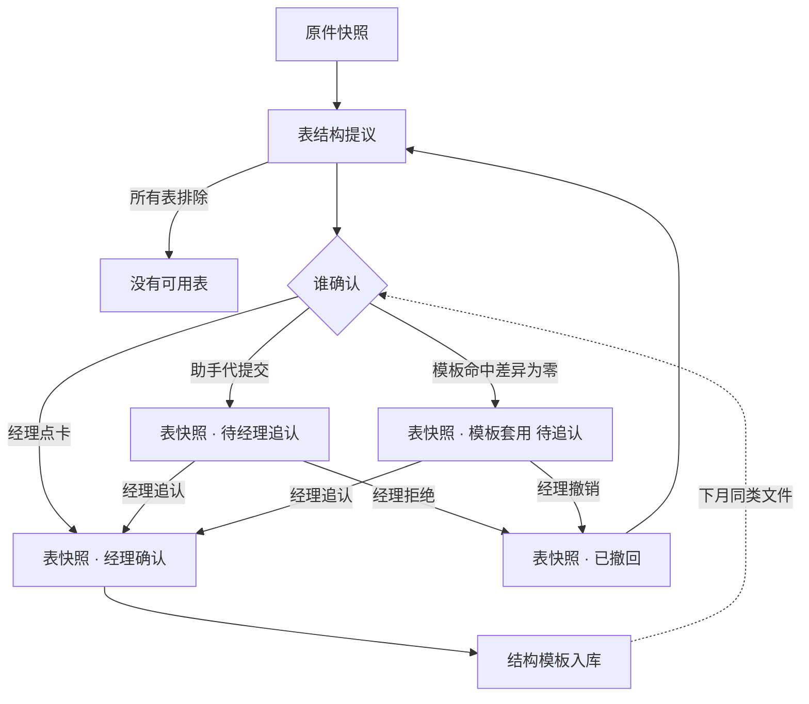
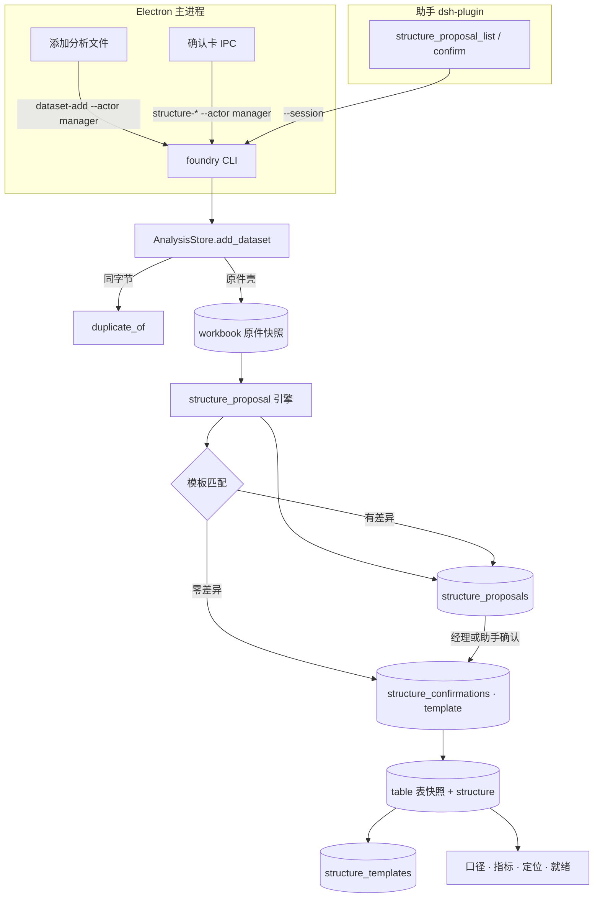
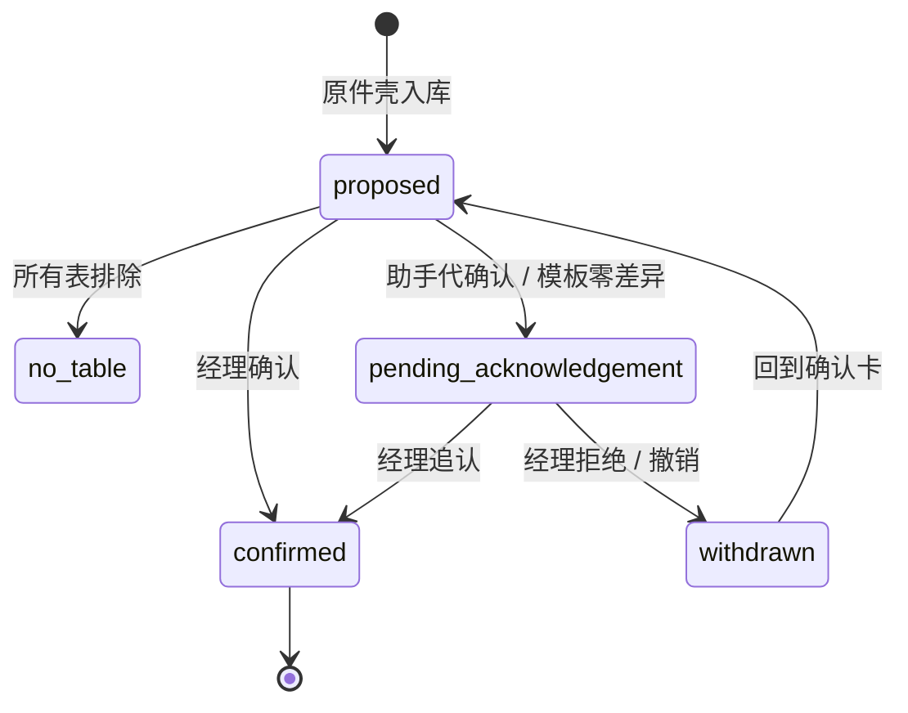

# 真实报表结构提议与确认 - Plan

## Goal Capsule

- **Objective:** 财务经理把金蝶、用友或自制的月结报表原样加进任务，不在 Excel 里改一行，就得到一份能进口径计算、每个数字都能点回原件单元格的表；下个月同类文件进来时几乎不用再动手。
- **Means:** 表结构提议引擎、工作区确认卡、结构模板注册表 (KTD1, KTD2, KTD5)。
- **Product authority:** 财务经理主导判断。本计划只负责「资料能不能算」的接入层。计算正确与失败可见、就绪与溯源一致、其它交互修补是三块相邻工作，不在本计划的活动范围内。
- **Execution profile:** 三段推进，先 Python 引擎与快照，再助手工具，最后桌面卡片；每段都以既有测试命令验证后再进下一段。
- **Stop conditions:** 发现表快照无法被现有口径或定位不改动就消费（R18 不成立）时停下重新设计快照形态；发现任何一条已定决策在代码里做不到时报告而不是绕开。
- **Tail ownership:** 实施完成后由 `ce-work` 常规收尾（提交、审查、合并）；本计划不写提交信息或分支编排。
- **Open blockers:** 无。

---

## Product Contract

Product Contract preservation: changed: R1 补充「没有可用表」终态；R12 补充合并列每行记原件列字母；R13、R17 补充拒绝助手代确认与撤回状态。三处均在规划范围确认中经用户确认，其余 R 未改。

### Summary

加文件后，系统对每张工作表给出一份表结构提议：选哪几张表、表头在第几行、哪些列是金额或借贷两列、哪些行是分节小计、哪些列要向下填充、标题里读到的期间单位币种。经理在工作区卡片上确认，助手也能用同一套工具代确认并单独标记。确认生成一份不可变、带原件坐标的表快照，同时存成结构模板；下次同类表命中模板直接套用，经理可一键撤销。

### Problem Frame

2026-09-12 用华宸物业两份真实形态的套表做了全链路验证。月结套表 14 张、预算与合同台账 16 张，每张表前三行是标题和说明，表头在第 4 行，表内夹着「资产类科目」这类分节行和「合计」「平衡校验」「校验说明」这类页脚。现有表模式把第一个非空行当表头，30 张表全部判成不可映射，就绪报告只能说缺币种。GL 余额表和分录清单的金额是借方、贷方两列，模型只认单列金额，83 行全部 `missing_amount`，而就绪报告又把借贷列算作有金额。同一文件加两次会生成两份快照，没有提示。

只有把表头提到首行、删掉分节行、把借贷合成一列金额之后，损益才算得出来，且与合并利润表一致。这些动作今天是人在 Excel 里做的，每张表、每个月都要重做一遍。

### Key Decisions

- **自动提议、经理一键确认。** 认对时经理不碰表，认错时改一下就行。(session-settled: user-directed — chosen over 全自动不让经理选、经理手工指定区域和列: 全自动认错就报不能算，手工指定每张表都要经理动手。) Governs R1, R2, R3, R4, R5, R6, R7, R9.
- **确认卡在工作区为主，助手共用同一套提议与确认工具。** 确认永远落成一条可追溯记录。(session-settled: user-approved — chosen over 只在对话里由助手提议经理回复、只在 UI 助手不能代确认: 前者证据只在聊天里，后者经理在对话里问能不能算时要切走点卡。) Governs R9, R10.
- **确认之前只有原件快照，确认之后才有可算的表。** 「有引用不等于已证实」不被绕开。(session-settled: user-approved — chosen over 按提议先生成可算表并标未确认: 标记容易被忽略。) Governs R11, R12.
- **助手代确认单独记录，待经理追认。** 对应现有四态里「执行成功不等于经理认可」。(session-settled: user-approved — chosen over 对话里说「行」就等于确认、助手不能代确认: 前者模型误读经理意思时无从追溯，后者把经理拖回 UI。) Governs R13.
- **结构模板注册表、模糊匹配、命中免确认。** 月结每月同样的表，第二个月起零操作。(session-settled: user-directed — chosen over 方案一只做表头签名完全一致时预填仍走确认卡、方案二把确认落在工作簿绑定上: 用户选择全量模板方案，接受注册表维护与误配风险。) Governs R14, R15, R16, R17.
- **七项识别能力一轮全上，不切最小版。** (session-settled: user-directed — chosen over 先只做 GL 余额表的表头与借贷列: 用户判断一次到位。) 框架决策，无单独 R。
- **派生表每行记住原件坐标，合并列按行记实际取值的列。** 不记就点不回第 18 行，借贷合并后每行取值的列不同。 Governs R12.
- **借贷合并的方向按科目类别提议，卡上逐列显示并可改。** 方向猜错直接改数字，所以不能藏在引擎里。 Governs R4.
- **模板命中视为一次「模板代确认」。** 它和「确认后才有可算表」并不冲突，但必须带来源标记和一键撤销，否则模板认错一次会连错整月。 Governs R13, R16, R17.
- **拒绝助手代确认与撤销模板套用是同一个动作。** 快照标「已撤回」不删除，已有 run 保留并在结果区标出。 Governs R13, R17.
- **待追认的表可以直接绑口径计算。** 追认只去标，不拦计算，也不重跑。 Governs R11, R13.

### Actors

- A1. 财务经理。加文件、看确认卡、确认或改提议、追认、拒绝、撤销模板套用、停用模板。
- A2. 分析助手。在对话里读取提议、按经理意思修改提议项并代提交确认；不接触路径与字节。
- A3. 系统。提议引擎、表快照、结构模板注册表、就绪报告与资料列表的状态展示。

### Requirements

**提议引擎认什么**

- R1. 多表工作簿逐表判断：每张表给出「可作数据表」或「排除」及理由，封面、看板、说明、对标假设页排除；不跨表合并；所有表都被排除时文件进入「没有可用表」终态并列出每张表的理由。
- R2. 表头行与标题区：识别表头所在行；表头之上的标题与说明行归为标题区，原文保留供 R7 使用。
- R3. 列角色：识别每列的角色，至少覆盖科目代码、科目名称、类别、方向、金额、借方、贷方、凭证号、行号、日期、摘要、期间、币种、单位；表头内的换行和全角空格在显示与匹配时去除；派生表列名用规范角色名。
- R4. 借贷两列：识别成对的借方与贷方列，提议合成「金额 加 借贷方向」；方向按科目类别提议，收入类取贷方、成本费用类取借方；没有类别依据的列方向标「未定」，未定方向不允许确认。
- R5. 分节、小计、合计与校验行：识别并提议排除；派生表不含这些行，确认记录列出被排除的原件行号与首格原文。
- R6. 合并单元格向下填充：识别凭证号、日期、摘要这类只在组首行有值的列，提议向下填充；填充值带「填充」来源标记。
- R7. 标题中的期间、单位、币种：从标题区提取为口径提议，只提议不落口径；没有币种标记时币种留空，不填 CNY。
- R8. 重复文件：字节相同的文件再次添加时提示已存在并指向原快照，不默认生成第二份；经理坚持另存时才生成。

**确认与快照**

- R9. 确认卡：加文件后工作区弹出确认卡，逐项展示 R1 到 R7 的提议，每项可改；确认生成表快照并写入确认记录。
- R10. 助手同一套工具：助手能读取提议、修改提议项、代提交确认；工具只接受资料标识和提议项，不接受路径、URL 或字节。
- R11. 确认前只有原件快照：未确认的文件在资料列表显示「待确认表结构」，就绪报告以「待确认表结构」为阻塞原因，口径不能绑定未确认的表；待追认的表可以绑定。
- R12. 表快照带结构声明与原件坐标：快照附带确认后的结构声明；每行记原件工作表与行号，每列记原件列字母，合并出来的金额列按行记实际取值的原件列字母，定位点回原文时指向原件单元格；快照不可变，改结构生成新版本，旧 run 继续绑旧版本。
- R13. 确认来源：确认记录写明「经理确认」「助手代确认」或「模板套用」，来源由调用入口决定，请求里自报的来源一律丢弃；后两者在资料列表、就绪报告和结果区带「待经理追认」标记，经理一键追认后去标，追认不重跑；经理可拒绝助手代确认，拒绝把该快照标「已撤回」并回到确认卡。

**结构模板**

- R14. 确认即入库：经理确认或追认后的结构自动存为结构模板，包含表头签名、表名模式和完整结构声明。
- R15. 模糊匹配：新文件的每张表与模板按列名集合、列顺序、标题模式计算匹配度，达到阈值即命中；命中结果给出匹配度和逐项差异。
- R16. 命中免确认：命中且逐项差异为零时直接生成表快照，来源按 R13 记「模板套用」；差异非零时回到确认卡并用模板预填。
- R17. 撤销与管理：经理可在资料列表一键撤销模板套用，快照标「已撤回」不删除，已有 run 保留并在结果区标出，文件回到确认卡；被撤销的模板降权；模板可查看、停用。

**与相邻工作的接口**

- R18. 表快照对现有口径、指标计算、定位、就绪报告是一份普通的 table 资料；它们不改动也能消费。

### Key Flows

- F1. 首次加载 GL 余额表
  - **Trigger:** 经理用「添加分析文件」加入月结套表工作簿。
  - **Actors:** A1, A3
  - **Steps:** 原件快照落档；提议引擎逐表出提议；确认卡列出候选表与每张表的表头行、列角色、借贷合并方向、排除行、填充列、标题口径；经理改一处后确认；表快照生成，结构入模板库；经理把表绑进口径。
  - **Covered by:** R1, R2, R3, R4, R5, R7, R9, R11, R12, R14

- F2. 对话里代确认
  - **Trigger:** 经理在对话里问「这批资料能不能出管理损益」，助手调就绪报告得到「待确认表结构」。
  - **Actors:** A1, A2, A3
  - **Steps:** 助手读取提议，向经理复述关键项；经理回「行」；助手代提交确认；表快照带「待经理追认」；经理稍后在资料列表一键追认，或拒绝后回到确认卡。
  - **Covered by:** R10, R11, R13

- F3. 下月同类文件
  - **Trigger:** 经理加入下月的同一套表。
  - **Actors:** A1, A3
  - **Steps:** 提议引擎先匹配模板；差异为零的表直接生成快照并标「模板套用」；差异非零的表回到确认卡预填；经理发现某张表认错，一键撤销回到确认卡。
  - **Covered by:** R13, R15, R16, R17

- F4. 重复添加
  - **Trigger:** 经理再次加入字节相同的文件。
  - **Actors:** A1, A3
  - **Steps:** 系统提示已存在并指向原快照；经理选择放弃或另存。
  - **Covered by:** R8

### Acceptance Examples

- AE1. **Covers R1, R2, R3, R4, R5.** Given 华宸月结套表的「02·GL科目余额表」，When 提议引擎处理该表，Then 表头行为第 4 行，「本期发生额 借方」「本期发生额 贷方」识别为借贷对，「资产类科目」「负债类科目」「权益类科目」「收入类科目」「成本费用类科目」「合计」「平衡校验」及三行校验说明提议排除，收入类科目方向提议贷方、成本费用类提议借方。
- AE2. **Covers R12.** Given AE1 确认后的表快照，When 定位「6602 管理费用」的金额，Then 定位指向原件「02·GL科目余额表」的借方列单元格，而不是派生表的行号。
- AE3. **Covers R6, R5.** Given 「03·GL月结分录清单」，When 提议引擎处理，Then 凭证号、日期、摘要提议向下填充，每张凭证的「小计」行和末尾「合计」行提议排除，派生表 183 行。
- AE4. **Covers R1.** Given 14 张表的月结套表，When 逐表判断，Then 「00·封面与编制说明」「01·核心指标看板」「13·行业对标与假设」排除，「02」「03」「10·区域经营损益表」「11·城市公司明细表」为可作数据表。
- AE5. **Covers R7.** Given 标题「华宸物业 | 2026年08月 | 单位：元 | 损益类科目每月结转…」，When 提取口径提议，Then 期间 2026-08、单位 元、币种留空，且口径本身不被写入。
- AE6. **Covers R11.** Given 文件已加入但确认卡未确认，When 助手调就绪报告或经理尝试绑口径，Then 就绪报告阻塞原因为「待确认表结构」，口径绑定被拒绝。
- AE7. **Covers R13.** Given 助手代提交确认生成的表快照，When 经理在资料列表追认，Then 「待经理追认」标记消失，已有 run 不重跑，确认记录同时保留代确认与追认两条来源。
- AE8. **Covers R15, R16, R17.** Given 上月已确认「02·GL科目余额表」的结构，When 本月同名同表头的文件加入，Then 该表直接生成「模板套用」快照；经理撤销后回到确认卡且该模板降权。
- AE9. **Covers R4.** Given 一张只有科目名称、借方、贷方而没有类别列的表，When 提议引擎处理，Then 借贷方向标「未定」，确认按钮不可用直到经理逐列选定。
- AE10. **Covers R8.** Given 同一份工作簿加入两次，When 第二次加入，Then 系统提示已存在并指向第一份快照，不生成第二份。

### Success Criteria

- 本次验证用的两份华宸套表，不在 Excel 里改任何内容即可加载，30 张表中至少「02」「03」「10」「11」和预算表的「01」「05」「06」「09」「11」「13」「14」被判为可作数据表。
- 「02·GL科目余额表」确认后绑进口径算管理损益，收入、成本、费用分别为 414,696,250、346,290,000、53,262,500 元，与合并利润表一致。
- 同一套表第二个月加入，全部命中模板的表不需要经理点确认卡。
- 确认卡的每一项改动、每一次代确认与追认、每一次模板套用与撤销都能在记录里查到是谁在什么时候做的。

### Scope Boundaries

- 结转凭证双计、空结果标成功、科目代码别名、量价拆分无视金额：计算正确与失败可见块，另开计划。
- 就绪报告按数据集分项、凭证下钻的判定、刷新策略切换崩溃：就绪与溯源一致块，另开计划。本计划只给就绪报告加「待确认表结构」原因、按资料的结构状态，并跳过已有确认表的原件壳。
- 文稿数字千分位与单位、临时文件名、圈选错误文案、工作簿检视回包路径：交互修补块，另开计划。
- 不自动填币种为 CNY，不跨表合并数据，不做 PDF 或扫描件的表结构识别。
- 模板不跨任务、跨租户共享。
- 现有 Excel 区域绑定（workbook_bind）保持并行存在，本计划不改也不隐藏。

#### Deferred to Follow-Up Work

- 多行表头与合并表头单元格的识别。
- 模板跨任务共享与模板导入导出。
- 助手侧的撤销模板套用与停用模板工具，待经理追认的交互稳定后再放开。

<!-- ce-section: work-relationships -->
### How This Work Fits Together

本计划只负责数据接入这一块。下面的划分是对 2026-09-12 真实数据验证结果的当前理解，不是承诺的路线图。

- 计算正确与失败可见
  - Depends on 本计划的表快照与规范列名，否则科目代码读不到。
  - Can proceed independently of 确认卡与模板。
- 就绪与溯源一致
  - Depends on R11、R13 给出的「待确认」「待追认」状态，就绪报告要把它们分数据集显示。
  - Shares 凭证号、行号的列角色识别（R3）。
- 交互修补
  - Can proceed independently of 本计划。
  - Still to decide 就绪报告与字段映射的 UI 入口是否并入确认卡。

### Dependencies / Assumptions

- 现有资料快照不可变、口径只绑资料、定位按原件列字母指单元格，这三条合同不变。
- 金蝶、用友风格导出遵循「标题区在上、表头一行、分节与合计夹在数据中」的形态；本次只在模拟样本上验证过，真实客户导出可能有多行表头（已延后）。
- 借贷方向依赖表内的类别或方向列；没有时经理逐列指定（R4）。

### Outstanding Questions

**Deferred to Planning**

- 模板匹配的相似度阈值取值：实施时按夹具校准，初值见 KTD5。
- 提议引擎的启发式评分细节：实施时按 U1 的测试场景校准。

### Sources / Research

- [docs/plans/2026-09-11-corporate-finance-workstation-plan.md](docs/plans/2026-09-11-corporate-finance-workstation-plan.md) 定义了就绪报告、定位与四态合同，本计划沿用；其 §5 1b 要求列字母来自单元格坐标而不是表头序号。
- [docs/finance/source-refresh-contract.md](docs/finance/source-refresh-contract.md)：同字节去重指向原快照、先分配批次再落盘、旧 run 不受影响，是本计划表快照落盘与去重的样板。
- 表解析入口 `foundry/analysis_data.py`（`_xlsx` 记录 `header_columns` 与 `source_row_numbers`，`_xlsx_workbook` 只读工作簿目录），字段别名与规范化 `foundry/finance_model.py`（`_physical_source_row`），就绪报告 `foundry/finance_readiness.py`，定位 `foundry/finance_locators.py`（`_column_letter_for_field`），工作簿检视与绑定 `foundry/workbook_bindings.py`、`foundry/finance_files.py`。
- 调整项的 pending 到确认链与 `mark_superseded`：`foundry/finance_service.py`、`foundry/finance_adjustments.py`。
- 2026-09-12 真实数据验证在本会话完成，样本为华宸物业月结套表与全面预算合同台账，均为模拟数据。

---

## Planning Contract

### Key Technical Decisions

- KTD1. **表快照是一份 `kind=table` 的普通资料，内嵌原件工作簿字节。** `source.xlsx` 存原件字节，`source_hash` 因此等于原件哈希，定位预览、就绪的完整性校验与 `FinanceFiles` 授权都不用改；`data.json` 存派生行，`transformation` 沿用 `format`、`sheet`、`source_row_numbers`、`header_columns`，并新增 `structure` 块（结构声明、`derived_from` 原件资料 id、被排除行、填充来源、逐行取值列）。Governs R12, R18。
- KTD2. **提议、确认、模板是 FinanceStore 的三个不可变集合。** `structure_proposals`（按原件资料 id，带 `revision`）、`structure_confirmations`（`parent_id` 指向提议 revision，`source` 为 manager、assistant、template 之一，`state` 为 confirmed、pending_acknowledgement、acknowledged、withdrawn 之一，追认与撤回各写一条新记录并以 `parent_id` 链接）、`structure_templates`。确认时若提议 revision 不是最新则拒绝，这是并发冲突的唯一处理。镜像调整项的 pending 到确认链与 `mark_superseded`。Governs R9, R13, R14, R17。
- KTD3. **确认来源由调用入口打标，用 CLI 的 `--actor` 顶层参数。** Electron 主进程对经理动作注入 `--actor manager`；未传时有 `--session` 视为 assistant，无会话视为 manager；模板套用由服务端内部标 template。请求 spec 里的 `source`、`confirmed_by`、`actor` 一律剥除。`FinanceStore` 在初始化时接收 actor。(session-settled: user-approved — chosen over 用「有无会话」推断来源: 主进程在 `analysis-refresh` 与 `record-session` 也会带会话 id，推断不可靠。) Governs R13。
- KTD4. **确认后的可见性：助手代确认要把新表快照并进该会话的快照集。** 镜像 `finance-source-refresh` 的 `update_session_context` 写法，否则窄会话确认了自己读不到的表。子会话不能确认。Governs R10, R11。
- KTD5. **模板匹配用表头签名加相似度。** 签名为去空白后的规范列角色序列加原表名模式；相似度按列名集合 Jaccard、顺序一致率、标题模式三项加权，初始阈值 0.85，命中且逐项差异为零才自动套用；差异非零回到卡片预填。模板记录带 `weight`，撤销一次降权，降到 0 停用；经理可手动停用。匹配发生在加文件那一刻，紧接提议引擎之后。Governs R15, R16, R17。
- KTD6. **提议引擎是纯函数：工作簿字节进，逐表提议出。** 表头行取「非空字符串单元格最多且其后连续有数据行」的行；表头之上为标题区；分节行为只有首格有值且其余为空的行；小计、合计、校验行按关键词加数值模式；借贷对按表头名（借方、贷方、借方金额、贷方金额及带换行变体）配对；方向按类别或方向列；期间、单位、币种复用就绪报告的标题正则并新增单位正则；超过 `MAX_ROWS` 或 `MAX_COLUMNS` 的表标「排除：过大」而不是整簿抛错。Governs R1 到 R7。
- KTD7. **同字节去重在 `add_dataset` 入口做，只针对原件壳。** 计算 `source_hash` 后扫描任务内 `kind=workbook` 或无 `structure` 的资料，命中返回 `duplicate_of` 而不落盘；`allow_duplicate=true` 时照常落盘；`source_refresh` 自带的 `duplicate_of` 不动。Governs R8。
- KTD8. **就绪报告与资料清单加按资料的结构状态。** 每条资料带 `structure_state`（pending_confirmation、pending_acknowledgement、confirmed、no_table、withdrawn）；有已确认子表的原件壳不再逐表探测；待确认壳以 `pending_structure` 为阻塞原因排在 `identity_failed` 之前；`sheet_candidates` 照旧输出以保住既有测试。Governs R11, R13。
- KTD9. **助手工具三个，追认、拒绝、撤销、停用只走经理的 IPC。** `structure_proposal_list`（read）、`structure_proposal_confirm`（edit，只收资料 id 与提议项，服务端拒绝 `path`、`url`、`file`、`bytes`、`preview_path`、`allowedRoot`）、`structure_template_list`（read）。分析 preset 三个全加，子工具只加两个 read；`foundry/resources/dsh-plugin` 镜像逐字节同步。Governs R10, R13, R17。
- KTD10. **确认卡放资料页，镜像调整项面板。** 卡片状态与 IPC 走现有 `financeCall` 白名单与 `FinanceCommand` 联合类型；无新 IPC 通道；追认、拒绝、撤销、停用四个命令只进渲染器白名单，不进 dsh 工具。Governs R9, R13, R17。
- KTD11. **定位读逐行取值列。** `build_source_locator` 在 `structure.row_columns` 存在时优先用该行记录的原件列字母，没有时走现有 `header_columns` 路径；派生表的 `header_columns` 保留原件借方、贷方两列的字母，不登记合并后的金额列。Governs R12, R18。

### High-Level Technical Design

### Assumptions

- 表快照的 `data.json` 与 `meta.json` 由 `AnalysisStore` 同一把任务锁下写入，沿用 `add_dataset` 的落盘顺序。
- 华宸样本的分节行只有首格有值；真实导出若分节行带合计数，按小计规则处理。
- 助手工具的 spec 走 `specTool` 的 `additionalProperties: true`，禁止项只能由 CLI 侧过滤。

### Sequencing

1. 阶段一（Python）：U1 引擎 → U2 表快照与定位 → U3 集合、CLI 与来源打标 → U4 模板 → U5 去重与就绪状态。
2. 阶段二（助手）：U6 工具与镜像。
3. 阶段三（桌面）：U7 主进程 → U8 渲染器卡片。
4. 收口：U9 仿华宸夹具端到端。

---

## Implementation Units

### U1. 表结构提议引擎

- **Goal:** 从工作簿字节生成逐表的结构提议，覆盖 R1 到 R7 的七项识别。
- **Requirements:** R1, R2, R3, R4, R5, R6, R7; AE1, AE3, AE4, AE5, AE9; KTD6
- **Dependencies:** 无
- **Files:** 新增 `foundry/structure_proposal.py`；复用 `foundry/analysis_data.py` 的 `_column_letter`、`MAX_ROWS`、`MAX_COLUMNS`，`foundry/workbook_bindings.py` 的 `_open`，`foundry/finance_readiness.py` 的 `_PERIOD_IN_TITLE`、`_CURRENCY_IN_TITLE`；测试 `tests/test_structure_proposal.py`，夹具生成器 `tests/fixtures/structure/build_huachen_like.py`
- **Approach:**
  1. 用非只读 `load_workbook` 打开以拿到 `merged_cells` 与单元格坐标，逐表扫描；超限的表直接产出「排除：过大」。
  2. 按 KTD6 的规则依次判定表头行、标题区、列角色、借贷对与方向、排除行、填充列、口径提议。
  3. 输出结构：每张表一条，含 `decision`（table 或 excluded 及 reason）、`header_row`、`title_rows`、`columns`（原件列字母、原表头、规范角色、借贷方向、方向依据）、`excluded_rows`（行号与首格原文）、`fill_down_columns`、`scope_hints`、`confidence`。
  4. 不读任务目录，不写任何记录。
- **Execution note:** 先用仿华宸夹具写失败的场景测试，再实现启发式；每条启发式独立可测。
- **Patterns to follow:** `foundry/analysis_data.py` 的坐标取列字母写法；`foundry/finance_readiness.py` 的标题正则。
- **Test scenarios:**
  - Covers AE1. 仿「02·GL科目余额表」：表头行为 4，借贷对配成一对，五个分节行与合计、平衡校验、三行说明进排除，收入类方向贷、成本费用类方向借。
  - Covers AE3. 仿「03·GL月结分录清单」：凭证号、日期、摘要进填充列，每张凭证的小计与末尾合计进排除，剩余数据行数为 183。
  - Covers AE4. 14 张表的工作簿：封面、看板、对标假设页判排除并带理由，02、03、10、11 判可作数据表。
  - Covers AE5. 标题「华宸物业 | 2026年08月 | 单位：元」：期间 2026-08、单位 元、币种空。
  - Covers AE9. 只有科目名称、借方、贷方的表：两列方向均为「未定」。
  - 表头带换行「本期发生额\n借方」：显示名与匹配名去换行后仍配成借贷对，原件列字母保留。
  - 表头不在第 4 行而在第 6 行：仍能定位表头。
  - 空表与只有标题的表：判排除，理由为无表头。
  - 一张表超过 `MAX_ROWS`：该表标排除过大，其它表照常处理，不抛错。
  - 两行完全相同的表头名：不崩溃，第二列角色标未知并保留列字母。
- **Verification:** `uv run --extra dev pytest tests/test_structure_proposal.py` 通过；引擎对两份华宸样本运行不抛错且输出与上述场景一致。

### U2. 表快照写入与逐行定位

- **Goal:** 按确认后的结构声明生成不可变表快照，现有口径、指标、定位不改即可消费。
- **Requirements:** R11, R12, R18; AE2; KTD1, KTD11
- **Dependencies:** U1
- **Files:** `foundry/analysis.py`（新增 `add_table_snapshot` 或等价入口）、新增 `foundry/structure_snapshot.py`（声明到派生行的转换）、`foundry/finance_locators.py`（`build_source_locator` 读逐行取值列）、`foundry/finance_model.py`（确认 `_physical_source_row` 直接适用）；测试 `tests/test_structure_snapshot.py`、`tests/test_finance_locators.py`
- **Approach:**
  1. 派生行：跳过排除行，填充列按组首行补值并记来源，借贷对合成规范列 `amount` 与 `dc_flag`，其它列按规范角色重命名；数值保持 Decimal 字符串。
  2. `transformation` 写入 `sheet`、`header_row`、`source_row_numbers`、`header_columns`（只登记原件列，含借方、贷方）、`structure`（声明、`derived_from`、`excluded_rows`、`fill_provenance`、`row_columns` 逐行取值列）。
  3. 原件字节再存一份为 `source.xlsx`，`source_hash` 与原件壳一致；`kind=table`。
  4. 定位：`row_columns` 存在时按行取列字母，否则走 `header_columns`。
- **Patterns to follow:** `foundry/analysis.py` 的 `add_dataset` 落盘顺序与锁；`foundry/finance_locators.py` 的 `_column_letter_for_field`。
- **Test scenarios:**
  - Covers AE2. 用 U1 对仿 02 表的提议生成快照，`normalize_finance_dataset` 后 6602 行的定位为该表借方列的原件单元格。
  - 收入行定位指向贷方列，成本行指向借方列，同一快照内两种列都能命中。
  - 快照 `source_hash` 等于原件壳的 `source_hash`，`read_dataset` 完整性校验通过。
  - 用快照建口径并跑管理损益：收入 414,696,250、成本 346,290,000、费用 53,262,500（配合科目映射）。
  - 填充列的值带「填充」来源，排除行不出现在派生行中。
  - 同一原件二次确认生成新快照 id，旧 run 的 `bindings` 不变。
  - 就绪报告把表快照当普通表处理，`_is_workbook_shell` 对它返回 False。
- **Verification:** 相关 pytest 通过；不改 `finance_service.save_context` 与 `finance_metrics` 即可完成上述场景。

### U3. 提议、确认集合与 CLI

- **Goal:** 提议、确认、追认、拒绝、撤销的不可变记录，CLI 命令与来源打标。
- **Requirements:** R9, R10, R11, R13, R17; AE6, AE7; KTD2, KTD3, KTD4
- **Dependencies:** U1, U2
- **Files:** `foundry/finance_service.py`（`COLLECTIONS` 加三个集合；`structure_proposal_list`、`structure_proposal_confirm`、`structure_acknowledge`、`structure_reject`、`structure_withdraw`）、`foundry/finance_cli.py`（`OPERATIONS`、`--actor`、确认后会话并集）、`foundry/cli.py`（顶层 `--actor` 参数）、新增 `foundry/structure_records.py`（状态机与来源规则）；测试 `tests/test_structure_records.py`、`tests/test_finance_cli.py`
- **Approach:**
  1. 原件壳入库后由 U5 的钩子写首条提议记录；`structure_proposal_list` 按资料 id 返回最新 revision。
  2. `structure_proposal_confirm` 校验 revision 为最新、无未定方向、spec 无禁止键，剥除自报来源，按 actor 写确认记录并调 U2 生成快照；assistant 来源时 state 为 pending_acknowledgement 并并集会话快照。
  3. 追认、拒绝、撤销各写新记录并 `parent_id` 链接；撤回后快照标 withdrawn，`mark_superseded` 式标记供列表与结果区读取。
  4. 子会话拒绝确认；口径绑定校验资料的结构状态不是 pending_confirmation 或 withdrawn。
- **Patterns to follow:** `finance_adjustment_save` 与 `finance_adjustment_confirm`；`_refresh_source` 的会话并集；`finance_locators.py` 的 `FORBIDDEN_ARGS`。
- **Test scenarios:**
  - Covers AE6. 未确认时 `save_context` 绑该原件壳被拒，错误码为待确认表结构。
  - Covers AE7. 助手来源确认后记录 state 为 pending_acknowledgement，追认后新记录 state 为 acknowledged，已有 run 记录不变。
  - 无 `--actor` 且带 `--session` 的确认记 assistant；带 `--actor manager` 记 manager；spec 里的 `source: manager` 被剥除并记 warning 诊断。
  - spec 带 `path` 或 `bytes` 被拒。
  - 提议 revision 过期的确认被拒。
  - 有未定方向的提议确认被拒。
  - 窄会话确认后能读到新快照 id。
  - 子会话确认被拒。
  - 拒绝助手代确认后快照标 withdrawn，资料回到 proposed，run 列表带撤回标记。
- **Verification:** pytest 通过；CLI 端到端能走完提议、确认、追认、拒绝四步且记录链完整。

### U4. 结构模板注册表与匹配

- **Goal:** 确认即入库，加文件时匹配模板，零差异自动套用，撤销降权。
- **Requirements:** R14, R15, R16, R17; AE8; KTD5
- **Dependencies:** U1, U3
- **Files:** 新增 `foundry/structure_templates.py`（签名、相似度、差异）、`foundry/finance_service.py`（`structure_template_list`、`structure_template_disable`、入库钩子）、`foundry/structure_records.py`（模板套用来源）；测试 `tests/test_structure_templates.py`
- **Approach:**
  1. 确认或追认成功后从结构声明生成模板记录（签名、表名模式、声明、`weight=1`）。
  2. 加文件时对每张表算相似度，达阈值取最高分模板，逐项比对差异；零差异直接走 U3 的模板来源确认；有差异把模板声明写进提议记录的 `prefill`。
  3. 撤销时目标模板 `weight` 减一，为 0 停用；停用命令直接置 0。
- **Patterns to follow:** `mark_superseded` 的标记式写法；`report_template_list` 的只返回公共字段。
- **Test scenarios:**
  - Covers AE8. 上月确认过的表签名，本月同签名文件加入后直接生成模板套用快照且 state 为 pending_acknowledgement；撤销后回到 proposed，模板 weight 降一。
  - 列名多一列时相似度低于阈值：不命中，正常提议。
  - 列名相同但顺序不同：命中且差异非零，回到卡片并预填。
  - 停用的模板不参与匹配。
  - 模板列表只返回 id、签名摘要、表名模式、weight，不含路径。
  - 两个模板同分：取 weight 高者。
- **Verification:** pytest 通过；用同一夹具连加两次，第二次不产生提议记录而产生模板套用记录。

### U5. 去重、提议钩子与就绪状态

- **Goal:** 同字节去重、加文件即出提议、就绪报告与资料清单显示结构状态。
- **Requirements:** R1, R8, R11, R13; AE10; KTD7, KTD8
- **Dependencies:** U1, U3, U4
- **Files:** `foundry/analysis.py`（`add_dataset` 去重与 `allow_duplicate`）、`foundry/analysis_cli.py`（`dataset-add --allow-duplicate`，回包 `duplicate_of`）、`foundry/finance_readiness.py`（`pending_structure`、跳过有确认子表的壳、`structure_state`）、`foundry/finance_service.py`（`list_finance_context` 与 `finance_source_list` 带 `structure_state`）；测试 `tests/test_analysis_datasets.py`（或既有资料测试文件）、`tests/test_finance_readiness.py`
- **Approach:**
  1. `add_dataset` 算完 `source_hash` 后扫描任务内原件壳，命中返回 `duplicate_of`；CLI 回包区分「已存在」与「已新增」。
  2. 原件壳落盘后同步运行 U1 引擎与 U4 匹配，写提议记录或模板套用；所有表排除时写 `no_table`。
  3. 就绪报告：有确认子表的壳跳过探测；待确认壳输出 `pending_structure` 阻塞原因；每条资料带 `structure_state`。
- **Patterns to follow:** `source_refresh.py` 的 `_duplicate_for_source_identity`；`finance_readiness.py` 的 `_blocked` 与 elif 链。
- **Test scenarios:**
  - Covers AE10. 同一工作簿加两次：第二次回 `duplicate_of` 指向第一份，资料数不变；`allow_duplicate` 时生成第二份。
  - 加入仿华宸工作簿后立即存在一条提议记录。
  - 只有封面和说明页的工作簿：资料状态为 `no_table`，理由逐表列出。
  - 待确认壳的就绪报告阻塞原因为 `pending_structure` 且排在其它原因之前，`sheet_candidates` 仍输出。
  - 已确认后就绪报告不再对该壳报 `identity_failed`。
  - 既有 `tests/test_finance_readiness.py` 全部保持通过。
- **Verification:** pytest 通过；两份华宸样本加入后就绪报告只剩「待确认表结构」一条阻塞。

### U6. 助手工具与镜像

- **Goal:** 助手能列提议、代确认、列模板；工具合同与镜像测试通过。
- **Requirements:** R10, R13; KTD9
- **Dependencies:** U3, U4
- **Files:** `dsh-plugin/finance-tools.js`、`dsh-plugin/package.json`、`dsh-plugin/presets/analysis/agent.cordis.yml`、`method/setup/SKILL.md`、`method/close/SKILL.md` 及 `foundry/resources/method/` 与 `foundry/resources/dsh-plugin/` 镜像；测试 `tests/test_r4_finance_tool_contracts.py`、`tests/test_packaged_resources.py`、`tests/test_method_packs.py`
- **Approach:**
  1. 三个工具按 KTD9 声明，read 列表加两个只读命令。
  2. 分析 preset 的 `tools` 加三个，`childTools` 只加两个 read。
  3. 人设加一句：就绪报告说待确认表结构时先读提议复述关键项，经理说行才代确认，并说明结果待经理追认；setup 与 close 包加同样一步。
  4. 手工复制镜像目录。
- **Test scenarios:**
  - 工具合同测试识别三个新工具的 kind 与参数。
  - 镜像逐字节相同的既有测试通过。
  - 子工具列表不含 `structure_proposal_confirm`。
  - 人设与 setup 包文本含「待经理追认」。
- **Verification:** 三个测试文件通过；`diff -r dsh-plugin foundry/resources/dsh-plugin` 为空。

### U7. Electron 主进程：来源注入、白名单与去重提示

- **Goal:** 经理动作带 `--actor manager`，确认卡命令进白名单，添加文件时处理去重回包。
- **Requirements:** R8, R9, R13, R17; KTD3, KTD10
- **Dependencies:** U3, U5
- **Files:** `app/electron/foundry.ts`（`Binding.actor` 与参数拼装）、`app/electron/ipc/register.ts`（`analysisAddFiles` 处理 `duplicate_of` 并二次确认；`financeCommands` 加 `structure-proposal-list`、`structure-proposal-confirm`、`structure-acknowledge`、`structure-reject`、`structure-withdraw`、`structure-template-list`、`structure-template-disable`）、`app/src/bridge.ts`（`FinanceCommand` 联合）；测试 `app/tests/analysis-ipc.test.ts`
- **Approach:**
  1. 主进程所有 `analysisCall` 与 `financeCall` 注入 `--actor manager`。
  2. 添加文件循环里遇到 `duplicate_of` 不再当失败，回渲染器一个「已存在」结果供提示；用户选另存时带 `--allow-duplicate` 重调。
- **Test scenarios:**
  - 任一 finance 命令的 argv 含 `--actor manager`。
  - `dataset-add` 回 `duplicate_of` 时 IPC 结果为已存在而非错误。
  - 七个结构命令通过白名单，未知命令仍被拒。
- **Verification:** vitest 通过；`npx tsc -p tsconfig.electron.json --noEmit` 干净。

### U8. 渲染器确认卡与状态标记

- **Goal:** 资料页确认卡逐项可改、确认、追认、拒绝、撤销；资料列表与结果区显示待确认、待追认、已撤回。
- **Requirements:** R4, R9, R11, R13, R17; AE9; KTD10
- **Dependencies:** U7
- **Files:** `app/src/views/Analysis.tsx`（资料页卡片入口与状态标签）、新增 `app/src/views/analysis/StructureProposalCard.tsx`、`app/src/views/analysis.css`；测试 `app/tests/analysis.test.tsx`、新增 `app/tests/structure-proposal-card.test.tsx`
- **Approach:**
  1. 卡片按表分组展示提议项：表头行、列角色与借贷方向（下拉可改）、排除行（可勾回）、填充列、口径提议；方向未定时确认按钮禁用。
  2. 提交走 `financeCall('structure-proposal-confirm')`，进行中禁用按钮，失败行内报错；成功后刷新资料列表。
  3. 资料卡显示结构状态；待追认显示追认与拒绝按钮；模板套用显示撤销；结果区对已撤回快照的 run 加标记。
  4. 图标只用 lucide-react，`strokeWidth` 1.5；不出现表情符号。
- **Execution note:** 沿用调整项面板的 deferred promise 测试写法，断言行为而不是实现。
- **Patterns to follow:** `FinanceAdjustmentPanel` 的加载、进行中锁与失败行内报错。
- **Test scenarios:**
  - Covers AE9. 提议含未定方向时确认按钮禁用，选定后可用。
  - 改一处表头行后确认：发出的 spec 含修改后的值与提议 revision。
  - 确认进行中按钮禁用；IPC 失败行内报错且卡片保留。
  - 待追认资料显示追认与拒绝；追认成功去标且不触发 run-metric。
  - 模板套用资料显示撤销；撤销后卡片重新出现。
  - 去重提示：添加已存在文件时出现提示并可选另存。
- **Verification:** `npx vitest run --maxWorkers=2` 通过两次；`tests/test_app.py` 通过。

### U9. 仿华宸夹具端到端

- **Goal:** 一份仿华宸月结套表的夹具从加文件到损益、定位、模板复用全程跑通，覆盖全部验收例。
- **Requirements:** R1 到 R18; AE1 到 AE10; Success Criteria
- **Dependencies:** U1 到 U8
- **Files:** `tests/fixtures/structure/build_huachen_like.py`（生成 14 张表的仿样本与预算表若干张）、新增 `tests/test_structure_end_to_end.py`
- **Approach:** 用夹具生成器造两份工作簿，通过 CLI 与 FinanceStore 走 F1 到 F4，逐条断言验收例与成功标准中的数字；夹具不含真实企业数据。
- **Test scenarios:**
  - Covers F1 / AE1, AE2, AE4, AE5. 首次加载：提议、确认、快照、口径、损益三个数字与定位单元格。
  - Covers F2 / AE6, AE7. 助手来源确认与追认。
  - Covers F3 / AE8. 第二份同结构工作簿加入即模板套用，撤销回卡片。
  - Covers F4 / AE10. 重复添加提示。
  - Covers AE3. 分录清单填充与排除后 183 行。
  - Covers AE9. 无类别列时方向未定。
  - 就绪报告在全部确认后不再有 `pending_structure`。
- **Verification:** 该测试文件通过；成功标准中的十一张可作数据表与三个损益数字全部命中。

---

## Verification Contract

| 门 | 命令 | 适用单元 | 通过信号 |
|---|---|---|---|
| Python 单测 | `uv run --extra dev pytest -q` | U1 到 U6, U9 | 全部通过，含既有 `tests/test_finance_readiness.py`、`tests/test_finance_locators.py` |
| 插件镜像 | `uv run --extra dev pytest tests/test_packaged_resources.py tests/test_r4_finance_tool_contracts.py -q` | U6 | 通过，`diff -r dsh-plugin foundry/resources/dsh-plugin` 为空 |
| 类型检查 | `cd app && npx tsc -p tsconfig.json --noEmit && npx tsc -p tsconfig.electron.json --noEmit` | U7, U8 | 无错误 |
| 前端测试 | `cd app && npx vitest run --maxWorkers=2` 连跑两次 | U7, U8 | 两次全部通过 |
| 集成门 | `uv run --extra dev pytest tests/test_app.py -q` | 全部 | 通过 |
| 真实样本手工验证 | 用 `foundry` CLI 加载桌面上的两份华宸样本 | U9 | 就绪报告只剩待确认；确认后损益三数与合并利润表一致 |

---

## Definition of Done

- 全部单元的测试场景有对应测试且通过；上表六道门全部通过。
- 两份华宸样本不改一字即可加载，确认后损益数字与合并利润表一致，定位指向原件单元格。
- 确认、追认、拒绝、撤销、模板套用在记录中都能查到来源与时间。
- 助手工具只暴露 KTD9 的三个，追认、拒绝、撤销、停用只在渲染器白名单。
- `CONCEPTS.md` 已含表结构提议、表快照、结构模板、待经理追认四个词条。
- 实施中试错留下的分支代码已清除；`foundry/resources` 镜像与源目录逐字节一致。
