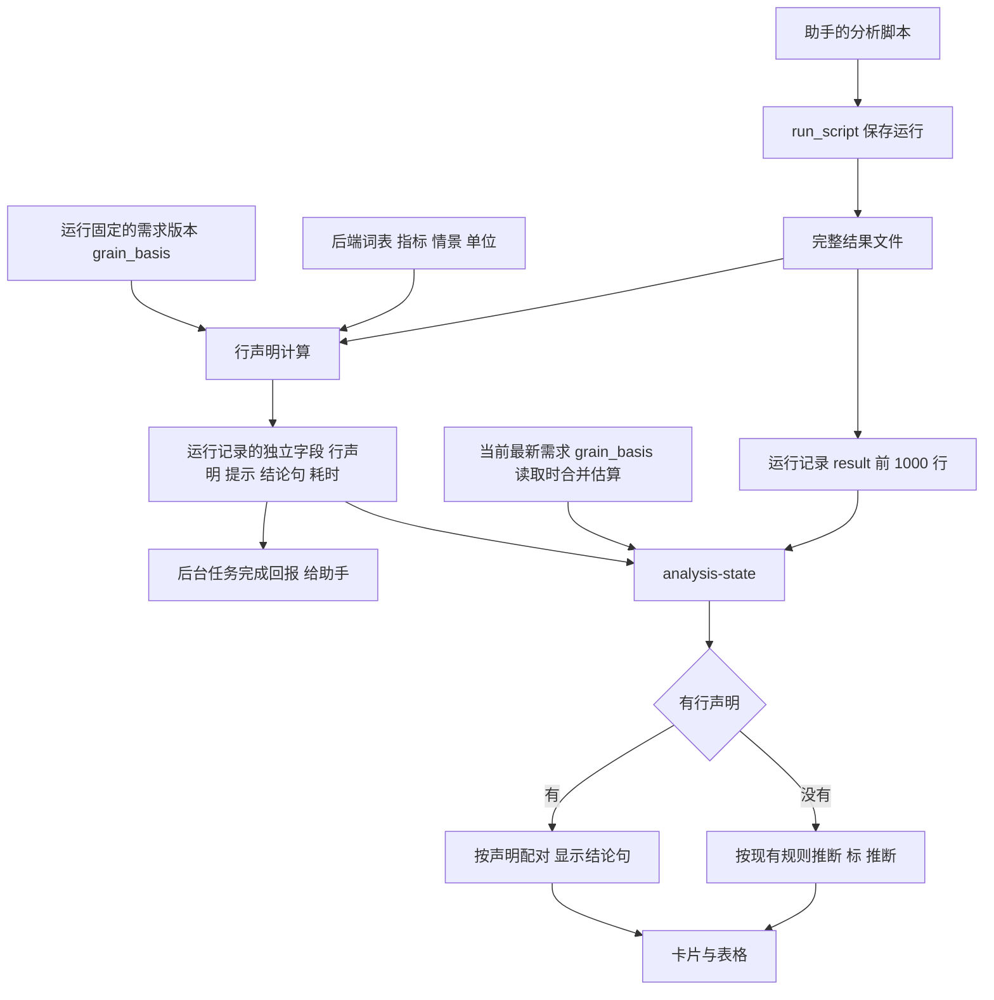
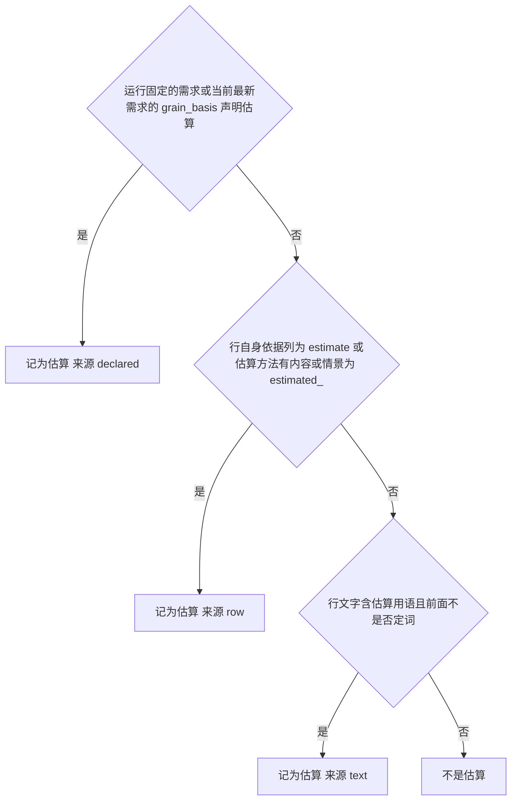

# Conclusion-First UI Follow-ups - Plan

## Goal Capsule

- **Objective:** 财务经理打开一个任务，首屏的结论数字自己说清是实际还是预算、哪个期间、是不是估算、按什么口径；长时间的操作说清在做什么；品牌和当前位置用金色，警告用自己的颜色。
- **Means:** 后端在保存运行时为每一行写下声明，前端只按声明配对和显示，旧运行保留推断并标「推断」（KTD1、KTD2）。标题栏和警示色按 KTD13、KTD14 调整，两个 libraries.dev 效果按 KTD15 试做。
- **Authority:** PRODUCT.md 和 DESIGN.md（本计划 U11、U12 更新其中的金色规则）先于本计划；本计划的 R 管产品行为，KTD 管实现机制；代码约定最后。
- **Stop conditions:** 任何改动让旧分析重跑变成「不可复算」时停下重新规划；任何一处把估算显示成普通预算时停下；两个试做效果任一门槛不过，撤掉并卸载依赖，不硬留。
- **Execution profile:** Deep。在 PR #42、#43 合并后开工。每个 PR 合并前跑一轮对抗评审（评审员加 2 到 3 名复核员），按项目惯例。
- **Who finishes:** 由 ce-work 或开发者按单元实施；合并由用户决定。

---

## Product Contract

### Summary

这份计划收尾结论优先改版留下的八项，并调整标题栏配色。核心是让结果行的含义由后端声明，不再由前端从名称和措辞里猜；同时补齐显示缺口、成果库状态、等待时长实测、首屏回归检查和页面拆分。标题栏品牌字改成金色，按钮只在当前、悬停、聚焦时用金色，警告另起一个颜色，并试做 Liquid metal 金色品牌字和 Gooey 页签滑动指示器。

### Problem Frame

PR #42、#43 把答案放到了首屏，但配对和估算判断全在前端靠名称和措辞推断。三轮评审里每一轮都找到新的写法漏网，最后一次是华宸 run 269d9fd9 把区域预算写成「推算」，卡片把估算显示成了批复预算。#29 当年用文字扫描标估算也是四轮不收敛，最后改成确定性的「估算值声明」才稳定。

评审还留下几处显示问题：切页签后财务运行的结果提示消失，单位写「比率」的百分数显示成 0.90%，单位写「-」的比率被当成金额，后端在一侧缺一个科目时仍把比较标为完整。成果库只列旧锁库流程的产出物，没有状态，也看不到分析文稿和导出件。

标题栏目前全是中性色。用户要求品牌字和按钮用应用里的金色。这个金色同时是警告、错误和删除操作的颜色，放上标题栏之后，品牌会读成警告。

### Requirements

**结果行的含义**

- R1. 脚本运行保存时，后端为每一行写明角色（实际、预算、差异、比率）、覆盖期间、是否估算和口径说明；前端按声明配对和显示。
- R2. 没有声明的脚本长表继续按现有规则推断，推断得出的卡片和结论标「推断」；财务引擎和结构已明确的结果不标。
- R3. 估算标记只增不减：声明、运行依据的需求、行自身文字三者任一说是估算，就显示估算。
- R4. 声明记下它依据的需求版本；需求改版后，卡片说明依据的是旧版本。
- R5. 助手写的脚本结果行有一份约定（指标名、情景名、单位）；不符合约定时运行照常成功，结果区和助手都收到中文提示。
- R6. 声明完整的配对结果有一句由后端用数字拼出的结论，标明来自脚本结果，不写成已核验，不能作为事实进入文稿。

**显示缺口**

- R7. 财务运行的成功或失败提示，在切页签、首次运行后页面重排、切任务回来后仍然看得到，且只出现在发起它的任务里。
- R8. 比率按申报单位显示：比率和 ratio 是小数，% 和 pct 是百分数，「-」表示未标单位；未标单位的比率不当金额配对，卡片和其他结果显示一致。
- R9. 预算差异里一侧缺某个科目时，这一行标为「缺项」，不写成完整；经理选择整组按 0 计入的情况保持原样。

**成果库**

- R10. 成果库同时列出分析文稿和导出件，显示它们已有的阅核和发布状态；旧流程产出物的状态列留空，只显示一个短横。

**等待与守护**

- R11. 记录财务运行、脚本运行和资料导入的实际等待时长（从点击到结果返回）；据实测决定是否加 mono Border beam，超过 3 秒才加，加之前征得用户同意。
- R12. 1280×800 下打开有结果的任务，分析结果不滚动就能看到结论条或关键数卡片；默认视图里没有 12 位 ID、英文枚举和英文列名。自动检查守住这一条。
- R13. Analysis.tsx 拆成 views/analysis 下的模块，行为不变。

**标题栏与颜色**

- R14. 标题栏「FA Foundry」文字用品牌金色；标题栏按钮平时保持中性，只有当前页签、悬停和聚焦时用金色，当前页签另有一个不靠颜色的标识。
- R15. 警告、错误、删除和输入错误改用单独的警示色，金色只用于品牌、当前位置、选择、焦点和原有的历史标记；浅色深色各一套，原生对话皮肤同步。
- R16. 试做 Liquid metal 金色品牌字和 Gooey 页签滑动指示器；各自过了 KTD15 的门槛才保留，否则撤掉代码并卸载依赖。

### Key Decisions

- **成果库并入文稿和导出件。** 复用已有的阅核、发布状态，旧流程不新增状态记录。（`session-settled: user-directed`，放弃的选项是给旧流程产出物补状态记录、或这一项不做，理由是文稿和导出件本来就有状态） Governs R10
- **警示色另起一个颜色。** 金色只留给品牌和位置。（`session-settled: user-directed`，放弃的选项是保持同一个金色、或标题栏另用更浅的金色，理由是避免品牌读成警告，也避免界面里有两种金） Governs R15
- **标题栏金色只用于当前、悬停、聚焦。** （`session-settled: user-directed`，放弃的选项是所有标题栏按钮常态金色，理由是更贴近「金色服务于位置」的既有规则） Governs R14
- **允许试做两个效果。** （`session-settled: user-directed`，放弃的选项是不计划 Gooey 和 Liquid metal，理由是带门槛的试做，不过就撤） Governs R16
- **约定只警告，不拒绝运行。** （`session-settled: user-approved`，放弃的选项是拒绝不合规的运行，理由是助手产出的结果不应因格式问题整份作废） Governs R5
- **旧运行保留推断并标明。** （`session-settled: user-approved`，放弃的选项是删除前端推断，理由是已有运行没有声明，删掉就没有卡片） Governs R2
- **Border beam 实测后再定。** （`session-settled: user-approved`，放弃的选项是立即加上，理由是目前只有合成数据的时长） Governs R11
- **估算必须标出。** （`session-settled: user-directed`，放弃的选项是不标，理由是issue #24 的用户要求） Governs R3

### Success Criteria

- 华宸两个真实运行（84b65b7d、269d9fd9）里，所有区域预算都显示「预算（估算）」，新运行靠声明，旧运行靠推断并标「推断」。
- 改动前保存的分析版本在改动后重跑，结果仍是「可复算」。
- 首屏回归检查在浅色和深色下都通过。
- 助手在结果不合约定时能从运行结果里读到中文提示，运行状态仍是成功。

### Scope Boundaries

- 助手对话区（harness 原生视图）的进度显示不在本计划内，主窗口目前拿不到它的信号。
- 标题栏下方任务行的图标、F 字 LOGO 图片、harness 自带的 44px 顶栏都不改。
- 不回填旧运行记录；运行记录保持不可变，旧运行走推断。
- 前端不做任何金额运算，结论句只在后端生成。
- Excel 加载项（excel-addin）的配色不随本计划调整。

#### Deferred to Follow-Up Work

- 若实测财务运行超过 3 秒，Border beam 的安装和接入另开一次改动，届时先征得用户同意。
- 成果库里旧流程产出物的阅核、发布状态，等旧锁库流程重新评估时再说。

### Sources

- 上游方案：docs/plans/2026-09-27-ui-conclusion-first-proposal.md
- 估算标注的确定性设计：issue #24 及其 PR #31（估算值声明）；#29 文字扫描方案四轮不收敛后被替换。
- 名称分类器教训：PR #12、#13、#38 的回归记录，规则是读线索要宽，拒绝要窄，两个方向都要测。
- 围栏规则：docs/plans/2026-09-01-1900-feat-foundry-fence-scope-plan.md，每个数字说清来源。
- 原生皮肤主题：docs/reviews/2026-09-08-frontend-shadcn-harness-review.md，原生视图不继承宿主 CSS 变量。
- libraries.dev 参考：metal-fx（MetalText，preset gold，WebGL2，深色效果最好，不自动处理减少动态效果）、liquid-gooey（Liquid.Item effect move，适合页签指示器）。

---

## Planning Contract

### Key Technical Decisions

- KTD1. **新增字段都放在运行记录的 result 之外。** 行声明、结论句、约定提示、耗时写在运行记录的独立字段里。finance 和 script 的 output_hash 都覆盖 result，改动 result 会让旧版本重跑变成不可复算，也会让已固定 output_hash 的文稿引用失效。
- KTD2. **行声明在保存运行时计算，依据运行固定的需求版本。** 需求版本以运行记录的 requirements_id 为准。grain_basis 从这个编号指向的需求记录读取，指纹也对这条记录重新计算后存下，不复用运行层的 requirements_semantic_fingerprint，因为重跑旧分析版本时，运行层的指纹取自执行时最新的需求，编号却是分析版本绑定的那一版。其余输入是行自身的组织、期间、情景、单位、标签和依据列，以及 KTD4 的声明词表。声明连同需求编号、指纹和规则版本一起存下，前端比较当前需求版本，不一致时在卡片上说明依据的是旧版本（R4）。规则版本由词表、单位表、估算用语合成，读取运行时发现存下的版本旧于当前规则，就用完整结果文件和运行固定的需求重算一次再返回，运行记录本身不改。
- KTD3. **估算判断统一在后端做，取并集。** 以下任一成立就记为估算，并记下依据来源。运行固定的需求版本里 grain_basis 声明为估算；该任务当前最新需求版本里 grain_basis 声明为估算，这一项在读取时合并，因为助手常在运行之后才补 grain_basis（华宸 692ab0b6 就是在 84b65b7d 保存 37 秒后才存下的）；行自身的依据列（basis、row_basis 等）为 estimate、估算方法列有实际内容、情景名为 estimated_ 开头；行文字里的估算用语（估算、推算、预估、估计、测算、estimat，前面紧挨否定词时不算）。前端现有的文字扫描只服务没有声明的旧运行，只能加估算，不能去掉。
- KTD4. **声明词表在 result_semantics.py 新建一份。** 内容是把 businessResults.ts 里的长表情景表、带期间后缀的情景规则和 KTD9 的单位表移到后端，再并上运行固定的需求版本里各项已列出的指标名和情景名。finance_requirements 的 RATIO_SCENARIOS、METRIC_LABELS 和 finance_explanations 的 METRIC_LABELS 保持原样，它们是需求闭合判断的依据，合并会改变哪些需求项能闭合。约定提示不对需求版本里已列出的名字报警。前端的同名列表只给旧运行兜底，加一条测试守住前后端词表一致。
- KTD5. **声明、提示、结论句都读完整结果文件。** 运行记录只存前 1000 行，完整结果文件读不到时，声明标为不完整，不生成结论句。
- KTD6. **约定提示走现有诊断形状。** 提示用 severity、code、中文 message 的诊断格式（与 comparison_group_missing 同形），写进运行记录并放进后台任务的完成回报，让助手能读到；运行记录里现有的英文 warnings 句子换成中文。助手看到的工具说明在 dsh-plugin 和 foundry/resources/dsh-plugin 两份里同步更新。
- KTD7. **结论句由后端生成，只用于声明完整的配对。** 做法仿照财务差异的 amount_change_display，一组里只要有一行是推断或声明不完整，就不生成。句子带「脚本结果」依据，不进入文稿的可引用事实。
- KTD8. **缺项用新的比较状态，财务运行记下计算版本。** 一侧缺科目的行记为 partial（界面显示「缺项」），需求闭合和解释检查把它当作未完整。财务运行记录新增计算版本字段，放在 result 之外；指纹里的 finance-v1 不改，改了会让所有财务运行第一次重跑都找不到旧运行。重跑时先和同指纹、同计算版本的旧运行比较，规则照旧。只有更早计算版本的旧运行时，输出哈希相同记为可复算，不同记为未验证复算，不记为不可复算。旧运行按原记录显示。
- KTD9. **单位是一张显式的表。** 比率和 ratio 为小数，% 、pct 和百分比为百分数，「-」为未标单位；未标单位的比率不参与金额配对，原样显示并注明「未标单位」，同时触发约定提示。只按申报单位换算，不按名称猜。
- KTD10. **财务操作的结果提示提到 Analysis 一层，按任务存。** 做法与已提升的运行中状态相同，键是任务，值是最近一次操作的名称、结果和时间；工作台卸载再挂载后读回，别的任务看不到。
- KTD11. **成果库是一份合并清单。** 读取层把旧流程产出物、分析文稿、登记过的导出件合成一份列表，每行带类型和来源，按时间排序；键用类型加各自的 id，避免序号撞车。文稿每条修订链只列最新一版，状态取该修订保存时的阅核、发布状态；导出件显示它来源修订的状态，不在「已认可且已归档」时写「分析草稿·待复核」。旧流程行的状态列留空，只显示一个短横。
- KTD12. **耗时分两层记录。** 运行记录写引擎耗时（脚本运行沿用 runner 已算出的 duration_seconds，财务运行新增，取消和超时也记）。用户实际等待的时长在渲染层计，从点击开始，到 track() 包住的整次操作和随后的刷新完成为止，再经一个只写日志的 IPC 交给主进程写入本机计时日志，不外传。资料导入和来源刷新从文件对话框返回后才开始计时，主进程的处理函数里包着系统文件对话框，在那里计时会把挑文件的时间算进去。Border beam 的决定看渲染层的数字，IPC 单次调用时长只作辅助。
- KTD16. **首屏检查扩展现有的 verify_ui_workspace。** 沿用 tools/verify_ui_workspace.cjs 的打包应用加合成数据的做法，种子数据补三类，分别是一个财务差异运行、一个带声明的脚本长表运行和一个无声明的旧格式运行；浅色深色各截一次。
- KTD13. **标题栏样式限定在标题栏内。** .fnd-head__tab 也被其他页面的返回按钮和 Formulator 按钮复用，金色规则只写在 .fnd-head 作用域里。当前页签用金色文字加一条金色下划线，悬停用金色文字，聚焦保留独立的焦点框；金色文字在白底和选择底色上的对比度用测试守住。
- KTD14. **警示色是一组新 token。** 新增警示色三件套，主色、-line、-fill，浅色深色各一套，与 --fnd-mark-outside、-line、-fill 一一对应，色相与金色分开，主色在白底和深色底上对比度不低于 4.5 比 1。错误、删除、输入错误、警告徽标原来用哪一件，就换成对应的警示色 token，边框和浅底也换，否则会剩下金色边框配警示色文字；外部引用等历史标记保留原来的金色。DESIGN.md 的前置 YAML、颜色说明和金色规则同步改写，原生对话皮肤 skin.ts 增加这组颜色并映射原生客户端的危险色别名，skin.test.ts 锁住。
- KTD15. **两个试做效果各有保留门槛。** Liquid metal 用 MetalText 做品牌字。MetalText 没有 preset 和 paused 参数，材质固定为 chromatic，只接受一个基础文字色 color，所以 color 传 U12 品牌字所用的同一个金色 token 的值，浅色深色各取一次；减少动态效果时不挂载 MetalText，直接显示 U12 的静态金色文字；不支持 WebGL2 时同样回退到静态文字。应用的 main.tsx 包了 StrictMode，开发版的双挂载会冻住 metal-fx 的共享渲染器，效果以打包版为准。Gooey 用 Liquid.Item 的 move 效果做工作区、成果库之间的滑动指示器。两者的保留门槛列在下面，最后一条只适用于 Liquid metal。
  - 打包后的应用里正常渲染。
  - 空闲时 CPU 和 GPU 占用没有可见上升；两者都保留时，合在一起再量一次。
  - 浅色深色都清楚。
  - 减少动态效果时静止。
  - 键盘操作、aria-current 和读屏不变。
  - 文字不发糊。
  - 仅 Liquid metal，品牌字在打包版浅色、深色截图里取样的主色与品牌金 token 同色相，对标题栏底色的对比度不低于 4.5 比 1。任一不过就撤掉并卸载依赖。依赖锁定版本，放 devDependencies，由 Vite 打包。

### High-Level Technical Design

结果行从脚本产出到卡片的路径如下。

估算判断在后端的取值如下，前端旧运行兜底只加不减。

标题栏按钮各状态的配色如下。

| 状态 | 文字 | 背景 | 其他标识 |
| --- | --- | --- | --- |
| 平时 | 次要文字色 | 透明 | 无 |
| 悬停 | 金色 | 透明 | 无 |
| 当前页签 | 金色 | 选择底色 | 金色下划线 |
| 聚焦（键盘） | 保持所在状态 | 保持所在状态 | 独立焦点框 |
| 禁用 | 保持现有禁用透明度 | 透明 | 无 |

### Assumptions

- 实施在 PR #42、#43 合并到 main 之后开始。若届时仍未合并，分支建在 #43 之上。

### Risks & Dependencies

| 风险 | 缓解 |
| --- | --- |
| 行声明放进 result 导致旧运行重跑变成不可复算 | KTD1 规定放在 result 之外；U2 用改动前后的同一版本重跑做回归测试 |
| 缺项状态改变财务输出，旧上下文重跑对不上 | KTD8 记下计算版本，输出因此变化的记为未验证复算；测试覆盖旧格式运行的显示 |
| 声明漏掉只写在文字里的估算 | KTD3 取并集；用 269d9fd9 的「推算」行做测试 |
| 警示色替换漏掉某处用法 | U11 先列出所有使用点再逐一替换，按类别写测试 |
| 金色文字在选择底色上对比度刚好 4.5 比 1 | U12 在 tokens.test.ts 增加对比度断言，不达标就调深 |
| Liquid metal 在浅色主题效果差、WebGL 常驻耗电 | KTD15 门槛，不过就撤 |
| Analysis.tsx 拆分与后续单元冲突 | 拆分作为第一个单元，纯搬移，保留 views/Analysis.js 的导出 |

### Sequencing

先拆分页面（U1），再做后端语义（U2 到 U5），然后前端消费和显示修补（U6 到 U8），接着实测与首屏守护（U9、U10），最后是标题栏和颜色（U11 到 U14）。U11 必须在 U12 之前，U13、U14 在 U12 之后。

---

## Implementation Units

| U-ID | 标题 | 主要文件 | 依赖 |
| --- | --- | --- | --- |
| U1 | Split Analysis.tsx | app/src/views/Analysis.tsx, app/src/views/analysis/* | 无 |
| U2 | Backend row declarations | foundry/analysis.py, foundry/finance_requirements.py | 无 |
| U3 | Script result contract warnings | foundry/analysis.py, foundry/analysis_jobs.py, dsh-plugin/analysis.js | U2 |
| U4 | Backend conclusion sentence | foundry/analysis.py | U2 |
| U5 | Variance partial status | foundry/finance_variance.py, foundry/finance_requirements.py | 无 |
| U6 | Frontend consumes declarations and unit table | app/src/views/analysis/businessResults.ts, BusinessResultView.tsx | U1, U2, U4, U5 |
| U7 | Lift finance outcome per task | app/src/views/Analysis.tsx 拆分后的工作台模块 | U1 |
| U8 | Deliverables union list | app/electron/reads.ts, app/src/views/Deliverables.tsx | 无 |
| U9 | Wait timing | foundry/analysis.py, foundry/finance_service.py, app/electron/ipc/register.ts | U1 |
| U10 | First-screen visual check | tools/verify_ui_workspace.cjs | U6 |
| U11 | Warning color token | app/src/styles/tokens.css, DESIGN.md, app/electron/harness/skin.ts | 无 |
| U12 | Gold title bar | app/src/components/Shell.tsx, app/src/components/components.css | U11 |
| U13 | Trial Liquid metal wordmark | app/src/components/Shell.tsx, app/package.json | U12 |
| U14 | Trial Gooey tab indicator | app/src/components/Shell.tsx, app/package.json | U12 |

### U1. Split Analysis.tsx

- **Goal:** 把 Analysis.tsx 拆成 views/analysis 下按面板划分的模块，行为和界面不变。
- **Requirements:** R13
- **Dependencies:** 无
- **Files:** app/src/views/Analysis.tsx；新建 app/src/views/analysis/ 下的 FinanceWorkbench.tsx、FinanceAdjustmentPanel.tsx、FinanceChartPanel.tsx、SourceRefreshPanel.tsx、WorkbookPanel.tsx、StructurePanel.tsx、DraftEditor.tsx、MaterialityFields.tsx、ExplanationQualityPanel.tsx、Methods.tsx、AnalysisEditor.tsx、shared.ts（unwrap、选项构造、scopeSummary 等共用函数）；测试 app/tests/analysis.test.tsx
- **Approach:**
  1. 按现有面板边界搬移，一个组件一个文件，具名导出，import 带 .js 后缀，沿用 views/analysis 的约定。
  2. unwrap 和选项构造函数移到共用模块，其余文件从那里引用。
  3. Analysis.tsx 只留外壳组件，继续从 views/Analysis.js 导出 Analysis，测试的导入路径不变。
- **Execution note:** 纯搬移，不顺手改逻辑；每搬一块跑一次整套前端测试。
- **Patterns to follow:** app/src/views/analysis/RunPanel.tsx、StructureProposalCard.tsx 的文件组织。
- **Test scenarios:**
  - 现有 app/tests/analysis.test.tsx 全部通过，测试文件不改。
  - tsc 通过，没有循环引用。
- **Verification:** 整套前端测试与构建通过，Analysis.tsx 少于 600 行，界面截图与拆分前一致。

### U2. Backend row declarations

- **Goal:** 脚本运行保存时为每一行计算声明，存在运行记录 result 之外。
- **Requirements:** R1、R3、R4
- **Dependencies:** 无
- **Files:** foundry/analysis.py（run_script 保存路径）；新建 foundry/result_semantics.py（声明计算与词表）；foundry/finance_requirements.py（读取 grain_basis 与词表）；app/src/bridge.ts（AnalysisRun 类型增加声明字段）；测试 tests/test_result_semantics.py（新建）、tests/test_analysis_runtime.py
- **Approach:**
  1. 声明逐行给出角色、期间标识、是否估算及依据来源、口径标签，并在运行层记下 requirements_id、语义指纹、是否完整（KTD2、KTD5）。
  2. 估算按 KTD3 取并集，词表按 KTD4 统一。
  3. 声明写在运行记录的独立字段，不进 result（KTD1）。
  4. 读完整结果文件；读不到时标为不完整。
- **Execution note:** 先写一个失败的测试，断言运行记录带有声明字段，且 output_hash 等于改动前保存的值，再动保存路径。脚本运行的复算状态本来就固定为未验证复算，不拿它做回归依据。
- **Patterns to follow:** foundry/finance_variance.py 行上的 semantics 与 comparison_status；foundry/finance_requirements.py 的 _organization_warnings。
- **Test scenarios:**
  - 华宸形状的长表（actual_1_8、budget_1_8、revenue_variance、revenue_achievement_ratio）得到正确角色和期间标识。
  - 区域预算行标签含「推算」、grain_basis 为空时，声明仍记为估算，来源为文字。
  - grain_basis 声明为估算、标签里没有估算用语时，记为估算，来源为声明。
  - 标签含「非估算」「不含估算调整」时不记为估算。
  - 1500 行结果、配对在第 1200 行时，声明来自完整文件；删掉完整文件后声明标为不完整。
  - 改动前保存的分析版本重跑，output_hash 与 result 和改动前那次运行逐字节相同，复算状态与改动前相同。
  - 需求在运行后改版，运行记录里的 requirements_id 和指纹仍指向运行时的版本。
  - 分析版本绑定旧需求、最新需求已改版时重跑，声明里的需求编号、指纹和估算来源都指向旧版。
  - 运行保存后再保存带 grain_basis 的需求，标签里没有估算用语的区域预算行在读取时记为估算，来源为声明。
  - 依据列为 estimate、估算方法有内容、情景为 estimated_budget 的行，标签里没有估算用语时仍记为估算。
  - 规则版本升级后读取已存的声明运行，按新规则返回，运行记录文件不变。
- **Verification:** 两个华宸真实运行的数据重跑后，所有区域预算行记为估算。

### U3. Script result contract warnings

- **Goal:** 助手写的结果行不合约定时给出中文提示，运行照常成功，助手能读到提示。
- **Requirements:** R5
- **Dependencies:** U2
- **Files:** foundry/result_semantics.py；foundry/analysis.py；foundry/analysis_jobs.py（完成回报）；dsh-plugin/analysis.js 与 foundry/resources/dsh-plugin/analysis.js（工具说明）；app/src/views/analysis/RunPanel.tsx（显示提示）；测试 tests/test_result_semantics.py、tests/test_analysis_jobs.py、tests/test_r4_finance_tool_contracts.py、app/tests/run-panel.test.tsx
- **Approach:**
  1. 约定检查在 U2 的声明计算里一并完成，提示按 KTD6 的诊断形状写入运行记录。
  2. 后台任务完成回报带上提示代码和中文说明。
  3. 运行记录里现有的英文 warnings 句子换成中文。
  4. 工具说明两份同步写入结果行约定，包括指标名、情景名、单位表、口径标签和依据列（估算行写 basis 为 estimate）。
  5. 行文字含估算用语而依据列不是 estimate 时，给一条补写依据列的提示。
  6. 结果区在结果表上方显示提示，默认折叠为一行摘要。
- **Patterns to follow:** foundry/finance_variance.py 的 comparison_group_missing；finance_requirements.py 的 _organization_warnings。
- **Test scenarios:**
  - 单位写「-」的比率行产生一条「未标单位」提示，运行状态为成功。
  - 情景名既不在声明词表、也不在运行固定的需求版本里的行产生提示，不影响其他行的声明；需求里列出的 budget_bud_fy 这类名字不报警。
  - 标签写「推算」、依据列为空的行产生补写依据列的提示，这一行仍记为估算。
  - 完全符合约定的运行没有提示，运行记录与改动前逐字节一致的字段保持一致（除新增字段）。
  - 后台任务完成回报里能读到提示代码。
  - 工具说明两份内容一致，tests/test_r4_finance_tool_contracts.py 通过。
  - 结果区显示中文提示，页面上没有英文 warnings 句子。
- **Verification:** 用助手跑一次不合约定的脚本，助手在回报里看到提示并能据此修正。

### U4. Backend conclusion sentence

- **Goal:** 声明完整的配对结果由后端生成一句结论，前端显示并标明来自脚本结果。
- **Requirements:** R6、R2
- **Dependencies:** U2
- **Files:** foundry/result_semantics.py；foundry/analysis.py；app/src/views/analysis/BusinessResultView.tsx；测试 tests/test_result_semantics.py、app/tests/business-result-components.test.tsx
- **Approach:**
  1. 按 KTD7，只对全部成员都有声明的配对组生成句子，句子包含实际、预算、差异、达成率和估算说明。
  2. 句子写在运行记录独立字段，带「脚本结果」依据。
  3. 前端显示在关键数卡片上方；旧运行沿用前端现有的显示方式并标「推断」。
- **Patterns to follow:** foundry/finance_variance.py 的 _display_amount_change；app/src/views/analysis/RunPanel.tsx 的 FinanceVarianceHeadline。
- **Test scenarios:**
  - 华宸集团收入、利润配对生成「1-8 月集团收入比预算少……（达成 94.5%）」形式的句子，数字与结果行一致，不做前端运算。
  - 区域预算为估算时，句子写明区域预算为估算。
  - 组内有一行推断时不生成句子。
  - 句子不出现在文稿的可引用事实里。
  - 同一数据的旧运行和新运行，显示的数字一致，只有依据标签不同。
- **Verification:** 华宸真实数据副本上，分析结果首屏出现结论句。

### U5. Variance partial status

- **Goal:** 预算差异里一侧缺某个科目时标为缺项，不再写成完整。
- **Requirements:** R9
- **Dependencies:** 无
- **Files:** foundry/finance_variance.py；foundry/finance_metrics.py（每侧科目证据）；foundry/finance_requirements.py（闭合判断）；foundry/finance_explanations.py；foundry/finance_service.py（计算版本号）；app/src/views/analysis/RunPanel.tsx（缺项显示）；测试 tests/test_finance_variance.py、tests/test_finance_requirements.py、app/tests/run-panel.test.tsx
- **Approach:**
  1. 组在两侧都存在、某科目在一侧没有来源行时，该行 comparison_status 记为 partial（KTD8）。
  2. 经理选择整组按 0 计入的路径保持 assumed_zero。
  3. 需求闭合和解释检查把 partial 当作未完整。
  4. 财务运行记录写入计算版本，指纹不变，重跑按 KTD8 比较复算。
  5. 结论条和表格对 partial 行显示「缺项」，结论句不引用缺项行。
- **Patterns to follow:** finance_variance.py 现有的 missing 与 assumed_zero 分支。
- **Test scenarios:**
  - 实际有收入和成本、预算只有收入时，成本行为 partial，利润行也不标完整，成本相关需求保持未闭合。
  - 两侧科目齐全时仍为 complete。
  - 整组缺失且经理选择按 0 计入时仍为 assumed_zero。
  - 旧格式运行（没有 partial）按原记录显示，不报错。
  - 两侧科目齐全的差异运行在升级后重跑，输出与升级前相同，仍为可复算。
  - 一侧缺科目的差异运行在升级后重跑，输出变了，记为未验证复算，不是不可复算；再重跑一次记为可复算。
  - 损益、情景、量价运行在升级后重跑仍为可复算。
- **Verification:** 后端测试和前端运行面板测试通过，华宸数据上完整的比较不受影响。

### U6. Frontend consumes declarations and unit table

- **Goal:** 前端有声明时按声明配对和显示，没有声明时走推断并标「推断」，单位按显式表换算。
- **Requirements:** R1、R2、R3、R4、R8
- **Dependencies:** U1、U2、U4、U5
- **Files:** app/src/views/analysis/businessResults.ts；app/src/views/analysis/BusinessResultView.tsx；app/src/views/analysis/RunPanel.tsx；测试 app/src/views/analysis/businessResults.test.ts、app/tests/business-result-components.test.tsx
- **Approach:**
  1. 有声明的运行直接按角色和期间标识配对，估算取声明值（R3 并集已在后端完成）。
  2. 没有声明的脚本长表沿用现有推断，卡片和结论标「推断」；声明行与推断行不跨组配对。
  3. 需求版本与运行记下的不一致时，卡片注明「依据旧版需求」。
  4. 单位按 KTD9 的表换算，卡片与其他结果共用同一个格式化函数。
  5. 财务引擎、结构化汇总、SQL 结果不显示「推断」。
- **Patterns to follow:** 现有 longScenarioPairing 的分组与跳过逻辑。
- **Test scenarios:**
  - 有声明的华宸运行：区域卡片显示「预算（估算）」，没有「推断」标记。
  - 没有声明的旧运行：卡片显示「推断」，区域预算仍按文字标估算。
  - 声明的实际行与推断的预算行不配成一张卡。
  - achievement_pct 单位为比率、值 0.945，卡片和其他结果都显示 94.50%；单位为 %、值 94.5 时也显示 94.50%。
  - 单位为「-」的 ratio 行不作为预算金额配对，原样显示并注明未标单位。
  - management_pnl 运行和结构化汇总运行不显示「推断」。
  - 运行依据的需求已改版时，卡片注明依据旧版需求。
- **Verification:** 两个华宸真实运行和合成旧运行在开发版里分别显示声明和推断两种卡片，估算标记齐全。

### U7. Lift finance outcome per task

- **Goal:** 财务操作的成功或失败提示在工作台卸载重挂后仍然可见，只属于发起它的任务。
- **Requirements:** R7
- **Dependencies:** U1
- **Files:** app/src/views/Analysis.tsx；U1 拆出的 app/src/views/analysis/FinanceWorkbench.tsx；测试 app/tests/analysis.test.tsx
- **Approach:** 按 KTD10，把最近一次财务操作的结果按任务存在 Analysis 一层，与已提升的运行中状态放在一起；工作台显示时读回，用户开始新操作时清除。
- **Patterns to follow:** Analysis.tsx 中已按任务存放的 financeRunning。
- **Test scenarios:**
  - 运行失败后切到资料页签再切回，失败提示仍在。
  - 首次运行生成分析版本、工作台从结果上方移到下方后，成功提示仍在。
  - 任务 A 的提示在切到任务 B 时不出现，切回 A 时还在。
  - 开始新的运行时，上一次的提示被替换为运行中状态。
- **Verification:** 前端测试通过，开发版里手动切页签确认。

### U8. Deliverables union list

- **Goal:** 成果库同时列出旧流程产出物、分析文稿和导出件，显示已有状态，并能打开各自的内容。
- **Requirements:** R10
- **Dependencies:** 无
- **Files:** app/electron/reads.ts（合并清单）；foundry/analysis.py 或 foundry/cli.py（列出各任务文稿与登记导出件的读取入口）；app/src/bridge.ts（清单行类型）；app/src/views/Deliverables.tsx；app/src/App.tsx（打开文稿、导出件的路由）；测试 app/tests/reads.test.ts、app/tests/views.test.tsx、tests/test_deliverables.py
- **Approach:**
  1. 按 KTD11 合成一份按时间排序的清单，每行带类型、任务、期间、状态和打开方式。
  2. 文稿每条修订链只列最新一版，状态取该修订的阅核、发布状态；导出件显示来源修订的状态。
  3. 打开文稿跳到该任务的文稿页签并选中这一版；打开 docx、pdf、html 导出件交给系统默认程序；旧流程行保持现有阅读器和导出按钮。
  4. 旧流程行的状态列留空，只显示一个短横。
- **Patterns to follow:** app/electron/reads.ts 的 deliverableGallery；Deliverables.tsx 现有列表与详情结构。
- **Test scenarios:**
  - 同一秒内有旧流程简报、文稿 v1、v2 和 v1 的 pdf 导出时，排序稳定，没有重复键。
  - 文稿只显示 v2 一行，状态为 v2 的阅核和发布状态。
  - v1 的 pdf 导出件显示 v1 的状态；未认可或未归档时写「分析草稿·待复核」。
  - 旧流程行的状态列只有一个短横，导出 Excel 按钮照常可用。
  - 点击文稿行跳到正确任务的文稿页签并选中这一版。
- **Verification:** 华宸数据副本的成果库里能看到分析文稿和导出件及其状态。

### U9. Wait timing

- **Goal:** 记录用户实际等待时长，并据实测决定是否加 Border beam。
- **Requirements:** R11
- **Dependencies:** U1
- **Files:** foundry/analysis.py（脚本运行保留 duration_seconds）；foundry/finance_service.py（财务运行耗时）；foundry/analysis_jobs.py（取消、超时耗时）；U1 拆出的 FinanceWorkbench.tsx 与资料导入入口（渲染层计时）；app/electron/ipc/register.ts（写计时日志的 IPC）；新建 docs/finance/2026-10-wait-timing-evidence.md（实测记录）；测试 tests/test_analysis_runtime.py、tests/test_analysis_jobs.py、app/tests/analysis-ipc.test.ts、app/tests/analysis.test.tsx
- **Approach:**
  1. 按 KTD12 在运行记录写引擎耗时，失败、取消、超时也写，放在 result 之外。
  2. 渲染层在 track() 包住的整次操作上计时，从点击到刷新完成，「保存口径并运行」这类两次调用自然算作一次用户等待；资料导入和来源刷新从文件对话框返回后才开始计。时长经只写日志的 IPC 由主进程写入本机计时日志。
  3. 用华宸数据副本跑一轮，记下中位数和最大值，写入实测记录。
  4. 若财务运行中位数超过 3 秒，另开改动并先征得用户同意再安装 Border beam。
- **Test scenarios:**
  - 脚本运行记录带 duration_seconds，与 runner 的值一致。
  - 取消的后台任务用任务时间戳算出耗时，并写入记录。
  - 计时日志只写本机文件，不包含金额或资料内容。
  - 「保存口径并运行」只记一条等待时长，包含随后的刷新。
  - 资料导入的等待时长不包含文件对话框打开的时间。
  - 两次运行耗时不同，output_hash 相同。
- **Verification:** 实测记录写好，Border beam 的去留有数字依据。

### U10. First-screen visual check

- **Goal:** 自动检查守住「首屏看到结论、默认视图没有技术标识」。
- **Requirements:** R12
- **Dependencies:** U6
- **Files:** tools/verify_ui_workspace.cjs；新建 tools/fixtures 下的种子数据生成脚本（按现有 tools 约定命名）；docs/verification 下的检查说明
- **Approach:**
  1. 按 KTD16 种子三类运行，打包应用在 1280×800 下打开分析结果。
  2. 断言结论条或第一张关键数卡片的上边缘在视口内。
  3. 可见文字里没有 12 位十六进制串、没有 actual_1_8 这类英文情景码、没有 value、metric_key 这类英文列名。
  4. 浅色和深色各截一次图，存到检查输出目录。
- **Patterns to follow:** tools/verify_ui_workspace.cjs 的 capture 与边界框断言。
- **Test scenarios:**
  - 有声明的脚本运行任务：卡片顶部在 800 像素以内。
  - 财务差异运行任务：结论条在首屏。
  - 旧格式运行任务：卡片带「推断」且在首屏。
  - 故意把财务设置移回结果上方时，检查失败。
- **Verification:** 检查在当前界面通过，人为回退时失败。

### U11. Warning color token

- **Goal:** 警告、错误、删除改用新的警示色，金色不再承担警告。
- **Requirements:** R15
- **Dependencies:** 无
- **Files:** app/src/styles/tokens.css；app/src/styles/shadcn-bridge.css（destructive 映射）；app/src/components/ui/button.tsx、badge.tsx、dropdown-menu.tsx；app/src/views/analysis.css；app/src/components/financial-controls.css；app/electron/harness/skin.ts；DESIGN.md；测试 app/tests/tokens.test.ts、app/tests/skin.test.ts
- **Approach:**
  1. 先列出 --fnd-mark-outside 的全部使用点，按「错误、删除、输入错误、警告」和「历史标记」两类分开。
  2. 按 KTD14 新增警示色三件套，前一类原来用主色、-line、-fill 哪一件就换成对应的警示色 token，后一类保留金色。
  3. skin.ts 的浅色深色主题增加警示色，并映射原生客户端的危险色别名。
  4. DESIGN.md 前置 YAML 增加警示色，改写颜色说明和金色规则。
- **Patterns to follow:** tokens.css 现有浅色、深色两块的写法；skin.test.ts 锁定 token 的方式。
- **Test scenarios:**
  - 警示色与金色的色值不同，在白底、深色底上对比度都不低于 4.5 比 1。
  - destructive 按钮、错误消息、aria-invalid 边框使用警示色，它们的边框和浅底也不再是金色。
  - 外部引用等历史标记仍为金色。
  - skin.ts 的警示色与 tokens.css 一致，skin.test.ts 通过。
- **Verification:** 浅色深色截图里，删除按钮和错误消息不再是金色，原生对话里的错误提示颜色与宿主一致。

### U12. Gold title bar

- **Goal:** 标题栏品牌字用金色，按钮只在当前、悬停、聚焦时用金色。
- **Requirements:** R14
- **Dependencies:** U11
- **Files:** app/src/components/Shell.tsx；app/src/components/components.css；DESIGN.md（nav-current 组件与金色规则）；测试 app/tests/views.test.tsx、app/tests/tokens.test.ts、app/tests/harness.test.ts
- **Approach:**
  1. 品牌字颜色改为金色 token，浅色深色随 token 切换。
  2. 按 KTD13 把标题栏按钮的金色规则限定在 .fnd-head 作用域内，按高层设计里的状态表实现。
  3. 当前页签加一条金色下划线作为不靠颜色的标识。
  4. DESIGN.md 的 nav-current 组件描述和金色规则改写，金色用于品牌、当前位置、选择、焦点和历史标记。
- **Patterns to follow:** components.css 里 .fnd-head__help 的悬停与聚焦写法；成果页签已有的 1px 金色下划线。
- **Test scenarios:**
  - 当前页签的 aria-current 仍为 page，文字为金色，有下划线。
  - 非当前页签平时为次要文字色，悬停变金色。
  - 键盘聚焦时焦点框可见，与金色文字不混在一起。
  - 金色文字在标题栏底色和选择底色上，浅色深色对比度都不低于 4.5 比 1。
  - 其他页面复用 .fnd-head__tab 的返回按钮和 Formulator 按钮颜色不变。
  - .fnd-head 高度不变，harness.test.ts 通过。
- **Verification:** 浅色深色截图对照状态表逐项核对。

### U13. Trial Liquid metal wordmark

- **Goal:** 试做 Liquid metal 金色品牌字，过门槛才保留。
- **Requirements:** R16
- **Dependencies:** U12
- **Files:** app/package.json、app/package-lock.json（metal-fx，锁定版本，devDependencies）；app/src/components/Shell.tsx；新建 app/src/components/MetalWordmark.tsx；测试 app/tests/views.test.tsx
- **Approach:**
  1. 先在锁定的 metal-fx 版本里核对 MetalText 的参数。按 libraries.dev 参考，它只有 children、font、color、strength、reflectionTargets，材质固定为 chromatic；如果锁定版本也是这样，按 KTD15 把品牌金 token 的值传给 color，浅色深色随 data-theme 切换。
  2. 减少动态效果时不挂载 MetalText，直接显示 U12 的静态金色文字；不支持 WebGL2 时同样回退。
  3. 按 KTD15 的门槛逐项检查，记录截图、取样色相和空闲占用。
  4. 不过门槛就删掉组件和依赖，保留 U12 的静态金色。chromatic 材质读不成品牌金时按不过门槛处理。
- **Execution note:** 这是试做，效果和占用以打包版为准（开发版的 StrictMode 双挂载会冻住共享渲染器），再决定写测试还是撤掉。
- **Test scenarios:**
  - 保留时：jsdom 下不支持 WebGL2，渲染回退文字「FA Foundry」，读屏名称不变。
  - 保留时：减少动态效果开启，不挂载 MetalText，显示静态金色文字。
- **Verification:** 门槛逐项有记录；保留或撤掉的决定写进 DESIGN.md 或提交说明。

### U14. Trial Gooey tab indicator

- **Goal:** 试做工作区、成果库之间的 Gooey 滑动指示器，过门槛才保留。
- **Requirements:** R16
- **Dependencies:** U12
- **Files:** app/package.json、app/package-lock.json（liquid-gooey，锁定版本，devDependencies）；app/src/components/Shell.tsx；app/src/components/components.css；测试 app/tests/views.test.tsx
- **Approach:**
  1. 用 Liquid.Item 的 move 效果做当前页签背后的指示器，填充色取选择底色，下划线保持金色。
  2. 减少动态效果时指示器直接落位，不做滑动。
  3. 按 KTD15 的门槛逐项检查，特别是文字清晰度和键盘切换。
  4. 不过门槛就撤掉，保留 U12 的静态样式。
- **Execution note:** 这是试做，先看效果再决定去留。
- **Test scenarios:**
  - 保留时：切换页签后 aria-current 正确，键盘 Tab 顺序不变。
  - 保留时：减少动态效果开启，指示器没有过渡动画。
- **Verification:** 门槛逐项有记录，去留有截图依据。

---

## Verification Contract

| 检查 | 命令或做法 | 适用单元 |
| --- | --- | --- |
| 前端测试 | 在 app 目录运行 `npx vitest run` | 全部前端单元 |
| 类型检查 | 在 app 目录运行 `npx tsc -p tsconfig.json --noEmit` | 全部前端单元 |
| 后端测试 | 在仓库根目录运行 `.venv/bin/python -m pytest -q`（含前端测试与类型检查） | 全部 |
| 构建 | 在 app 目录运行 `npm run build` | 全部前端单元 |
| 首屏检查 | 设置 PLAYWRIGHT_MODULE 后运行 `node tools/verify_ui_workspace.cjs` | U10 及之后 |
| 真实数据核对 | 复制华宸 QA 数据到临时目录，开发版 Vite 5273 加 Electron CDP 9341 截图 | U2、U4、U6、U8、U12 |
| 可复算回归 | 改动前保存的分析版本在改动后重跑，复算状态不比改动前差。脚本运行 output_hash 与 result 逐字节不变（状态本来就是未验证复算）；SQL 和结构化汇总仍为可复算；财务运行输出不变的仍为可复算，因缺项输出变化的记为未验证复算，不出现不可复算 | U2、U3、U4、U5、U9 |
| 对抗评审 | 每个 PR 合并前一名评审员加 2 到 3 名复核员，分别在 PR 和 main 上复现 | 全部 |

新增或加强的测试要在上一提交的代码上确认会失败。

---

## Definition of Done

- 所有 R 都有对应单元完成，测试、类型检查、构建、首屏检查全部通过。
- 华宸两个真实运行里没有一处估算显示成普通预算，旧运行卡片带「推断」。
- 改动前保存的分析版本重跑后，复算状态按 Verification Contract 的可复算回归不比改动前差，没有一处变成不可复算。
- DESIGN.md 的颜色说明、金色规则、警示色和组件描述与实现一致，skin.ts 与 tokens.css 一致。
- U13、U14 的去留有记录；撤掉的试做没有残留代码和依赖。
- 实测等待时长写入记录，Border beam 的去留有结论。
- 试错过程中留下的废弃代码已删除，没有注释掉的旧实现。
- 每个 PR 合并前完成对抗评审，发现的问题已修复或以已知问题写进 PR 说明。

| 单元 | 完成标志 |
| --- | --- |
| U1 | Analysis.tsx 只剩外壳，测试不改仍通过 |
| U2 | 声明写入 result 之外，华宸区域预算记为估算，旧版本重跑 output_hash 不变 |
| U3 | 不合约定的运行成功且有中文提示，助手读得到 |
| U4 | 声明完整的配对有后端结论句，推断组没有 |
| U5 | 缺科目的行为缺项，闭合判断随之调整，计算版本已记入运行，没有运行变成不可复算 |
| U6 | 声明与推断两种卡片分开显示，单位换算一致 |
| U7 | 切页签、首次运行、切任务后提示仍在且不串任务 |
| U8 | 成果库列出文稿和导出件及其状态，能打开 |
| U9 | 耗时写入记录与计时日志，实测记录完成 |
| U10 | 首屏检查通过，人为回退时失败 |
| U11 | 警示色独立，原生皮肤同步 |
| U12 | 标题栏配色符合状态表，对比度测试通过 |
| U13 | 门槛记录完成，保留或撤掉 |
| U14 | 门槛记录完成，保留或撤掉 |
