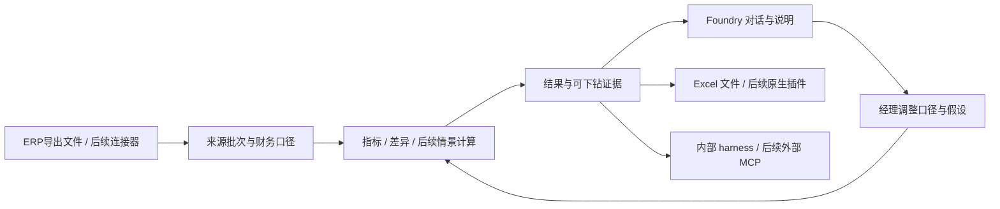

# Foundry 财务分析能力与工具链：调研结论及落地选择

调研日期：2026-09-06。修订：r2，补入随包技能接入与复用发现。面向企业内部财务经理，关注 ERP 账套、预算、经营明细与管理报告。本文是 `$plan` 调研和规划交付，未安装依赖、修改产品代码或进行厂商租户实测。

## 建议先做什么

**先接通已有财务技能，再补齐财务口径、稳定计算、明细下钻和 Excel 工作回路。** Foundry 已有四项 Anthropic finance 方法，以及任务、版本、SQL/Python、草稿和助手工具。当前只核实技能随包存在，尚未完成会话发现、加载和实际调用证明；旧 locked-window/单表指引也需先适配 analysis 模式。阶段 0 解决这些问题并用现有计算路径完成基线，后续复用技能知识建设高频工具，保留临时问题的自由分析。第一条完整产品路径是：企业账套导出文件 → 管理损益 → 差异桥 → 追问明细 → 经理改写说明 → 可继续计算的 Excel。

这十个产品提供了三类参考：Datarails、Aleph、Cube 将表格与财务数据模型连接；Pigment、Drivetrain、Planful、Anaplan 将假设、版本和财务结果连接；金蝶、用友、帆软展示了中国企业账务对象如何进入管理分析。下文的“借鉴”是对 Foundry 的设计推导，不代表建议采购这些产品。

阅读入口：[执行计划](../../../.omx/plans/2026-09-06-finance-capability-plan.md) · [分阶段验收方案](../../../.omx/plans/2026-09-06-finance-capability-test-spec.md) · [当前代码核查](04-codebase-map.md) · [随包技能接入发现](07-bundled-skills-integration.md)。

## 十个产品：能力、真实边界与值得借鉴的机制

证据标记：**文档**指官方帮助/接口文档明确描述；**宣称**指官方产品或发布页；**待联调**指本轮未取得真实账户、账套、插件宿主或接口运行证据。文档确认不等于我们已经验证厂商实际效果。

| 产品 | 公开证据支持的能力 | 边界 | 对 Foundry 的借鉴 |
|---|---|---|---|
| **Datarails** | 文档：Excel Flex 刷新同时同步数据集、映射与分组；FinanceOS 提供 ChatGPT MCP 连接。[Flex](https://support.datarails.com/hc/en-us/articles/15717939528860-Datarails-Flex-Add-In-Overview)、[MCP](https://support.datarails.com/hc/en-us/articles/25905041804444-Connect-Datarails-to-ChatGPT) | 该 ChatGPT 接法明确只读；生成下载文件与更新原工作簿是不同动作 | 刷新应携带口径与批次，保持工作簿、计算和说明可对应 |
| **Aleph** | 宣称：Excel/Sheets 双向拉取与提交预算、情景；MCP 将财务数据和工作流能力带到 Claude/ChatGPT 等入口。[表格](https://www.getaleph.com/platform/spreadsheets)、[MCP 发布说明](https://www.getaleph.com/blog/introducing-aleph-mcp) | 写入 Aleph 数据层不等于写入 ERP；本轮未得到完整 MCP 工具/权限合同或租户实测 | 科目映射、说明记录和助手入口共用数据上下文，连续讨论时不反复搬文件 |
| **Cube Software** | 文档：Smart Analysis 按基准/比较情景、维度与阈值找差异；MCP 除查询外还可创建情景、写计划值和刷新现有源连接。[差异分析](https://help.cubesoftware.com/hc/en-us/articles/35073891751444-Uncover-variances-with-Cube-s-Smart-Analysis)、[MCP 工具合同](https://help.cubesoftware.com/hc/en-us/articles/45569561283092-Connect-Cube-to-AI-Apps-via-MCP-Server) | MCP 写情景需要对应权限与可写范围，不写回源系统；此处研究的是财务产品 Cube Software | 明确指标、维度、情景与读写工具；经理改假设生成版本，常规分析持续执行 |
| **Pigment** | 文档：Version 维度用于可追溯版本，Scenarios 用于快速假设试算；MCP 包含查询及 advanced mode 的建模工具。[版本/情景](https://kb.pigment.com/docs/versions-scenarios)、[MCP](https://kb.pigment.com/docs/mcp-server-1) | 不能把 MCP 概括成全部只读；权限与工具类型分别约束，文档所列可读指标类型有限 | 分开“保存了哪个分析版本”和“测试哪个业务情景”，逐步支持驱动依赖 |
| **Drivetrain** | 宣称：用业务驱动因素建立计划和滚动预测。接口文档列出指标列表与批量指标数据两个 API。[驱动计划](https://www.drivetrain.ai/solutions/driver-based-planning-software)、[API](https://integrations.drivetrain.ai/extending-drivetrain/drivetrain-api) | 批量数据接口使用 POST，但属于取数；不能据此推断任意模型写回。API 页正文抓取受限，本轮核到官方索引内容，待联调 | 从收入、毛利、回款周期等少数可解释驱动开始，定期把实际数接入未来预测 |
| **Planful** | 宣称：Spotlight 连接 Excel/PPT/Word 并刷新；MCP 页面明确只读，当前列 Claude，其他客户端列为后续支持。[Spotlight](https://planful.com/solution-hub/spotlight-microsoft/)、[MCP](https://planful.com/platform/mcp/) | 不把未来客户端写成现有能力；部分深层帮助文档受访问限制，Marketing 子产品流程不能外推全部财务模块 | 同一份指标刷新不同成果；Foundry 先做 Excel，后续才扩报告演示文稿 |
| **Anaplan** | 文档：维度、模块和版本组织计算；Actual/Forecast 与 switchover 支持实际/预测衔接；Excel Add-in 可区分读与读写连接。[维度](https://help.anaplan.com/dimensions-e020c93d-9f3e-4cce-8294-2d34073b302a)、[版本](https://help.anaplan.com/versions-19b4391f-5257-40ee-8dfb-36f0ab426c8f)、[Excel](https://help.anaplan.com/excel-add-in-series-4-4f3c3661-1e69-42f1-ad86-00c6898075c6) | 不同 Excel 产品/插件系列与平台要求分别核验；其完整 EPM 建设范围远超当前 Foundry 首期 | 明确时间、维度、指标公式和实际截止点，让 LLM 使用确定性计算结果 |
| **金蝶 AI 星辰** | 宣称：财税、智能凭证与经营分析；有自身开放平台与 API 服务入口。[财税产品](https://www.kingdee.com/product/stellar_finance.html)、[API 入口](https://www.jdy.com/ecology/api/) | 星辰与星空不同；本轮未展开星辰完整官方账务接口合同，不能用星空 WebAPI 代替。具体对象、套餐、账套授权待核 | 先兼容星辰导出文件，再按目标租户验证科目余额、分录、辅助维度和刷新能力 |
| **用友 YonGPT / ERP** | 宣称：YonGPT 用企业业务数据提供洞察；U8 文档明确有科目总账、凭证明细及辅助字段。[YonGPT](https://www.yonyou.com/news/2607)、[科目总账](https://u8open.yonyou.com/apiCenter/accountsum_batch_get)、[凭证明细](https://u8open.yonyou.com/apiCenter/voucherdetaillist_batch_get) | YonGPT 不是统一的账套接口；U8/U9/NC/NCC/YonBIP 的产品、版本与租户接口各自核实。公开 U8 文档不证明目标客户已经开通 | 适配器按具体 ERP 产品实现，保留借贷、期间、客户、供应商、项目、部门和源分录身份 |
| **帆软 FineBI** | 文档：自然语言问数、钻取、指标归因和 AI 诊断；数据更新支持按条件使用全量/增量。[问数据](https://help.fanruan.com/finebi/doc-view-2580.html)、[AI 诊断](https://help.fanruan.com/finebi/doc-view-2625.html)、[数据更新](https://help.fanruan.com/finebi/doc-view-1823.html) | 智能诊断有采样上限和适用条件；FineBI、FineDataLink、FineReport 分别有分析、集成、报表侧重，不是同一产品，也无强制串联关系 | 把问题、指标、维度、追问和证据连起来；已有帆软指标资产可复用，Foundry 自身完成财务分析 |

这不是功能数量或效果排名。公开资料的细致程度不同，本轮没有跨产品统一基准、价格比较或采购评估。

## 关键机制如何转化为 Foundry 能力

### 1. “Excel 不搬家”需要稳定的工作簿连接

用户要保留的是公式、格式、手工假设和工作习惯。只有导入/导出文件，无法证明原工作簿可以持续刷新。Aleph 的双向表格与 Cube 的 fetch/publish 都将“从模型取数”和“提交计划输入”定义为不同动作。[Aleph 表格](https://www.getaleph.com/platform/spreadsheets)、[Cube publish](https://help.cubesoftware.com/hc/en-us/articles/4407348689940-Publish-data-to-Cube)

**设计推导：** Foundry 需要记录工作簿身份、命名表/区域、输入与结果角色、关联指标/情景、上次版本和冲突处理。先做到已验证模板中的文件往返；再通过 Office.js 实现 Excel 内绑定、刷新和宿主重算。微软文档提供持久绑定与 Excel API；openpyxl 读取缓存公式值且不保证任意复杂工作簿对象完整往返，不能把两者当成同一级交付。[技术依据与平台边界](05-implementation-evidence.md)

### 2. 自动差异说明要从计算和业务线索生成

Cube Smart Analysis 明确提供基准情景、比较情景、阈值、差异与维度下钻。Aleph 的官方 BvA 指南强调科目到报告行的映射、交易下钻和可复用的说明记录。[Cube Smart Analysis](https://help.cubesoftware.com/hc/en-us/articles/35073891751444-Uncover-variances-with-Cube-s-Smart-Analysis)、[Aleph BvA 指南](https://www.getaleph.com/answers/live-drillable-bva-excel-ai)

**设计推导：** 将解释分成计算贡献、业务线索和经理判断。例如预算利润 25、实际 30，收入贡献 +20、成本 −10、费用 −5，利润差异为 +5；这证明分解闭合。至于“促销导致毛利变化”，需要销售资料或经理补充，不能从金额差异直接证明。经理可以编辑和采用解释，系统记录依据与版本即可。

应保存的是说明片段及其指标、贡献明细、来源、期间和单位，允许一键回到明细；自由文稿仍可保存，不将未证实判断变成写稿障碍。后续刷新时只重算受影响的数字，经理撰写的业务说明保留并提示检查。

### 3. 财务语义需要可执行，而不仅是字段说明

Pigment 的指标/维度和 Anaplan 的模块/时间/版本都把模型结构放在计算之前。中国 ERP 则有不能丢失的借贷方向、会计期间与辅助核算；U8 科目总账和凭证明细接口直接体现这些字段。[Pigment Metrics](https://kb.pigment.com/docs/model-metrics)、[Anaplan Modules](https://help.anaplan.com/modules-5d25099d-15ae-426c-ade1-33b658f58b8c)、[U8 总账](https://u8open.yonyou.com/apiCenter/accountsum_batch_get)

**设计推导：** 同一个“金额”字段不足以支持财务分析。收入/费用的有利方向、资产余额的时点性质、毛利率的重算规则、预算基准、组织与币种都应进入指标合同。第一期只做管理损益所需的最小部分；余额、预算与可选凭证即可开始，AR/AP 和完整汇兑政策后续增加。

### 4. 情景不是改一个文件名

Pigment 将长期版本与即时情景区分；Anaplan 的版本机制包含实际/预测切换。[Pigment 版本与情景](https://kb.pigment.com/docs/versions-scenarios)、[Anaplan Versions](https://help.anaplan.com/versions-19b4391f-5257-40ee-8dfb-36f0ab426c8f)

**设计推导：** Foundry 现有 analysis revision 记录“分析怎么做”；新增 ScenarioRevision 记录“业务条件变成什么”。第一组驱动只需要销量、价格、毛利、收付日期等明确输入。比如“回款晚两周”，应将应收款移到未来时间轴，重算 13 周现金，并保留原情景。应先完成确定性计算，之后再考虑有回测和区间的统计预测。

### 5. ERP 接入的价值在稳定对象与刷新

用友公开文档提供具体总账与凭证对象；FineBI 更新规范则明确增量策略取决于时间戳和历史变更条件。[U8 凭证](https://u8open.yonyou.com/apiCenter/voucherdetaillist_batch_get)、[FineBI 更新](https://help.fanruan.com/finebi/doc-view-1823.html)

**设计推导：** 每个连接器至少回答：这批数据属于哪个账套/期间，主键如何定义，分页是否完整，更正与作废如何处理，何时形成可计算的快照。先做按期间全量拉取、核对与原子发布；只有源接口支持时才做增量。不能把接口调用成功或拉到一页数据等同于账套接通。

首个连接器由实际可获得的 ERP 决定。文件映射、领域对象与计算内核可以先完成；目标租户权限决定联调时间，不决定 Foundry 是否能从导出文件提供价值。

### 6. 开放 harness 要开放操作能力与上下文

MCP 已出现在多家产品中，但权限范围不同：Datarails 对接 ChatGPT 明确只读，Cube 文档则公开查询和计划写入工具，Planful 当前 MCP 也明确只读。[Datarails MCP](https://support.datarails.com/hc/en-us/articles/25905041804444-Connect-Datarails-to-ChatGPT)、[Cube MCP](https://help.cubesoftware.com/hc/en-us/articles/45569561283092-Connect-Cube-to-AI-Apps-via-MCP-Server)、[Planful MCP](https://planful.com/platform/mcp/)

**设计推导：** Foundry 不应因借鉴只读产品而收窄现有 harness。阶段 0 先把四项随包技能接入实际会话，迁移旧模式指引，用已有 SQL/Python 完成分析；阶段 2 再增加五个内部业务工具：列财务上下文、计算指标、解释差异、下钻明细、保存解释草稿。沿用已有任务授权，连续调用，无逐工具审批；保留 SQL/Python、后台任务和子任务，不以专用工具覆盖范围限制经理的问题。外部 MCP 之后复用这些业务服务，避免不同入口各算一套数字。

“Foundry 调用已有厂商 MCP”和“Foundry 向 Claude/ChatGPT 提供 MCP”是两个方向。前者适合已经购买并整理好数据的企业；后者让用户选择助手客户端。两者都不能替代财务模型本身。

## 中国企业数据：按任务逐步接入

下表是 Foundry 的建议输入合同，不是宣称每个 ERP 都已开放同名接口。管理损益最少用前三项；凭证与辅助维度决定下钻深度。

| 数据对象 | 必须保留的信息 | 支持的分析 |
|---|---|---|
| 科目与管理映射 | 科目代码/层级/方向、管理报告行、有效期与映射版本 | 管理损益、成本费用归集、口径复用 |
| 科目余额与发生额 | 账套、组织、期间、期初/借方/贷方/期末、币种、单位、结转政策 | 余额核对、期间比较、损益汇总 |
| 预算/目标 | 组织、期间、管理科目、版本、维度粒度、单位 | 预算差异、执行率、利润桥 |
| 凭证与辅助核算（可选首期） | 单据/分录ID、摘要、借贷金额、部门/客户/供应商/项目、过账状态 | 明细下钻、异常贡献、费用结构 |
| 应收/应付及收付计划（后续） | 到期日、剩余金额、部分结清、贷项、核销、截止日 | 账龄、回款假设、13周现金预测 |
| 销售/采购/库存成本（按场景） | 产品、数量、价格、成本、单位、业务与会计期间关联 | 单品量价分解、毛利、库存占用 |

凭证级汇总和余额表可互相核对，但没有凭证时仍应提供余额级分析。辅助维度缺失时清楚标示覆盖范围，经理可继续分析或补数。

## 当前代码给出的现实起点

| 现状 | 对落地的含义 |
|---|---|
| AnalysisStore 已有 dataset/revision/run/draft/method；SQL 方法能重绑定；已有映射/勾稽代码可复用（`foundry/analysis.py:104`、`:768`；`foundry/caliber.py:45`） | 从现有记录和服务扩展，减少重复架构 |
| metrics/conversion_rules 目前可声明，尚不是可执行财务语义引擎（`foundry/analysis.py:347`；`foundry/analysis_sql.py:368`） | 财务指标和转换规则是实质建设重点 |
| xlsx 导入读公式缓存；当前导出为新工作簿，结果文本化；Univer 是只读预览（`foundry/analysis_data.py:53`；`foundry/analysis.py:677`、`:729`；`app/electron/univer.ts:500`） | 先修金额可计算和绑定合同，再独立验证原生 Excel 插件 |
| analysis-refresh 只刷新任务资料上下文；runner 无网络（`foundry/analysis_cli.py:150`；`foundry/runner.py:39`） | 源连接/批次刷新需独立服务，不把 ERP 凭据塞入计算脚本 |
| 四项方法随包存在，但宿主未显式传入方法目录；`method/FOUNDRY.md:5`、`:12` 仍有旧 locked-window/单表指导 | 阶段 0 接通真实提供方/loader，适配运行模式，验证真实分析与新包会话；阶段 2 在其上复用方法建设高频工具 |

以上为本次代码阅读。完整路径和边界见 [代码核查](04-codebase-map.md)，未以阅读代替软件测试。

## 交付顺序与第一期边界

| 顺序 | 交付 | 完成证据 |
|---|---|---|
| 0 | 接通四项随包技能，迁移旧规则，用现有 SQL/Python 建立分析基线；固定企业样本与技术验证设计 | A27–A34：真实发现、正文与引用加载、G1/G2 调用；干净配置与新包/安装版重启复验 |
| 1 | 最小账套语义与管理损益 | 源控制总额一致，缺明细也能分析，映射可修订 |
| 2 | 差异桥、下钻、可编辑说明、五个内部 harness 财务工具 | 分解闭合；数字引用可核对；经理连续追问/修改无需逐步审批 |
| 3 | Excel 文件协作 | 普通金额可 SUM；已支持模板保留公式/格式；范围冲突可处理 |
| 4 | 来源刷新与首个 ERP 适配器 | 分页/失败/更正有合同，真实账套联调后才标为接通 |
| 5 | 账龄与小型驱动/现金情景 | 13周现金连续、假设变化可比较、原情景可复算 |
| 6 / 7 | 原生 Excel 插件 / 对外 MCP，分别交付 | 真 Excel 保存重开与重算；实际外部客户端调用同一计算服务 |

第一期承诺为阶段 0–3；技能接通是后续领域工具开发的前置完成条件。阶段 4–7 分开验收；现金情景可先用文件样本，不依赖全部 ERP 接口上线。不纳入首期的内容包括：全公司预算审批、复杂法定合并、完整三表联动、统计预测平台、所有 Office 宿主，以及建账/支付执行。

未来扩展保留账套、组织、期间、币种、账户、交易身份和领域命名空间。分析调整、拟制凭证、已过账凭证、预测收付款与真实付款指令分别建模；在业务需求明确后复用底层数据和计算能力。

## 验证方式与调研局限

执行计划配套 34 条合同验收：保留 A01–A26，新增阶段 0 的 A27–A34，覆盖技能资源、发现、加载、运行模式、实际调用、降级诊断、复用和安装版验证。解释评测仍至少 30 题，首期 20 题覆盖利润/下钻/经理改写，后续至少 10 题覆盖账龄/现金/情景；阶段 0 的 G1/G2 调用基线不能冒充完整评测。合成样本明确预期数字、明细依据和允许的表述，不以模型自评替代核对。真实性验证还需一份获准使用的企业样本，ERP 和 Excel 宿主各自提供联调证据。

公开资料不能确定目标租户许可、区域版本、接口额度和插件兼容性。金蝶星辰完整接口合同、本轮受限的厂商文档及具体客户端写入边界都保留待验证状态。该限制不影响先建设文件路径和确定性财务计算。

详细调研：[Excel 三家](01-excel-native.md) · [四家计划系统](02-planning-systems.md) · [中国 ERP 与帆软](03-china-erp.md) · [代码差距](04-codebase-map.md) · [技术依据](05-implementation-evidence.md) · [计划审阅记录](06-plan-review.md) · [随包技能接入](07-bundled-skills-integration.md)。
