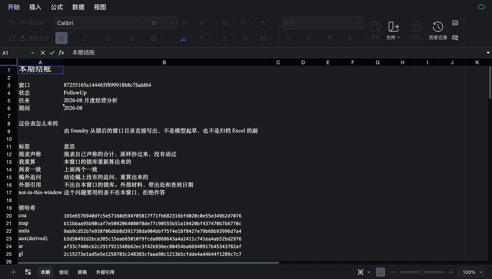
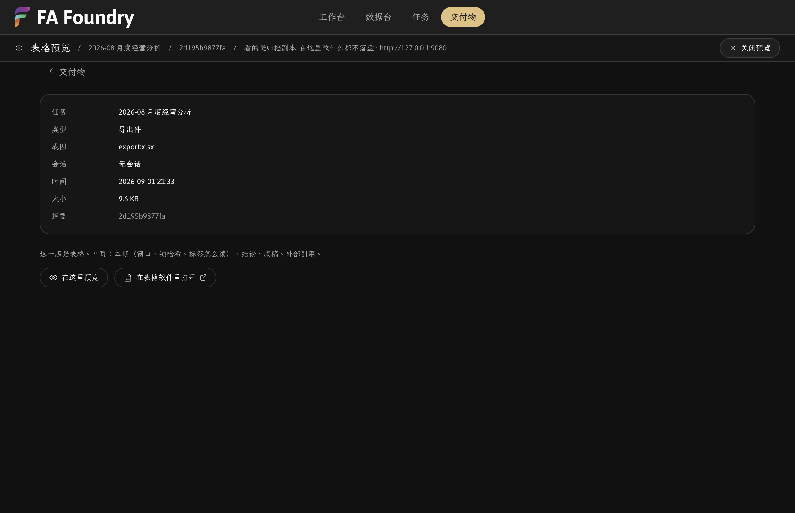

# Preview a filed workbook through a fenced, ephemeral Univer gateway

## Context

FA Foundry (`app/`, Electron) embeds the DeepSeek Harness. The Python CLI in `foundry/` files each close's deliverables as immutable versions under `var/tasks/<id>/artifacts/<sha256><ext>` (`foundry/task.py:186`; written at `:356`, resolved at `:382`). The third-party bundle `dsh-univer-office@0.2.12` is staged into `app/extra/dsh` for the authoring seat (`dsh-plugin/package.json`, companion `office`), and all thirteen of its `univer_*` tools are denied on the close seat: `officeDenied()` reads the manifest's `omitTools` (`dsh-plugin/index.js:443-447`) and `period-scope` passes them to `ctx.tools.restrict` (`dsh-plugin/period-scope.js:37`; KTD12).

The gap: the bundle was installed and nothing in the app showed a workbook. The operator asked for a read-only look at a filed workbook with no model touching a univer tool, and set three conditions before any of the bundle's server code ran: `UNIVER_ALLOWED_ROOT` is the task's own artifacts directory; the gateway runs only while a preview is open; no model in the loop (KTD20).

Why the viewer cannot just open a file: it is not a file renderer. It opens a *unit* inside a `.univer` container that the bundle's gateway serves over HTTP and a WebSocket. The plugin's own `computeFileState` builds the viewer URL as `${gateway}/?file=${encodeURIComponent(fileKeyOf(file))}` (`lib/index.js:6781`), and the gateway's descriptor route, `GET /uf/<key>` with the descriptor `Accept`, answers the same `viewUrl: /?file=<key>` (`artifacts/gateway.cjs:450720-450723`, `:451340`). So a preview needs a server, a container, a copy of the workbook inside it, and a page. Bundle paths below (`lib/index.js`, `artifacts/gateway.cjs`, `artifacts/unit-content-worker.mjs`) are relative to `app/extra/dsh/node_modules/dsh-univer-office/`, which `npm run harness` stages and git does not track; their line numbers are for version 0.2.12. Store paths such as `artifacts/preview/` are runtime locations under the store, not repository paths.

Shipped as commit 9f12b77 / 3a4e3ea on main.

### What didn't work

- Setting `UNIVER_ALLOWED_ROOT` on the harness child (`harnessEnv`, `app/electron/harness/boot.ts:92`) to fence the plugin's own gateway. The plugin's `gatewayLaunch` builds that gateway's environment from an explicit list, `["HOME", "LANG", "LC_ALL", "PATH", "TMPDIR"]` plus its own three names (`lib/index.js:696-708`). The variable measured as present on the harness and reached nothing. That plumbing is gone: `app/tests/harness.test.ts:106-116` asserts `harnessEnv` sets no `UNIVER_ALLOWED_ROOT`, and `:118-128` checks the plugin's allowlist is still the allowlist when `FOUNDRY_DSH_INSTALL` points at the staged tree.
- Detaching the pane with `removeChildView` alone. After 关闭预览 the gateway was gone and the port free, but the viewer's page target was still in the CDP `/json` list: a renderer with nothing to talk to. Fixed in commit 3a4e3ea (`app/electron/harness/pane.ts:97-104`).

## Guidance

Pin the contract from the bytes before running anything. Every wire shape in `app/electron/univer.ts` was read from the bundle, and `app/tests/harness.test.ts:273-290` pins the banner, the exit code, the fence name and the unit route against the staged files, so a release that moves them fails a test rather than a preview.

1. Fence with `UNIVER_ALLOWED_ROOT`, container in a subdirectory. `_assertWithinAllowedRoot` rejects when the relative path is empty or starts with `..` (`gateway.cjs:450628-450636`), so a container *at* the root is refused too.

```ts
export function containerPath(allowedRoot: string, sha256: string): string {
  return path.join(allowedRoot, 'preview', `${sha256}.univer`);
}
```

(`app/electron/univer.ts:189-191`.) The root is chosen next to the only call that could widen it: `allowedRoot: path.dirname(file)`, where `file` came back from the CLI by digest, never from the wire (`app/electron/ipc/register.ts:281-289`). This is the task's `artifacts/` directory, not the per-task session workspace that G9 made under `userData` for harness sessions; the two are different trees and only the first holds filed deliverables.

2. Import in the worker before starting a server. The worker reads `{operation:"import", sourcePath, unitType}` from stdin and writes `{ok:true,result}` or `{ok:false,error:{code,message}}` (`artifacts/unit-content-worker.mjs:311713-311731`; `sourcePath` must be absolute, `:311958`). An import needs no gateway, so a workbook the worker cannot read costs no port and no process (`app/electron/univer.ts:408-456`).

3. Content goes in through a worktree and a merge. The trunk create route takes a name and nothing else; the plugin's client sends `{ name }` (`lib/index.js:427-431`). Only a draft-worktree unit accepts a `snapshot` (`lib/index.js:464-468`; handler at `gateway.cjs:450948-450952`), and `POST .../merge` lands it (`gateway.cjs:451022-451024`). This is the plugin's own `univer_import` (`lib/index.js:6614-6632`) without the model.

4. Ephemeral container. Removed before every open together with `-wal`, `-shm` and `-journal`, and removed again on close (`app/electron/univer.ts:239-243`, `:504`, `:566-570`).

5. Gateway lifetime equals strip lifetime. `close()` detaches the page, kills the child, removes the container (`:562-571`). The renderer closes the preview whenever the version it shows is no longer the one on screen (`app/src/App.tsx:289-295`).

6. No tool registration. The host talks to the gateway with `fetch` (`:253-292`). Nothing here is exposed to a model.

7. Allowlist environment plus `NODE_PATH`.

```ts
const out = inherited(parent);
out.UNIVER_COLLAB_GATEWAY_PORT = String(own.port);
out.UNIVER_VIEW_ASSETS_ROOT = own.viewerRoot;
out.UNIVER_ALLOWED_ROOT = own.allowedRoot;
out.NODE_PATH = withNodePath(parent, own.nodePath);
out.DO_NOT_TRACK = '1';
out.ELECTRON_RUN_AS_NODE = '1';
```

(`:157-164`; `INHERITED` at `:92` is the plugin's own five names.) `NODE_PATH` is the staged `node_modules`, so libsql and the two native bindings resolve (`:123-125`). Ports are tried upward only on exit 98, `GATEWAY_PORT_IN_USE_EXIT_CODE` (`gateway.cjs:319908`); any other early exit is reported with its stderr rather than as a timeout (`:385-394`).

8. Close the page on detach.

```ts
window.contentView.removeChildView(view);
if (!view.webContents.isDestroyed()) view.webContents.close();
```

(`app/electron/harness/pane.ts:102-103`; stub and assertion in `app/tests/formulator.test.ts:15-18`, `:87-92`.)

9. Label the unit. The worker names an import after its source file, which is sixty-four hex characters. The host passes `label` as both the unit name and the workbook's own name (`:522-529`); the IPC layer builds it as `${task title} · ${digest.slice(0,12)}` from `showTask` (`register.ts:292`).

10. Dark, view only and in the app's language are the viewer's own switches, and none of them is `prefers-color-scheme`. Its appearance is one localStorage key, `light` or `dark`, default `light` (`HD()` in the staged viewer bundle); `nativeTheme.themeSource = 'dark'` in `app/electron/main.ts` turned the harness page dark and left the viewer white. So the key is written on the viewer's origin from the gateway's plain-text 404 page, then the viewer is loaded (`:224-236`, `:545-547`); done the other way round the viewer would boot twice. `editable=false` is read only under `mode=embedded` (the viewer's URL reader returns null for it in standalone mode); measured, that layout disables 39 of 42 toolbar controls against 27 of 43 with `editable=true`, and drops the file sidebar that showed the container's base64 key. `lang=zh-CN` is read off the URL before storage and `navigator.language` (`:212-214`).

## Why This Matters

Security facts read from `gateway.cjs`: it binds `LOOPBACK_HOST = "127.0.0.1"` (`:451521`, `:451610`); its authz route answers allow-all through `sendAllowAllAuthz` (`:450766`, `:451350-451352`); `applyCors` reflects `req.headers.origin ?? "*"` (`:450699-450700`). Any page on the machine that can reach the port can talk to it. The allowed root is therefore the one boundary the gateway enforces, and it only exists if the entry point reads it (`:451618`). Set to a task's artifacts directory, the most such a page reaches is the scratch containers under deliverables the operator already has open. Unset, the root is the filesystem.

This is also where the preview stands with KTD11's line and the two-borrows study's "no host RPC for the page". Both object to a loopback carrying task bytes on a path a model can reach. The preview's loopback serves a scratch copy, is reachable by no tool, and dies with the strip; the line is "no loopback carrying task bytes on a path a model can reach", not "no loopback".

The harness-child fence was a false comfort because a fence is only as real as the process that reads it. `harnessEnv` set the variable on a process that never forwards it. "The variable is present" measured on the wrong process is the trap; the test now couples to the launcher's bytes so a plugin release that starts forwarding the whole environment turns the comment into a red test.

Detach must close the page because `removeChildView` takes the view out of the window and nothing else. Two panes that detach once at quit hid that. A preview that opens and closes per version leaked one renderer per cycle.

## When to Apply

- Embedding any third-party local server with its own viewer. Read its entry point for the env names it honours and its route table before running it, and put the fence on the process you spawn.
- Any time a "fence" env var is set on a process that may not forward it. Read the child's launcher; `ps -E` on the actual child is the measurement.
- `WebContentsView` panes that open and close repeatedly. A detach that does not end the page leaks a renderer per cycle.
- A viewer that needs a server. Run the server for the life of the strip that names it, not the life of the app.

## Examples

The open sequence (`app/electron/univer.ts:474-557`):

1. Fence check: `file` must start with `${allowedRoot}${path.sep}` (`:490`); the digest must be 64 hex (`:493`). A second open closes the first, gateway and all (`:496-498`).
2. Worker import: `{operation:'import', sourcePath, unitType: 2}` on stdin (`:456`). No gateway yet.
3. Remove any old container and its sqlite side files; create the `preview/` subdirectory (`:504-505`).
4. Start the gateway on 9080, upward only on exit 98, waiting for `[dsh-univer-gateway] listening on http://127.0.0.1:<port>` (`:60`, `:320-333`; banner printed at `gateway.cjs:451624`).
5. `POST /uf/<key>` with `{}` creates the container (`:511`); `<key>` is base64url of the absolute container path (`:178-180`).
6. `POST /uf/<key>/worktrees` `{agentId:'fa-foundry', name:'preview'}` returns `{worktreeId}` (`:512-520`).
7. `POST /uf/<key>/worktrees/<id>/units` `{type:2, name, snapshot:{...snapshot, name}}` (`:525-531`).
8. `POST /uf/<key>/worktrees/<id>/merge`; refused unless `ok === true` (`:532-538`).
9. `Pane.attach` on the gateway's 404 page, the appearance key written there, then `Pane.load(viewerUrl)` where `viewerUrl` is `${origin}/?file=${encodeURIComponent(key)}&mode=embedded&scope=trunk&editable=false&lang=zh-CN` (`:212-214`, `:545-547`).

Entry points in the renderer: 在这里预览 beside 在表格软件里打开 (`app/src/views/Deliverables.tsx:151-156`), 预览 per filed workbook (`app/src/views/TaskDetail.tsx:229-232`), and the 表格预览 strip with 关闭预览 (`app/src/views/Preview.tsx:17-45`).

Measured on the packaged app (`npm run package`, scratch `--user-data-dir`, `FOUNDRY_VAR` at a scratch store, driven over CDP on `--remote-debugging-port`), per this session's measurement:

| Step | Observed |
|---|---|
| Click 在这里预览 | `previewStatus` returned `running` in 2 to 3 s; four sheets drawn (本期 / 结论 / 底稿 / 外部引用); the unit named `2026-08 月度经营分析 · 2d195b9877fa` (the deliverable's digest, not a commit) |
| Viewer page | `mode=embedded`, `lang=zh-CN` on the ribbon, appearance key `dark` with `html.class=gateway-dark univer-dark` and a `rgb(10, 10, 10)` ground; 39 of 42 toolbar controls disabled under `editable=false` |
| Gateway env (`ps -E`) | HOME, PATH, UNIVER_COLLAB_GATEWAY_PORT=9080, UNIVER_VIEW_ASSETS_ROOT, UNIVER_ALLOWED_ROOT=<task artifacts dir>, NODE_PATH, DO_NOT_TRACK=1, ELECTRON_RUN_AS_NODE=1 (LANG, LC_ALL, TMPDIR absent in the parent); no key-shaped name, no `DSH_*`, no `FOUNDRY_*` |
| Natives | libsql, the formula engine and the Office exchange bindings load under Electron-as-Node |
| Click 关闭预览 | status null in 1 s; no gateway process; port 9080 free; `artifacts/preview/` empty; viewer page targets 0 after commit 3a4e3ea |

What is deliberately not true, said plainly. "Read-only" is enforced by the viewer's own `editable=false`, which is a toolbar and cell-editor switch, not a permission the gateway checks: what a page could still write to is the scratch container, fresh per open and deleted on close. The filed `.xlsx` is never opened by the gateway; the worker reads it once. The first build showed the viewer in standalone mode, editable, with a sidebar naming the container by its base64url key; the embedded layout removed all three. The plugin's own gateway on the authoring seat stays unfenced by `UNIVER_ALLOWED_ROOT` and is kept off the close seat by preset. Not measured: two tasks' previews at once (the second replaces the first by design), and a machine whose natives are another architecture. Per `docs/plans/2026-09-01-1900-feat-foundry-fence-scope-plan.md:371`, the Univer Pro licence in the bundle expires 2026-11-15; a risk to the look, not to the close.

### Evidence



The viewer inside the app after 在这里预览: the embedded layout with no sidebar, the dark appearance seeded before it booted, the Chinese ribbon, and the editing controls disabled by `editable=false`.



The strip above the viewer naming the task, the digest, the gateway origin and 关闭预览; the gateway's lifetime is tied to this strip.

## Related

- `docs/plans/2026-09-01-1900-feat-foundry-fence-scope-plan.md`, KTD20: the decision this learning documents, with the three operator-accepted conditions and the packaged-app measurements.
- Same plan, KTD12: why the thirteen `univer_*` tools are denied on the close seat by `period-scope`; the preview is the model-free counterpart.
- Same plan, KTD11 and `docs/studies/2026-09-01-two-borrows-landing.md` (明确不做): the loopback line the preview must not cross, reconciled above.
- Same plan, KTD19: the two placements the preview buttons landed in, beside the export, pinned by the same rendered-order tests in `app/tests/views.test.tsx`.
- Same plan, KTD18: the single-instance lock is the app-level analogue of the gateway's port-in-use exit code.
- Same plan, G9: the per-task session workspace under `userData` is a different tree from the artifacts directory the gateway is fenced to.
- `docs/plans/2026-08-30-2100-feat-foundry-task-chain-plan.md`, U10: the spawn pattern the gateway reuses (banner on stdout, a child environment this app builds rather than inherits; the harness child scrubs, the gateway child allowlists); U9: content-addressed deliverables, which is what lets the container and the label be named by digest.
- `docs/studies/2026-09-01-youmind-containment-model.md`: the product motive, a task owns what it produced and opens it in place.
- No GitHub issues touch the preview or the gateway as of this writing.
